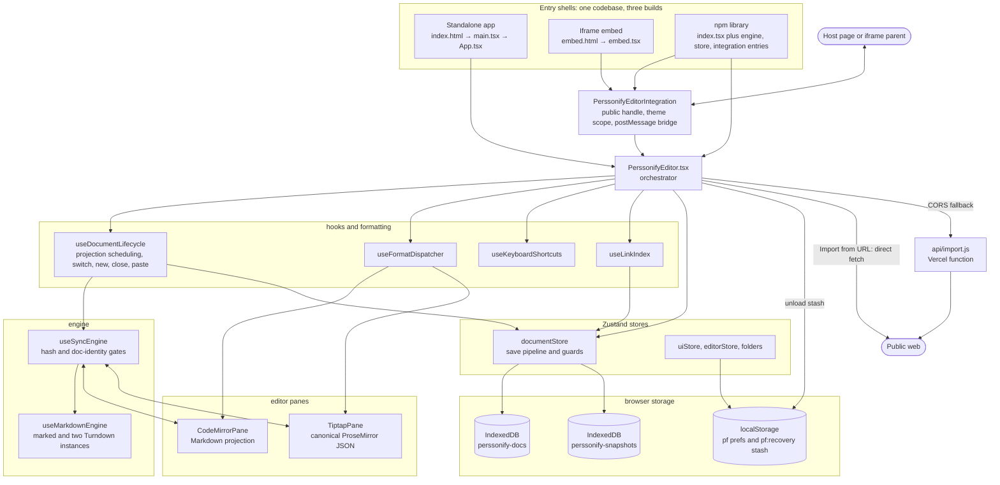
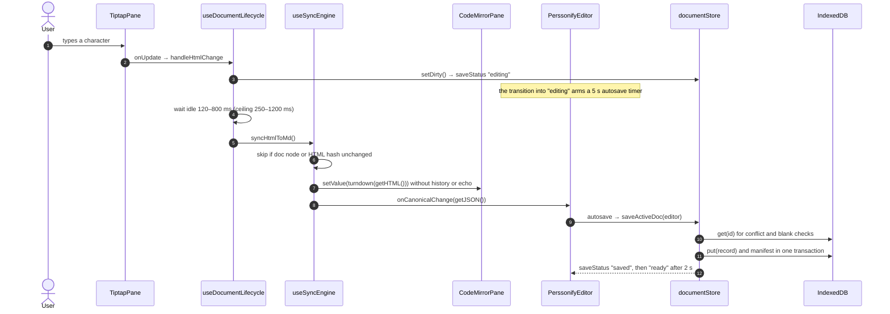

# Markdown Studio — Onboarding Report

> Audited 2026-09-28 against `@perssonify/editor` **1.77.0** (`package.json:3`).
> Audience: engineers joining the project who need to understand it, check that it matches its docs, and start contributing.

**How this report was produced**

- **Read-only.** Nothing was installed, built, run or changed, apart from creating this file.
- **Two gaps in the checkout limit what could be checked:**
  - There is no `node_modules`, so third-party library internals could not be read.
  - There is no `.git`, so commit SHAs, history claims and branch settings could not be verified.
- **Coverage.** Every manifest, config, CI file and doc was read. The source was read module by module:
  - entry points, the orchestrator, the document lifecycle and the sync engine
  - stores, persistence, import/export and the relay
  - the integration API, UI surfaces, tooling, the unit tests and the browser tests

  Each High-severity finding in §8 was re-verified by re-reading the cited lines.
- **Labels in §8:**
  - **Confirmed** means the code path was read and the behaviour follows directly from it.
  - **Suspected** means the code points that way, but the outcome depends on runtime or library behaviour that could not be run or read here.
- Line numbers refer to this checkout. What was skipped is listed at the end.

---

## 1. What this is

Markdown Studio (npm package `@perssonify/editor`) is a dual-pane Markdown editor. A CodeMirror 6 pane shows raw Markdown and a TipTap 3 (ProseMirror) pane shows rich text. Both edit the same document and stay in sync. The stored source of truth is ProseMirror JSON; Markdown is a projection of it.

It serves two groups:
- **Writers and note-takers** who want Markdown's portability without giving up WYSIWYG editing.
- **Product teams** who embed the editor in their own apps, either as a React library or as an iframe.

Everything runs in the browser. Documents live in IndexedDB, and there is no account, backend or telemetry. The one exception is a Vercel serverless relay, used only when "Import from URL" is blocked by CORS.

On top of editing, it provides:
- a multi-document library with folders and `[[wiki links]]`
- a relationship map and a cards board
- version history
- import and export for Markdown, HTML, JSON, DOCX, PDF and ZIP

---

## 2. Tech stack

| Area | Technology | Declared (`package.json`) | Resolved (`bun.lock`) | Notes |
|---|---|---|---|---|
| Language | TypeScript, strict mode | `^5.9.3` | 5.9.3 | Only `src/` is type-checked (`tsconfig.json:39`). Tests, e2e, `api/`, `build/` and `scripts/` are plain JS. |
| UI runtime | React, React DOM | dev `^18.3.1`, peer `>=18` | 18.3.1 | `@types/react` resolves to **19.2.14** and is undeclared; see BLD-5. |
| Rich-text engine | TipTap 3 (ProseMirror via `@tiptap/pm`) | core/react/pm/starter-kit `3.20.0`; link and table `3.20.4`; code-block-lowlight `^3.21.0` | 3.20.0 / 3.20.4 / 3.21.0 | `@tiptap/extension-list` is imported but not declared. |
| Markdown pane | CodeMirror 6, `@lezer/highlight` | view `^6.39.14`, state `^6.5.4`, lang-markdown `^6.5.0`, commands, search, language | view 6.39.14, state 6.5.4 | |
| Markdown → HTML | marked, marked-emoji, marked-footnote | `^12.0.2`, `^2.0.3`, `^1.4.0` | 12.0.2, 2.0.3, 1.4.0 | Configured per instance in `src/engine/build-marked.ts`. `breaks: true` is always on. |
| HTML → Markdown | Turndown | `7.2.4` | 7.2.4 | GFM rules are hand-written in `src/engine/turndown-rules.ts`; `turndown-plugin-gfm` is not used. |
| State | Zustand | peer only, `>=5.0.0` | 5.0.12 | |
| UI kit | Tailwind CSS v4, shadcn/ui (`base-mira`) on Base UI, lucide-react, sonner, next-themes, cva, clsx, tailwind-merge, tw-animate-css | tailwind `4.3.3`, base-ui `^1.3.0`, lucide `^0.577.0`, sonner `^2.0.7`, next-themes `>=0.4.0` | 4.3.3, 1.3.0, 0.577.0, 2.0.7, 0.4.6 | Generated primitives live in `src/components/ui/`. |
| Math, diagrams, music, code | KaTeX, Mermaid, abcjs, lowlight | `^0.18.1`, `^11.16.0`, `^6.6.4`, `^3.3.0` | 0.18.1, 11.16.0, 6.6.4 | All lazy-loaded. |
| Import / export | fflate (zip/gzip), @zip.js/zip.js (encrypted zip), mammoth (DOCX in), docx (DOCX out) | `^0.8.3`, `^2.8.34`, `^1.12.0`, `^9.7.1` | 0.8.3, 2.8.34, 1.12.0, 9.7.1 | zip.js, mammoth and docx are lazy-loaded. |
| Persistence | IndexedDB, localStorage | — | — | Two databases, `perssonify-docs` and `perssonify-snapshots`, both at version 1. |
| Build | Vite 8 (Rolldown), @vitejs/plugin-react, @tailwindcss/vite, vite-plugin-pwa (Workbox), custom PostCSS plugin | vite `8.1.5`, plugin-react `6.0.4`, pwa `^1.3.0` | vite 8.1.5 (rolldown 1.1.5), pwa 1.3.0 (workbox-build 7.4.1) | Three configs: `vite.config.ts` (library), `vite.app.config.ts`, `vite.embed.config.ts`. |
| Unit tests | Vitest, jsdom, Testing Library, jest-dom, fake-indexeddb | `4.1.10`, `29.1.1`, `^16.3.2`, `^6.9.1`, `^6.2.5` | same | Only `src/__tests__/*.test.{js,jsx}` is collected. |
| Browser tests | Custom Node runner, playwright-core (Chromium) | `1.62.1` | 1.62.1 | In `e2e/`. |
| Server code | One Vercel Node function using `undici` | `^7.29.0` (a **devDependency**) | 7.29.0 | `api/import.js` |
| Tooling | Bun as package manager (CI uses `latest`); Node | engines: `^20.19.0` or `>=22.12.0` | — | `bun.lock` is committed. `bun run` executes Vite with Node. |
| Hosting and CI | Vercel (static SPA plus one function), GitHub Actions | — | — | `vercel.json`, `.github/workflows/ci.yml` |

---

## 3. Architecture

### 3.1 Three products from one codebase

| Product | Entry chain | Build → output | How it ships |
|---|---|---|---|
| **Standalone app** | `index.html` → `src/main.tsx` (fonts, palette, stale-deploy reload hooks, `ThemeProvider`) → `src/App.tsx` (router, URL params, tour) → `PerssonifyEditor` | `bun run build:app` → `dist-app/`, with a PWA service worker | Vercel builds and serves it (`vercel.json:2-8`). |
| **Iframe embed** | `embed.html` → `src/embed.tsx` (URL params, `allowedOrigins`) → `PerssonifyEditorIntegration` → `PerssonifyEditor` | `bun run build:embed` → `dist-embed/index.html`, relative base, no service worker | Built in CI. **Not deployed by this repo** (see API-5). |
| **npm library** | `src/index.tsx`, plus the `./engine`, `./store` and `./integration` entries | `bun run build` → `dist/` (ES + CJS + `.d.ts` + `styles.css`) | Published with a manual `npm publish`; there is no script or CI job for it. |

### 3.2 How the parts communicate

| Channel | Used for | Where |
|---|---|---|
| Function calls, props, imperative refs | Orchestrator ↔ hooks ↔ panes. Pane handles such as `getValue`, `setValue`, `setHTML`, `getJSON` and `isComposing`. | `src/PerssonifyEditor.tsx`, `src/ui/EditorPanes.tsx` |
| Zustand stores | Document state and save status, UI preferences, derived link index, folder tree | `src/store/documentStore.ts`, `uiStore.ts`, `editorStore.ts`, `folders.ts` |
| IndexedDB | Documents, the manifest, prefs; the version-history snapshot ring | `src/store/idb-storage-adapter.ts`, `src/store/snapshot-store.ts` |
| localStorage / sessionStorage | UI preferences (`pf:*`), the crash-recovery stash, one-shot handoffs | `src/store/uiStore.ts`, `src/store/crash-recovery.ts` |
| `window.postMessage` | Iframe host ↔ embed | `src/integration/host-bridge.ts` |
| HTTP (`fetch`) | **Only** "Import from URL": a direct fetch first, then the `/api/import` relay | `src/store/url-import.ts`, `api/import.js` |
| Service worker | Offline caching of the standalone app | `vite.app.config.ts:22-92`, `public/sw-recover.js` |

There are no message queues, websockets, background jobs, server databases or auth providers.

### 3.3 Component diagram



### 3.4 Startup (standalone app)

1. **`index.html`, before anything else loads:**
   - A blocking script applies the stored theme and palette before first paint (`index.html:20-37`).
   - An 8-second watchdog runs if the bundle never boots. It unregisters service workers, clears caches and reloads once (`:39-73`).
2. **`src/main.tsx`:**
   - Reloads once on `vite:preloadError`, i.e. when a stale deploy's chunk is missing (`:18-25`).
   - Reloads when a new service worker takes control (`:34-42`).
   - Sets `__PF_BOOTED` (`:46`).
   - Renders `ThemeProvider` (storage key `perssonify-theme`, default `system`) around `<App/>` (`:61-69`).
3. **`src/App.tsx`:**
   - Reads `?import_url=` during render (`:28-32`). It only pre-fills the importer and never fetches.
   - Applies and then strips `?ads`, `?readonly` and `?view_mode` (`:40-71`).
   - Mounts `PerssonifyEditor` with `initialDocument` (Welcome), `starterDocuments` and routing callbacks (`:148-171`).
   - Lazy-loads `/about`, `/help` and the tour. Routes are `/`, `/about`, `/help` and `/graph` (`src/app/router.tsx:16-21`).
4. **`PerssonifyEditor`'s one-shot init effect (`src/PerssonifyEditor.tsx:1484-1663`):**
   1. Loads prefs: sync mode, markdown features, folder tree, and view mode (with the one-shot `pf:session-view-mode` handoff).
   2. Calls `documentStore.initialize()` (`src/store/documentStore.ts:414-471`). That reads the manifest, adopts any `pf:recovery` stash as unsaved drafts, and activates the last open document.
   3. Either hydrates the editor with that document (`setCanonical` + `markHydrated`) or, when storage is empty, seeds the Welcome document plus the Changelog and "About Perssonify" starters.
   4. Sets `initDoneRef = true` (`:1654`). **Autosave is disabled until this point.**

### 3.5 End-to-end flow: a keystroke in the rich pane until it is on disk

1. TipTap `onUpdate` (`src/ui/TiptapPane.tsx:342-346`) → `EditorLayout` → `PerssonifyEditor.handleHtmlChange` (`src/PerssonifyEditor.tsx:692-695`). That also starts the host's 300 ms `onContentChange` timer (`:590-601`).
2. `useDocumentLifecycle.handleHtmlChange` (`src/hooks/useDocumentLifecycle.ts:276-294`) calls `documentStore.setDirty()` (`src/store/documentStore.ts:715-720`, status becomes `editing`). It also schedules a projection. The wait comes from `src/hooks/sync-schedule.ts:55-80`:
   - idle delay = `clamp(120, 1.5 × cost, 800)` ms
   - max-wait ceiling = `clamp(250, 8 × cost, 1200)` ms
   - "cost" is a moving average of how long recent projections actually took.
3. The timer fires. While the Markdown pane is mid-IME-composition it retries every 120 ms. Then it calls `useSyncEngine.syncHtmlToMd` (`src/engine/useSyncEngine.ts:108-178`):
   - It skips if the ProseMirror doc node is unchanged, or if the HTML hash matches the last one.
   - Otherwise it converts with `htmlToMd` (Styled) or `htmlToCleanMd` (Clean), i.e. `cleanHtmlForTurndown` → Turndown → `normalizeMarkdown` (`src/engine/useMarkdownEngine.ts:235-236`).
4. `CodeMirrorPane.setValue` applies a minimal diff. The change is kept out of undo history and change events are suppressed, so it does not echo back (`src/ui/CodeMirrorPane.tsx:448-489`).
5. `onCanonicalChange(editor.getJSON())` calls `documentStore.updateDerived`, which recomputes counts and fidelity (`src/store/documentStore.ts:1032-1050`). In library mode it also emits the host `onChange`.
6. The **transition** into `editing` arms a 5-second autosave timer (`src/PerssonifyEditor.tsx:1813-1826`; `AUTOSAVE_MS`, `src/constants.ts:55`). Because it is armed on the transition, a save lands about 5 s after the first unsaved keystroke, not 5 s after typing stops.
7. `autosave` (`src/PerssonifyEditor.tsx:1714-1774`) flushes pending projections, then calls `saveActiveDoc` (`src/store/documentStore.ts:548-712`), which runs these steps in order:
   1. The hydration chokepoint: refuse unless the editor holds the active document.
   2. `storage.get` plus a multi-tab drift check. If the stored copy is more than 2 s newer, it parks a terminal `conflict`.
   3. Re-checks ownership after the await.
   4. The blank-over-content backstop, which parks a terminal `blocked`.
   5. Snapshots the old version into the version-history ring, without waiting for it.
   6. Re-reads the latest title and metadata, then calls `storage.save`.
8. `IndexedDBStorageAdapter.save` (`src/store/idb-storage-adapter.ts:294+`), all in **one transaction**:
   - stamps `updated`
   - serializes the record
   - checks the 50 MB app cap by walking every document with a cursor
   - `put`s the record and rewrites the manifest
9. The status goes `saved`, then `ready` after 2 s. The new document list triggers an incremental link-index update 600 ms later (`src/hooks/useLinkIndex.ts:153-203`), and the status bar re-renders.

Edits in the Markdown pane are the mirror image: CodeMirror update listener → `handleMdChange` → `syncMdToHtml` → `preprocessMarkdown` + marked → `tiptap.setHTML(..., emitUpdate:false)`.



### 3.6 Switching documents

1. `FolderTree` `onSelect` (`src/ui/FolderTree.tsx:698`) → `handleSelectDocFromPanel` (`src/PerssonifyEditor.tsx:878-881`) → `handleSwitchDoc` (`src/hooks/useDocumentLifecycle.ts:458-503`).
2. `handleSwitchDoc` bumps `switchGenRef`, ends any IME composition, caches a dirty draft, captures undo history and runs `autosaveOnLeave`.
3. `documentStore.switchToDoc` (`src/store/documentStore.ts:746-808`):
   - bumps its own `switchSeq`
   - optimistically sets `activeDocId` and sets `hydratedDocId = null`, so saves are refused in the meantime
   - reads the record and prefers a cached draft
4. `hydrateEditorWithDoc` (`src/hooks/useDocumentLifecycle.ts:426-439`):
   - `setCanonical` pushes content into both panes and drops their undo history (`src/engine/useSyncEngine.ts:227-256`)
   - restores a validated cached undo stack, if one exists
   - calls `markHydrated`

Every await is followed by a generation check, so an older switch can't hydrate over a newer one.

### 3.7 The only HTTP flow: Import from URL

1. `UrlImportDialog` → `fetchImportResource` (`src/store/url-import.ts:271-358`). First it rewrites provider share links (`src/store/import-url-normalize.ts`).
2. It fetches directly, with `credentials: "omit"` and `no-referrer`. On a thrown network or CORS error it retries through the same-origin `/api/import?url=` (`url-import.ts:220-261`).
3. `api/import.js` handles the request:
   - GET only.
   - `Sec-Fetch-Site` must be `same-origin` or `none` (`:220-229`).
   - Per-IP rate limit of 40 requests/min per warm instance (`:191-204`).
   - http(s) only, ports 80 and 443 only.
   - DNS-resolves the host and refuses private, loopback, link-local, CGNAT and metadata addresses, including IPv4-in-IPv6 forms (`:39-119`).
   - An undici `Agent` pins the vetted IPs to the connection (`:123-134`).
   - Follows at most 5 redirects manually, re-validating each hop (`:137-160`). 20 s timeout per hop. 25 MB cap.
   - The response is forced to `application/octet-stream` + `attachment` + CSP `sandbox`. The real type is passed in `X-Upstream-Content-Type` (`:259-273`).
4. The bytes go through archive detection or the 5 MB text path, then `handleImportUrl` → `importItems` → `ingest` → new documents.

### 3.8 Invariants the design depends on

`CLAUDE.md` explains each of these at length. All of them were checked against code.

- The canonical copy is TipTap's ProseMirror JSON; Markdown is a projection of it.
- The `force*` sync callbacks have **empty dependency arrays** and call through refs (`src/engine/useSyncEngine.ts:190-202`). Adding a dependency brings back the render-loop crash.
- Composition (IME and dictation) guards apply only to the pane a projection **writes**. A stuck composition flag expires after 8 s (`COMPOSITION_STALL_MS`).
- `hydratedDocId` is the save chokepoint. Every path that pushes content into the editor must call `markHydrated`.
- Two generation guards work together: `switchGenRef` protects editor hydration and `switchSeq` protects the store's `activeDocId`. Every async path that hydrates the editor must re-check after each await.
- Schema parity. A node or mark added to `TiptapPane` must also be added to `SERIALIZE_EXTENSIONS` (`src/engine/serialize-doc.ts`), to `KNOWN_ELEMENTS` (`src/store/ingest.ts`), and given a Turndown rule. With no rule, Turndown silently strips the tag.
- `pf:*` / `perssonify-*` identifiers are on-disk contracts. Do not rename them.

---

## 4. Directory map

| Path | Purpose |
|---|---|
| `src/PerssonifyEditor.tsx` | The orchestrator component (2,864 lines). Everything is wired here. |
| `src/main.tsx`, `src/App.tsx`, `src/app/router.tsx` | Standalone app: boot, shell, four-route history router |
| `src/embed.tsx` | Iframe-embed shell: URL params → `PerssonifyEditorIntegration` |
| `src/index.tsx` | Library root entry (public exports) |
| `src/engine/` | Markdown ⇄ HTML ⇄ ProseMirror conversion and bidirectional sync: `useSyncEngine`, `useMarkdownEngine`, `build-marked`, `turndown-rules`, `preprocessor`, `html-cleaner`, `serialize-doc`, `math-marked`, `emoji-map` |
| `src/store/` | Zustand stores; the document model; storage adapters; recovery nets (snapshots, history cache, crash stash); ingest, import/export, archives and URL import; link index; graph, cards, outline and search helpers; console commands |
| `src/hooks/` | Lifecycle glue: `useDocumentLifecycle`, `sync-schedule`, `useKeyboardShortcuts`, `useLinkIndex`, `useDialogs`, `useActiveHeading`, `useTickWhileActive`, `use-mobile` |
| `src/formatting/` | Command dispatcher, plus Markdown text, table, case and selection helpers |
| `src/extensions/` | Custom TipTap nodes and marks (WikiLink, Math, Callout, Details, Emoji, Frontmatter, SizedImage, ThemeImage, BackgroundColor). Also three unwired, authoring-only nodes: BlockId, FieldBlock, TransclusionBlock. |
| `src/integration/` | Public embedding API: `PerssonifyEditorIntegration`, the postMessage `host-bridge`, `prompt-builder`, `associations` |
| `src/ui/` | Feature components: panes, toolbar, menu bar, workspace panel, cards, map, find/replace, status bar, sheets, dialogs |
| `src/ui/pages/` | The routed `/about` and `/help` pages |
| `src/components/ui/` | Generated shadcn/Base UI primitives. Several are unused (§8.8). |
| `src/data/` | The shortcut table, first-run starter documents, and About-page credits |
| `src/theme/` | Accent palettes and `sanitizeCssColor`, theme hooks, and the unused `createTheme` |
| `src/utils/`, `src/lib/` | `quickHash`, the diagnostics logger, safe storage, URL safety, reduced motion; `cn()` |
| `src/__tests__/` | 105 Vitest files (96 `.test.js`, 9 `.test.jsx`) plus `setup.js` |
| `api/` | `import.js`, the only server code (a Vercel function) |
| `build/` | `scope-css.mjs`, a PostCSS plugin that scopes the **library** stylesheet so it cannot restyle the host page |
| `e2e/` | Browser test campaign: `run.mjs`, `lib.mjs`, 10 `cases/`, 25 `probes/` (22 are unreferenced), host-page `fixtures/` |
| `scripts/` | `doc-anchors.mjs` (checks and fixes line anchors in docs); `live-preview-walkthrough.mjs` (unreferenced; defaults to **production**) |
| `docs/` | Engineering docs and `runbooks/`. Start at `docs/README.md`. |
| `public/` | Icons, `brand/` images used by the Welcome document, `sw-recover.js`, and an orphaned `site.webmanifest` |
| `marketing/` | Product copy kit, not code |
| `.github/` | CI workflow, PR template, issue forms |
| Root files | `package.json`, `bun.lock`, `vite*.ts`, `vitest.config.js`, `tsconfig*.json`, `vercel.json`, `components.json`, `index.html`, `embed.html`, plus `CLAUDE.md`, `HANDOVER.md`, `CHANGELOG.md`, `SECURITY.md`, `CONTRIBUTING.md` |

---

## 5. Key files to read first

| # | File | Why |
|---|---|---|
| 1 | `CLAUDE.md` | The team's list of invariants. Each paragraph records a bug that happened and the rule that now prevents it. Read it before any structural change, but treat it as a set of claims: §8.9 lists entries that no longer match the code. |
| 2 | `src/PerssonifyEditor.tsx` | The hub. Navigate it by line range: props 84-207, store selectors 246-306, sync engine 516-539, lifecycle 611-627, imperative handle 1147-1318, import pipeline 1373-1482, init 1484-1663, save and autosave 1673-1826, unload stash 1832-1899, `handleAction` 1951-2142, cards 2411-2516, render 2571-2862. |
| 3 | `src/engine/useSyncEngine.ts` | The core idea in about 300 lines: two projections, their gates, and the force variants with empty dependencies. |
| 4 | `src/hooks/useDocumentLifecycle.ts` | Projection scheduling, plus every path that leaves a document and the generation guard on each. |
| 5 | `src/store/documentStore.ts` | `saveActiveDoc`, `switchToDoc`, `initialize` and `patchDocById`: the data-integrity core. |
| 6 | `src/store/document.ts` | The `DocumentRecord` shape, title resolution (`resolveDocTitle`), and what gets serialized. |
| 7 | `src/store/idb-storage-adapter.ts`, `src/store/storage-adapter.ts` | Persistence, adapter selection, the manifest, the quota check. |
| 8 | `src/engine/useMarkdownEngine.ts`, `build-marked.ts`, `turndown-rules.ts`, `html-cleaner.ts` | The two converters and their pre- and post-passes. |
| 9 | `src/ui/TiptapPane.tsx` | The live schema (extension list at 292-312), the paste hook and the pane handle. |
| 10 | `src/ui/CodeMirrorPane.tsx` | The Markdown pane: compartments, composition handling, minimal-diff `setValue`. |
| 11 | `src/store/ingest.ts` | Import formats, the HTML sanitizer, and residual analysis. |
| 12 | `src/integration/PerssonifyEditorIntegration.tsx`, `src/integration/host-bridge.ts` | The public API and the iframe protocol. |
| 13 | `src/main.tsx`, `src/App.tsx`, `src/embed.tsx`, `index.html` | Boot, routing, URL params, recovering from a stale service worker. |
| 14 | `api/import.js` | The only server code, and it is internet-facing. |
| 15 | `package.json`, `vite.config.ts`, `vite.app.config.ts`, `vercel.json`, `.github/workflows/ci.yml`, `e2e/README.md` | How the project is built, tested and deployed. |

---

## 6. Data

### 6.1 The document record (`src/store/document.ts:31-57`)

`serializeForStorage` (`:307-323`) persists these fields:

| Field | Meaning |
|---|---|
| `id` | From `generateId()` (`:91`). |
| `title`, `userTitle`, `titlePinnedByUser` | `title` is the display title; `userTitle` holds an explicit rename, and `titlePinnedByUser` records whether a real user action set it. `resolveDocTitle` (`:205-221`) picks: a pinned rename, otherwise the first heading, otherwise the first paragraph (up to 60 characters). |
| `origin` | **Layer 1, immutable.** `{format, raw, source, timestamp, alternates}`. It keeps the **full raw imported input**. |
| `canonical` | **Layer 2.** ProseMirror JSON, the source of truth. Dangerous URLs are stripped when the record is created (`src/store/canonical-sanitize.ts`). |
| `residuals` | **Layer 3.** `ResidualItem[]`: what ingest could not represent. Shown in `ResidualsDialog`. |
| `ingestReport` | Fidelity summary. May include `preIngestHtml` (up to 50K characters). |
| `metadata`, `tags` | Values from `:::fields:::` blocks, the card fields `cardColor`/`cardPinned`, and tags. |
| `created`, `updated` | ISO timestamps. The adapter re-stamps `updated` on every save unless `_preserveUpdated` is set. |

Never persisted:
- `_ingestHtml`, `fidelityReport`, `_persistedCanonical`, `_preserveUpdated`
- `markdownCache` and `htmlCache`, which are never written in production

The manifest row, `DocumentSummary` (`:78-87`), is `{id, title, updated, created, wordCount, tags, hasResiduals, originFormat}`.

### 6.2 IndexedDB

| Database | Version | Object store | Key | Index | Value |
|---|---|---|---|---|---|
| `perssonify-docs` (`src/store/idb-storage-adapter.ts:65-67`) | 1 | `documents` | out-of-line: the document id | — | JSON string of a `DocumentRecord` |
| | | `meta` | `"__manifest"`, `"__prefs"` | — | JSON strings |
| `perssonify-snapshots` (`src/store/snapshot-store.ts:57-59`) | 1 | `snapshots` | `id`, auto-increment | `byDoc` on `docId` | `{id, docId, ts, reason, title, bytes, words, hash, canonical}` |

- **App-level cap:** 50 MB (`idb-storage-adapter.ts:66`). This is separate from the browser's own quota.
- **Upgrade handling:** `onupgradeneeded` only creates missing stores. Neither database handles `onblocked` or `onversionchange`.
- **Snapshot ring (version history):**
  - Limits: 20 snapshots per document, 12 MB in total, 30 days. The newest snapshot of each document is never evicted.
  - Throttled to one per 90 s per document, except a large shrink, which is always recorded as `pre-clear`. Also records `pre-delete` and `pre-restore`.
  - An in-memory fallback ring uses negative ids.
- **Fallback when `indexedDB` is undefined:** a `window.storage` shim, then a localStorage adapter (keys `doc:{id}`, `doc:__manifest`, `doc:__prefs`), then memory (`src/store/storage-adapter.ts:384-430`). The choice is made by feature detection only; see DI-10.

### 6.3 Prefs (`meta.__prefs`)

- `lastActiveDocId`
- `syncMode`: `styled` or `clean`
- `editorMode`: `md`, `html` or `split`
- `markdownFeatures`
- `folderTree`: `{folders, docParents, docOrder, expanded}`. Documents are stored flat; the folder hierarchy exists **only** here.
- `historyMemory`

### 6.4 Browser keys

These are on-disk contracts. Do not rename them.

- **localStorage:**
  - `pf:*` UI prefs in `src/store/uiStore.ts`: workspace, paste-styled, case-content-only, show-ads, read-only, context-menu, console, keyboard-shortcuts, font-size, line-height, reading-width, spellcheck, focus-mode, docnav-width, workspace-tab.
  - Find/Replace `pf:fr-*`, `pf:card-view`, `pf:tour-seen-v1`.
  - `pf:recovery`, the unload stash. **It contains document content.**
  - `perssonify-theme`, `perssonify-theme-mode` (integration only), `perssonify-palette`, `perssonify-diag`.
- **sessionStorage:** `pf:session-view-mode`, `pf:preload-reload-at`, `pf:boot-recover-at`.

### 6.5 Migrations

There is no versioned migration framework; both databases are at version 1. A few fixes are applied as records and prefs are read:
- `titlePinnedByUser` back-fill (`src/store/document.ts:128-130`)
- workspace tab `map` → `outline` (`src/store/uiStore.ts:205-209`)
- reading width px → ch (`uiStore.ts:141-146`)
- legacy `pf:fr-headings` → `pf:fr-scope` (`src/ui/FindReplace.tsx:76-79`)

`docs/local-development.md` says to bump `DB_VERSION` only for a new object store or a data transform.

### 6.6 Export and backup formats

- **`perssonify-document` envelope**, `_version "1.1.0"` (`src/store/import-export.ts:276-289`):
  - Fields: `{_format, _version, id, title, canonical, origin, residuals, ingestReport, metadata, tags, created, updated}`.
  - It does **not** carry `titlePinnedByUser`.
- **Full backup:**
  - `perssonify-backup-YYYYMMDD-HHMMSSmmm.zip`, one envelope per document at `<folder path>/<title>.json`.
  - On import it is treated as a backup only if **every** entry is an envelope (`src/store/archive.ts:362-366`).
- **Other exports:** Markdown (Clean or Styled), standalone HTML, DOCX (generated from Markdown by `docx`), PDF (browser print), a zip of `.md` files, and graph JSON.

### 6.7 External APIs and integrations

- **Import relay** `/api/import` (§3.7). It is the only server endpoint.
- **Provider link rewriting** (`src/store/import-url-normalize.ts`):
  - Google Drive → `drive.usercontent.google.com/download`
  - Google Docs → `/export?format=html`. This path is broken; see IMP-2.
  - Google Sheets → CSV
  - GitHub blob → `raw.githubusercontent.com`
  - Dropbox → `dl=1`
- **postMessage bridge** (`src/integration/host-bridge.ts`):
  - Host → editor: `{type:"perssonify", action, payload, requestId}`. Editor → host: `{type:"perssonify", version:"1.0", event, payload, timestamp}`.
  - 21 actions: `setDocuments`, `addDocuments`, `updateDocument`, `appendToDocument`, `importContent`, `openDocument`, `setFieldSchemas`, `setTheme`, `setMode`, `setAccent`, `setChrome`, `setAssociations`, `getCanonicalDocument`, `getMarkdown`, `getHTML`, `getGraph`, `getDocuments`, `getActiveDocument`, `getAssociations`, `copyAsPrompt`, `exportAs`.
  - Events: `ready`, `onChange`, `onContentChange`, `onSave`, `onLinkClick`, `onGraphUpdate`, `response`.
  - The editor side accepts only allowlisted origins. The client side also checks `event.source`. Calls time out after 10 s on the client. Unknown actions reject.
- **Host callbacks** (library props): `onChange`, `onContentChange` (debounced 300 ms), `onSave` (explicit saves only), `onLinkClick`, `onGraphUpdate`, `onReady`, `onStorageMetricsChange`, `onStorageQuotaExceeded`.
- **Not present:** analytics, telemetry, error reporting, authentication, cookies (except one in the unused `sidebar.tsx`), and any third-party API. Ads are placeholder markup only.

---

## 7. Run it locally

### 7.1 Prerequisites

- **Bun**, any recent version. CI uses `latest`.
- **Node `^20.19.0` or `>=22.12.0`.** Vite 8 runs on Node even when started with `bun run`, and the e2e runner is plain Node.
- **Chromium**, for e2e only. Install it through playwright-core (below) or point `E2E_CHROME` at an existing binary.

### 7.2 Commands

All scripts are defined in `package.json:72-93`.

```bash
bun install                  # CI uses: bun install --frozen-lockfile
bun run dev                  # standalone app at http://localhost:5173 (vite.app.config.ts)
bunx tsc --noEmit            # type gate; always pass --noEmit (see BLD-8)
bun run test                 # vitest run (jsdom)
bun run test:watch
bun run test:coverage        # v8 coverage; measures engine/, store/, formatting/, extensions/ only
bunx vitest run src/__tests__/sync-engine.test.js   # one file
bun run build:app            # dist-app/  (what Vercel deploys)
bun run build:embed          # dist-embed/ (index.html, relative base)
bun run build                # dist/ library (ES + CJS) + .d.ts via tsconfig.build.json
bun run preview              # serve dist-app/
```

**Browser (e2e) campaign.** See `e2e/README.md`. Build all three outputs first:

```bash
bun run build:app && bun run build:embed && bun run build
bunx playwright-core install chromium        # CI (Linux) adds --with-deps
bun run e2e                                  # every suite except perf
bun run e2e:harness   # also: e2e:smoke, e2e:deep, e2e:dataloss, e2e:library, e2e:bridge,
                      #       e2e:journeys, e2e:faults, e2e:stress, e2e:perf
```

Before trusting an e2e result, know two runner behaviours:
- `e2e/run.mjs` refuses to start without `dist-app/index.html`. Any console error fails a case.
- The `library` and `bridge` suites **pass with zero checks** if `dist/` or `dist-embed/` is missing (TST-2).

**Pre-PR gate** (the same as CI, `.github/workflows/ci.yml`):
- `bunx tsc --noEmit`
- `bun run test`
- `bun run build:app`, `bun run build`, `bun run build:embed`
- the e2e suites

### 7.3 Environment variables

Nothing is **required**. The product reads no environment variables, and there is no `.env` or `.env.example`. These are optional:

| Variable | Read at | Effect | Default |
|---|---|---|---|
| `VITE_PERSSONIFY_DIAG=true` | `src/utils/diag.ts:15-16` (build time) | Turns on `[DIAG]` console logging | off |
| `?diag=1` URL param, or `localStorage["perssonify-diag"]="1"` | `src/utils/diag.ts:19-21` | Same, at runtime | off |
| `E2E_CHROME` | `e2e/lib.mjs:23` | Chromium executable | Playwright's registry, then a Linux-only directory scan |
| `PLAYWRIGHT_BROWSERS_PATH` | `e2e/lib.mjs:28` | Directory to scan for Chromium | `/opt/pw-browsers` |
| `E2E_APP_DIR`, `E2E_EMBED_DIR`, `E2E_DIST_DIR` | `e2e/lib.mjs:14-15`, `e2e/cases/library.mjs:15` | Build output locations | `dist-app`, `dist-embed`, `dist` |
| `E2E_JSON` | `e2e/lib.mjs:409-410` | Path for a JSON report (overwritten by each suite) | unset |
| `E2E_LONG_ROUNDS` | `e2e/cases/stress.mjs:156` | Number of stress rounds | 8 |
| `DIR`, `REPS`, `THROTTLE`, `OUT` | `e2e/cases/perf.mjs:13-20, 90` | Perf target, repetitions, CPU throttle, output directory | app dir, 1, 4, `.` |
| `PREVIEW_URL`, `PW_CHROMIUM` | `scripts/live-preview-walkthrough.mjs:4, 46` | Walkthrough target. **Defaults to production.** | `https://markdownstudio.com` |

Two build-time values also matter:
- **`__APP_VERSION__`** is injected from `package.json` by all three Vite configs. Vitest does not define it, so tests see `VERSION = "1.4.0"` (`src/constants.ts:23-24`).
- **Vercel** needs no project env vars. The relay reads only request headers.

### 7.4 Local gotchas

- **`bun run dev` does not serve `/api/import`.** The dev server's SPA fallback returns `index.html` with a 200, and the importer tries to ingest it. Test the relay with `src/__tests__/import-relay.test.js`, or run it with `vercel dev`.
- **Never run a bare `tsc` or `bunx tsc`.** The root config emits `.js` and `.d.ts` files next to the sources (BLD-8).
- **On Windows, `node scripts/doc-anchors.mjs --fix` silently does nothing.** Its entry guard at `:172` can't match Windows paths. The check itself still runs inside `doc-anchors.test.js`.
- **The app build registers a PWA service worker.** If a stale build keeps showing, unregister the worker in DevTools → Application.
- **Test files must be `.test.js` or `.test.jsx`.** Files ending in `.ts` or `.tsx` are silently ignored (`vitest.config.js:16`).

### 7.5 Reset local data

Run this in the browser console:

```js
indexedDB.deleteDatabase('perssonify-docs');
indexedDB.deleteDatabase('perssonify-snapshots');
Object.keys(localStorage)
  .filter((k) => k.startsWith('pf:') || k.startsWith('perssonify-'))
  .forEach((k) => localStorage.removeItem(k));
location.reload();
```

---

## 8. Health check

Each item carries an ID, a severity (High, Medium or Low), a status (Confirmed or Suspected), and evidence as `path:line`. Nothing was executed. "Confirmed" means the defect follows directly from code that was read.

### 8.0 Read these first

| ID | Finding | Severity | Status |
|---|---|---|---|
| DI-1 | Rich→Markdown conversion merges soft line breaks | High | Confirmed |
| DI-2 | Rich-pane paste strips `data-*` node identity and edits the pasted text | High | Confirmed |
| DI-3 | After a reload, the unload stash overwrites a newer version saved by another tab, even though the save had been refused as a conflict | High | Confirmed |
| DI-4 | Remounting the library editor can overwrite the active document | High (library) | Confirmed |
| API-1 | `onContentChange` can report doc A's id with doc B's content | High (library hosts) | Confirmed |
| BLD-1 | The library's CommonJS output is likely unloadable | High if true | Suspected |
| DI-7 | Full backups above the import limits cannot be restored | Medium–High | Confirmed |
| API-2 | "Changes saved" and host `onSave` fire even when nothing was written | Medium | Confirmed |
| UI-1 | Every new user's first-run library contains broken `[[Welcome]]` links | Medium | Confirmed |
| SEC-1 | The import relay is an open GET proxy for non-browser clients | Medium | Confirmed |

### 8.1 Data integrity and persistence

- **DI-1: Soft line breaks get merged.** `High` · `Confirmed`
  - `cleanHtmlForTurndown` runs `body.querySelectorAll("br + br").forEach(br => br.remove())`. The CSS `+` combinator ignores text nodes, so in `<p>a<br>b<br>c</p>` the second `<br>` is removed and the Markdown reads `a` / `bc`.
  - This runs on every rich→Markdown projection, on every hydration (`setCanonical` converts to Markdown), and on every Markdown export.
  - Triggers:
    - any paragraph of three or more lines typed with single newlines (marked runs with `breaks: true`), where a line carries no inline formatting
    - every `.txt` import
  - The canonical keeps its breaks until the next Markdown-pane edit projects the merged text back; autosave then persists it.
  - No test covers this.
  - Evidence: `src/engine/html-cleaner.ts:105-106`, `src/engine/useMarkdownEngine.ts:235-236`, `src/engine/useSyncEngine.ts:237-246`, `src/engine/build-marked.ts:15-18`, `src/store/ingest.ts:494-507`.
- **DI-2: Rich-pane paste rewrites what is pasted.** `High` · `Confirmed`
  - Every `text/html` paste, including copy-paste inside the editor, bypasses ProseMirror's own paste handling.
  - It goes through regex sanitizers that remove `class="…"`, `id="…"`, `data-*="…"`, `lang`, `dir` and ` on…=` from the **raw HTML string, including text content**. The result is inserted with `insertContent`.
  - Copying and pasting within the editor loses the `data-*` identity of wiki links, task items, math, callouts and front matter.
  - Pasted code such as `<div class="x">` or `onClick={f}` silently loses those substrings.
  - Evidence: `src/ui/TiptapPane.tsx:326-339`, `src/hooks/useDocumentLifecycle.ts:296-326`, `src/engine/html-cleaner.ts:151-171`.
- **DI-3: A save refused because of a multi-tab conflict is written anyway after a reload.** `High` · `Confirmed`
  1. When another tab has saved newer content, `saveActiveDoc` parks a terminal `conflict`.
  2. On unload, this tab still stashes its live content to `pf:recovery`. Stash entries carry no base revision.
  3. At boot, `initialize()` adopts the stash, checking only `at > stored.updated`. This happens before any document is active, so no draft base is recorded.
  4. The activated document takes the stored `updated`, so the measured drift is 0, and the next autosave overwrites the other tab's version.
  - Parked drafts for other documents are flushed on unload through `patchDocById`, which has no drift check at all.
  - The other version is recoverable only if the 90 s snapshot throttle happened to capture it.
  - Evidence: `src/PerssonifyEditor.tsx:1842-1866, 1882`, `src/store/crash-recovery.ts:29-34`, `src/store/documentStore.ts:432-437, 572-583, 1076-1078`.
- **DI-4: Remounting the library editor can overwrite the active document.** `High` for library hosts · `Confirmed` code path
  - `initialized` is a module-level flag that is never reset, so a second mount's `initialize()` returns `null`.
  - The editor then either seeds a **duplicate** `initialDocument`, or shows the empty state while the store still says the new, empty editor holds the previous active document.
  - The first autosave of anything typed passes the hydration chokepoint and replaces that document.
  - A remount also ignores a new `storageAdapter`.
  - The standalone app never remounts. Hosts that unmount and remount (route changes, tabs, React StrictMode double mounts in dev) are exposed.
  - Evidence: `src/store/documentStore.ts:224, 396-400, 414-416`, `src/PerssonifyEditor.tsx:1531, 1574-1653`.
- **DI-5: The blank-save backstop does not fail closed with the built-in adapters.** `Medium` · `Confirmed`
  - `IndexedDBStorageAdapter.get`, and the fallback adapters, catch read errors and return `null`. `storedReadFailed` therefore stays false.
  - A blank editor can then be written, and the pre-overwrite snapshot is skipped.
  - Evidence: `src/store/idb-storage-adapter.ts:282-291`, `src/store/documentStore.ts:568-590, 625-648`.
- **DI-6: A corrupt manifest shrinks the library to one document.** `Medium` · `Confirmed` (needs corruption)
  - A manifest that fails to parse is treated as empty. The next save rewrites it with only the saved document.
  - `list()` reads only the manifest, and nothing rebuilds it from the `documents` store, so every other record is orphaned.
  - Evidence: `src/store/idb-storage-adapter.ts:210-222, 274-280, 342-350`.
- **DI-7: Full backups above the import limits cannot be restored.** `Medium–High` · `Confirmed`
  - Restore uses the default archive limits: 5 MB compressed, 5 MB per entry, 20 MB total, 500 entries. Export has no matching limit.
  - An over-limit backup is reported only as "Skipped 1 file(s)".
  - Non-text zip entries also count toward the limits.
  - Evidence: `src/store/archive.ts:100-105, 234-241, 258-270`, `src/PerssonifyEditor.tsx:2064-2093`.
- **DI-8: Restoring a backup does not reproduce the library exactly.** `Medium` · `Confirmed`
  - `updated` is re-stamped when the document is saved.
  - Every restored title becomes a pinned user rename, so editing the H1 no longer renames the document.
  - Documents under a folder whose name starts with "." are skipped.
  - Empty folders, manual ordering and expand state are not exported.
  - Evidence: `src/store/ingest.ts:526-566`, `src/store/idb-storage-adapter.ts:294-296`, `src/store/archive.ts:300`.
- **DI-9: Formatting shortcuts typed into text inputs edit the hidden document.** `Medium` · `Confirmed`
  - The shortcut listener acts whenever focus is anywhere inside the editor container, and never checks the event target.
  - So ⌘B, ⌘I, ⌘E, ⌘⇧7 and the like, typed in the Cards editor, a rename box, library search or the console, format the active document (possibly covered by an overlay and `inert`) and mark it dirty.
  - Evidence: `src/hooks/useKeyboardShortcuts.ts:125-179, 201-210`.
- **DI-10: No storage fallback when IndexedDB exists but won't open.** `Medium` · `Confirmed`
  - This happens with blocked site data and in some private modes.
  - Init fails with a 4-second "Failed to initialize" toast. After that, autosave and ⌘S silently do nothing for the session.
  - Evidence: `src/store/storage-adapter.ts:402-405`, `src/PerssonifyEditor.tsx:1655-1661, 1679, 1717`.
- **DI-11: The app never calls `navigator.storage.persist()`.** `Medium` · `Confirmed`
  - IndexedDB therefore stays best-effort and can be evicted by the browser. This is already documented as a known risk.
  - Evidence: a grep of `src/` finds no call; `docs/gotchas.md:214-219`.
- **DI-12: Table cells lose formatting on round-trip.** `Medium` · `Confirmed`
  - Cells are serialized by a separate Turndown instance (`miniTd`) that has no strikethrough, sized-image or theme-image rules. `~~x~~` inside a cell is destroyed on the next rich→Markdown projection.
  - An aliased wiki link in a cell is written back with its pipe backslash-escaped. The preprocessor splits at the first pipe, so the target gains a trailing backslash and the link breaks.
  - The fidelity report flags neither loss.
  - Evidence: `src/engine/turndown-rules.ts:365-366, 368-434`, `src/engine/preprocessor.ts:150-153`.
- **DI-13: Front matter containing `<ul `, `<ol ` or `<li ` is wiped.** `Low–Medium` · `Confirmed` (rare)
  - The JSON is put into an HTML attribute without escaping `<`, and the list-style regexes then inject `style="…"` into it.
  - The front matter then parses as empty, and it is persisted that way.
  - Evidence: `src/engine/preprocessor.ts:62`, `src/engine/useMarkdownEngine.ts:227-232`, `src/extensions/FrontmatterBlock.ts:53-59`.
- **DI-14: The heading-attribute regex crosses lines.** `Medium–Low` · `Confirmed`
  - A heading followed by `{…}` on a later line, or a Pandoc-style `{#id}`, is rewritten into garbage. The next rich-pane edit writes that garbage back into the Markdown.
  - Evidence: `src/engine/preprocessor.ts:169-176`.
- **DI-15: "Content only" case change can corrupt HTML next to a URL.** `Low–Medium` · `Confirmed` (the option is on by default)
  - The URL mask swallows an adjacent tag placeholder, and the single-pass restore leaves a private-use token in the text.
  - Evidence: `src/formatting/case-transform.ts:112-116`.
- **DI-16: Smaller gaps.** `Low` · `Confirmed`
  - `patchDocById` and `renameDoc` overwrite content without taking a snapshot. These paths serve card saves, host `updateDocument` and the unload draft flush.
  - A save that completes during a rename can revert the rename in memory.
  - Prefs writes do read-modify-write from a stale copy.
  - `$` is not escaped on rich→Markdown, so `$HOME/$USER` becomes inline math.
  - Evidence: `src/store/documentStore.ts:657-697, 907-969`, `src/store/history-cache.ts:128-130`, `src/hooks/useDocumentLifecycle.ts:349-350`, `src/engine/math-marked.ts:47`.

### 8.2 Library, embed and host API

- **API-1: `onContentChange` can pair one document's id with another's content.** `High` for hosts · `Confirmed`
  - This callback is the documented way for a host to autosave.
  - It captures `docId` when the timer is scheduled, but reads the content 300 ms later. The timer is not cleared on a document switch.
  - So a switch within 300 ms of typing reports doc A's id with doc B's content.
  - Evidence: `src/PerssonifyEditor.tsx:590-609`.
- **API-2: Manual save reports success without checking the result.** `Medium` · `Confirmed`
  - It shows "Changes saved" and fires the host `onSave` without checking whether anything was written.
  - `saveActiveDoc` returns normally when it blocks a blank-over-content write, when it aborts after a switch or delete, and when it swallows a non-quota error.
  - A host mirroring `onSave` can therefore persist the blank content the local backstop refused.
  - Evidence: `src/PerssonifyEditor.tsx:1685-1691`, `src/store/documentStore.ts:601-611, 625-637, 701-711`.
- **API-3: `storageAdapter` does not isolate storage, despite its doc comment.** `Medium` · `Confirmed`
  - Importing the store opens `perssonify-docs` when the module loads.
  - Snapshots always go to `perssonify-snapshots`.
  - The unload stash writes document content to `localStorage["pf:recovery"]`.
  - Evidence: `src/PerssonifyEditor.tsx:90-94`, `src/store/documentStore.ts:223`, `src/store/idb-storage-adapter.ts:150-170`, `src/store/crash-recovery.ts:61`.
- **API-4: `importContent` skips the leave-document path.** `Medium` · `Confirmed`
  - Unsaved edits in the current autosave window are overwritten.
  - Content is pushed before the new document is activated, so the host's `onChange` carries the previous document's id.
  - It persists the import, although the integration guide says it does not.
  - Evidence: `src/PerssonifyEditor.tsx:1168-1176`, `docs/integration-guide.md:216-217`.
- **API-5: The in-app embed snippet points at a page that isn't deployed.** `Medium` · `Confirmed`
  - The Share/embed builder targets `/embed.html`, but the Vercel build emits only the app. On markdownstudio.com the rewrite therefore serves the **full app** inside the iframe: no bridge, the `theme`/`accent`/`chrome`/`bg` params are ignored, and it registers the PWA worker.
  - Evidence: `src/ui/LinkBuilder.tsx:197`, `vite.app.config.ts:99`, `vercel.json:2, 7`.
- **API-6: `copyAsPrompt` leaves linked documents empty.** `Low–Medium` · `Confirmed`
  - With linked documents included, it pushes unresolved Promises, because `getDocById` is async. Linked documents therefore render as empty blocks.
  - Evidence: `src/integration/PerssonifyEditorIntegration.tsx:300-305`, `src/store/documentStore.ts:1052`.
- **API-7: A host's `setMode` value is not validated.** `Low–Medium` · `Confirmed`
  - An unknown value hides both panes and is persisted to prefs.
  - Evidence: `src/PerssonifyEditor.tsx:1310`, `src/integration/host-bridge.ts:130-131`.
- **API-8: `ready` is emitted twice, before initialization finishes.** `Low–Medium` · `Confirmed`
  - It is sent when the bridge is created and again from a 500 ms timer, both before `initialize()` completes.
  - A host that seeds when `getDocuments()` returns an empty list can therefore re-seed on every load.
  - Evidence: `src/integration/host-bridge.ts:217-219`, `src/integration/PerssonifyEditorIntegration.tsx:384-393`.
- **API-9: Props and API that do nothing.** `Low` · `Confirmed`
  - `fieldSchemas` and `linkResolver` are unused, and not marked deprecated.
  - `onFieldChange` and `onExport` never fire.
  - `setFieldSchemas` writes `window.__perssonifyFieldSchemas`, which nothing reads.
  - Evidence: `src/integration/PerssonifyEditorIntegration.tsx:37-56, 151-153`, `src/PerssonifyEditor.tsx:1309`.
- **API-10: The library touches the host page.** `Low` · `Confirmed` (diag) / `Suspected` (palette reachability)
  - `diag.ts` reads the host page's `?diag=1` and its localStorage.
  - The accent picker writes `data-palette` on the host's `<html>` and writes `perssonify-palette` to its storage.
  - Evidence: `src/utils/diag.ts:14-25`, `src/theme/palette.ts:67-75`.
- **API-11: Ads can appear in a full-chrome embed via `?ads=`**, although the docs say never. `Low` · `Confirmed`
  - Evidence: `src/embed.tsx:133-134`, `src/ui/AdUnit.tsx` (the gate checks only `showAds` and the chrome level).

### 8.3 Import, export and the relay

- **IMP-1: A crafted `.tar` or `.tgz` hangs the tab.** `Medium` · `Confirmed`
  - A negative size field makes `parseTar` step back to the same header forever.
  - The main thread is blocked, so the unload stash cannot run either.
  - Evidence: `src/store/archive.ts:159-170`.
- **IMP-2: Google Docs URL import can never succeed.** `Medium` · `Confirmed`
  - The normalizer requests `/export?format=html`. The guard against Google sign-in pages then rejects any HTML response from a provider whose name starts with `google`.
  - Evidence: `src/store/import-url-normalize.ts:90-106`, `src/store/url-import.ts:338-346`.
- **IMP-3: Exports leak original imported content.** `Medium` (privacy) · `Confirmed`
  - JSON and backup exports include `origin.raw` (the full original import) and `ingestReport.preIngestHtml`. Content the user later removed still ships in a shared file.
  - Both also count toward the 50 MB storage cap.
  - Evidence: `src/store/ingest.ts:487, 586`, `src/store/import-export.ts:276-289`.
- **IMP-4: Relay responses over 4.5 MB probably fail.** `Medium` · `Suspected` (platform limit)
  - Vercel functions cap response bodies at 4.5 MB. The relay buffers up to 25 MB and sends it in one response.
  - Larger imports would fail with the generic "relay is unavailable" message.
  - Evidence: `api/import.js:24, 258, 274`.
- **IMP-5: Direct-fetch timeouts are misclassified.** `Low` · `Confirmed`
  - `AbortSignal.timeout()` rejects with `TimeoutError`, but the code checks for `AbortError`.
  - Slow hosts are therefore retried through the relay and end with a misleading CORS message.
  - Evidence: `src/store/url-import.ts:201-212, 240-243`.
- **IMP-6: URL import of `.tar`, `.tgz` and `.gz` is broken.** `Low–Medium` · `Confirmed`
  - The extension is stripped from the name, gzip is renamed `.zip`, and tar is decoded as text.
  - A `.docx` URL yields "no importable documents".
  - Evidence: `src/store/url-import.ts:134, 306-327`.
- **IMP-7: Extension handling differs by import path.** `Low` · `Confirmed`
  - `.mdown` is plain text via file import, but Markdown via archive or URL.
  - `.txt` is text via file import, but Markdown via URL.
  - Evidence: `src/store/import-export.ts:65-75`, `src/store/archive.ts:107`, `src/store/url-import.ts:114-122`.
- **IMP-8: Decompression limits probably aren't enforced.** `Low–Medium` · `Suspected`
  - gzip decompression is described as bounded, but the whole input is pushed in one call before the limit is checked.
  - Limits for encrypted zips trust the sizes the archive declares.
  - Evidence: `src/store/archive.ts:85-88, 198-223`.

### 8.4 Security

- **SEC-1: The relay is an open GET proxy for non-browser clients.** `Medium` · `Confirmed`
  - `Sec-Fetch-Site` cannot be forged by page JavaScript, but `curl` can send `same-origin`.
  - Remaining limits: ports 80/443, 25 MB, and 40 requests/min per IP per warm instance.
  - SECURITY.md claims it is not an open proxy.
  - Evidence: `api/import.js:220-234`, `SECURITY.md:79-81`.
- **SEC-2: The embed bridge trusts whoever frames it.** `Medium–Low` · `Confirmed` (mechanism)
  - Without `?allowed_origin=`, the embed trusts the origin of `document.referrer`, so any page that frames it gets the full read/write API.
  - Browsers' third-party storage partitioning mitigates this. It is not mitigated for same-site framers or webviews without partitioning.
  - The docs describe the default as deny-all.
  - Evidence: `src/embed.tsx:33-50`, `src/integration/host-bridge.ts:118-194`, `docs/auth.md:63-69`.
- **SEC-3: No XSS path was found for imported content.** Positive, `Confirmed`
  - HTML import goes through an inert `DOMParser` and the denylist `sanitizeForIngest`.
  - The rich pane only accepts content that fits its schema.
  - The one live `dangerouslySetInnerHTML` that renders document content (the Cards preview) is sanitized.
  - Mermaid runs with `securityLevel: "strict"`, and KaTeX uses its default `trust: false`.
  - Links open with `noopener,noreferrer`, and only for http(s), mailto and tel.
  - Evidence: `src/store/ingest.ts:436-474`, `src/ui/CardsView.tsx:884`, `src/PerssonifyEditor.tsx:2452-2458`, `src/ui/DiagramPreview.tsx:75-79`, `src/hooks/useLinkIndex.ts:328-337`.
- **SEC-4: The public `ingest()` can return unsanitized HTML.** `Low–Medium` · `Confirmed`
  - It is exported from `@perssonify/editor/store`. For Markdown input it returns marked's output unsanitized.
  - Without a DOM, its fallback sanitizer only removes blocked tags; `on*` handlers and `javascript:` URLs survive.
  - A consumer that renders `result.html` gets XSS.
  - Evidence: `src/store/ingest.ts:465-473, 491-492`, `src/store/index.ts:2`.
- **SEC-5: No security headers on the app.** `Low` · `Confirmed`
  - No CSP, no `frame-ancestors` or X-Frame-Options, no Referrer-Policy. SECURITY.md explicitly scopes scanner-style reports out.
  - Print export writes into an unsandboxed same-origin iframe.
  - Evidence: `vercel.json:9-40`, `src/store/print-export.ts:14-37`.
- **SEC-6: Gaps in the relay's address denylist.** `Low` · `Confirmed` (gaps) / `Suspected` (impact)
  - Not blocked: 198.18.0.0/15, 192.0.0.0/24, multicast and reserved IPv4 ranges, fec0::/10, IPv4-compatible IPv6, and Teredo. None is known to be exploitable on Vercel.
  - The client-side pre-check misses `[::ffff:127.0.0.1]`, but the server checks again.
  - Evidence: `api/import.js:39-94`, `src/store/url-import.ts:43-93`.
- **SEC-7: Host `themeVars` are not sanitized.** `Low` · `Confirmed`
  - They are merged into CSS variables without going through `sanitizeCssColor`. The host controls this value.
  - Evidence: `src/integration/PerssonifyEditorIntegration.tsx:380`.

### 8.5 UI, UX and accessibility

- **UI-1: First-run wiki links are broken.** `Medium` · `Confirmed`
  - The Changelog and "About Perssonify" starters link to `[[Welcome]]` three times.
  - The welcome document's title is derived from its first heading, `# Markdown Studio`. `App.tsx` passes `title: "Welcome"` only as a fallback.
  - `resolveTarget` finds no match, so every new user starts with broken links.
  - The starter test hard-codes `WELCOME_TITLE = "Welcome"`, so it cannot catch this.
  - Evidence: `src/data/starter-documents.ts:39, 280, 374`, `src/constants.ts:87`, `src/PerssonifyEditor.tsx:1576-1608`, `src/store/ingest.ts:627-640`, `src/store/link-index.ts:148-170`, `src/__tests__/starter-documents.test.js:38`.
- **UI-2: Wiki-link resolution disagrees with itself.** `Medium` · `Confirmed`
  - The index falls back to a case-insensitive **substring** match: the first hit wins, so the result depends on list order. Clicks require an exact title.
  - A link can be drawn as a map edge and not flagged as broken, yet still say "Document not found" when clicked.
  - Evidence: `src/store/link-index.ts:148-170`, `src/hooks/useLinkIndex.ts:305-309`.
- **UI-3: Cards pin and colour changes don't show until the board is reopened.** `Medium` · `Confirmed`
  - The board rehydrates only when a document's `id:updated` changes, and metadata patches deliberately keep `updated`.
  - As a result, Unpin can't be reached from the board either.
  - Evidence: `src/ui/CardsView.tsx:199-234, 253, 358-366`, `src/PerssonifyEditor.tsx:2500-2507`.
- **UI-4: Notes can't be edited from the board on narrow phones.** `Medium` · `Confirmed`
  - Below 480 px a card opens in Preview and the Preview/Write toggle is hidden.
  - Evidence: `src/ui/CardsView.tsx:763-774, 945-949`.
- **UI-5: Every card save reloads the whole library.** `Low–Medium` · `Confirmed`
  - Each save, create or delete reloads every document behind a full-board skeleton.
  - Evidence: `src/ui/CardsView.tsx:209-234`.
- **UI-6: Find/Replace highlights don't match its own count.** `Medium` · `Confirmed`
  - The highlights ignore Match case, Whole word and the scope filters, because the panes build their own case-insensitive regex. They disagree with the match count and with Replace All.
  - Pressing ⌘F while typing in the panel closes it.
  - Evidence: `src/ui/FindReplace.tsx:879-882`, `src/ui/CodeMirrorPane.tsx:70-71`, `src/ui/TiptapPane.tsx:77-78`, `src/PerssonifyEditor.tsx:1922-1925`.
- **UI-7: Map wheel zoom stops working after the first open.** `Low–Medium` · `Confirmed` code path
  - The listener's effect runs once, before the `<svg>` exists, and its dependencies never change.
  - The existing e2e probe only tests the first open, where the lazy chunk load masks the problem.
  - Evidence: `src/ui/GraphView.tsx:683-717, 1407`.
- **UI-8: Headings are silently capped at 40.** `Low–Medium` · `Confirmed`
  - This applies to the Outline, the map rail and the heading-link menu.
  - Evidence: `src/store/doc-outline.ts:44`, `src/PerssonifyEditor.tsx:702, 728, 744, 2370`.
- **UI-9: Link and image inserts in the Markdown pane discard the URL.** `Medium` · `Confirmed`
  - After ⌘K or Insert image, the URL the user just typed is dropped and a placeholder (`](url)` or `image-url`) is inserted instead.
  - Evidence: `src/formatting/useFormatDispatcher.ts:249-259, 503-504`.
- **UI-10: Broken-link styling never applies.** `Low` · `Confirmed`
  - Calling `String()` on `{target, displayText}` objects produces `"[object object]"`, which never matches a link.
  - Evidence: `src/hooks/useLinkIndex.ts:231-240`, `src/store/link-index.ts:34`.
- **UI-11: Accessibility.** `Low–Medium` · `Confirmed`
  - The collapsed bottom tray stays focusable.
  - The guided tour captures Enter, so Skip, Back and Close advance the tour instead.
  - Folder-row menu buttons are invisible when focused from the keyboard.
  - The library search input has no label.
  - Evidence: `src/ui/BottomTray.tsx:37-51`, `src/ui/Walkthrough.tsx:159-164`, `src/ui/FolderTree.tsx:524, 729`, `src/ui/WorkspacePanel.tsx:513-518`.
- **UI-12: Version history is easy to damage.** `Low–Medium` · `Confirmed`
  - Deleting a snapshot is one unconfirmed click, and for a deleted document it may be the only copy.
  - Restore-in-place is not blocked in read-only mode.
  - Evidence: `src/ui/VersionHistorySheet.tsx:108-135`.
- **UI-13: The "Collapsible details" feature flag does nothing.** `Low` · `Confirmed`
  - Nothing reads it.
  - Evidence: `src/store/settings.ts:39-40`, `src/ui/SettingsSheet.tsx:51`.
- **UI-14: Most lazy chunks have no local error boundary.** `Low` · `Confirmed`
  - Only Find/Replace has one. A failed WorkspacePanel, GraphView or CardsView chunk falls through to the top-level boundary.
  - Evidence: `src/PerssonifyEditor.tsx:2657, 2723-2784`.

### 8.6 Build, packaging and dependencies

- **BLD-1: The library's CommonJS output is probably unloadable.** `High if true` · `Suspected` (needs a build)
  - `output.chunkFileNames: '[name]-[hash].js'` also applies to the CJS build. Because the package has `"type": "module"`, Node treats those `.js` chunks as ESM.
  - So `require("@perssonify/editor")` would fail once `dist/index.cjs` requires a shared or lazy chunk.
  - Nothing tests loading `dist/`.
  - Evidence: `vite.config.ts:52, 66-68`, `package.json:31-57`.
- **BLD-2: Packages imported but not declared.** `Medium` · `Confirmed`
  - `@tiptap/extension-list`: externalized by the library build, so consumers must resolve it themselves.
  - `nanoid`: used at runtime by the public `BlockId`.
  - `prosemirror-model` / `prosemirror-state`: type imports.
  - `postcss`: used by the build plugin, but appears only in `overrides`.
  - `zustand` is declared only as a peer.
  - These all resolve through Bun's hoisting, but strict installers (strict pnpm, Yarn PnP) may fail.
  - Evidence: `src/ui/TiptapPane.tsx:4`, `src/engine/serialize-doc.ts:4`, `src/extensions/BlockId.ts:2-4`, `build/scope-css.mjs:1`.
- **BLD-3: Packages declared but never imported.** `Low–Medium` · `Confirmed`
  - `vaul`, `@fontsource/geist-sans` and `@floating-ui/dom` are runtime dependencies, so they ship to consumers.
  - `@tiptap/extension-highlight` is a dev dependency **and a peer dependency**, which forces consumers to install it.
  - Evidence: grep across `src/`, `api/`, `e2e/`, `build/` and `scripts/` finds no imports; `package.json:105, 143, 179-180, 198`.
- **BLD-4: TipTap versions are skewed.** `Medium` · `Confirmed` (lockfile)
  - `extension-code-block-lowlight` 3.21.0 requires core and pm `^3.21.0`, but the lock has 3.20.0.
  - link and table are at 3.20.4 while core is 3.20.0.
  - Evidence: `package.json:140-158, 181`, `bun.lock:648, 662, 688, 726`.
- **BLD-5: React 19 types against a React 18 runtime.** `Medium` · `Confirmed` (resolution) / `Suspected` (impact)
  - `@types/react` resolves to 19.2.14, undeclared, against React 18.3.1.
  - The type gate can therefore accept React-19-only patterns, such as passing `ref` as a plain prop. That is the exact bug the `forwardRef` wrappers in `src/components/ui/input.tsx` exist to prevent.
  - Evidence: `bun.lock:818-820, 1468`.
- **BLD-6: The library build's minifier may not be installed.** `Medium` · `Suspected`
  - The library config sets `minify: 'esbuild'`. Vite 8 treats esbuild as an optional peer (^0.27 or ^0.28), and the lock contains only an orphaned 0.25.12.
  - Evidence: `vite.config.ts:58`, `bun.lock:1086, 1692`.
- **BLD-7: The library bundles its dependencies and also declares them.** `Low–Medium` · `Confirmed`
  - Only peers are externalized, so runtime dependencies (mermaid, katex, docx, mammoth, marked, turndown, base-ui and others) are bundled into `dist/` while also being listed as dependencies. Consumers download them twice.
  - There is no `prepublishOnly` or `prepack` script.
  - Evidence: `vite.config.ts:13-32, 62-64`, `package.json:72-93`.
- **BLD-8: tsconfig pitfalls.** `Low–Medium` · `Confirmed`
  - The root `tsconfig.json` has `"noEmit": false` and `"declaration": true` but no `outDir`. A bare `tsc` writes `.js` and `.d.ts` files beside the sources.
  - The type gate doesn't cover `api/`, `e2e/`, `build/`, `scripts/`, the Vite configs or any test.
  - Evidence: `tsconfig.json:11-13, 39`, `tsconfig.build.json:4-5`.
- **BLD-9: Lazy dependencies may end up in eager chunks.** `Low–Medium` · `Suspected` (no build)
  - The lazily imported `mammoth` and `@zip.js/zip.js` aren't on the lazy-exclusion list, so they would fall into the eager `vendor` chunk.
  - Mermaid's nested `marked@16` matches the eager `markdown` rule.
  - Evidence: `vite.chunks.ts:14-43`.
- **BLD-10: Install and override drift.** `Low` · `Confirmed` / `Suspected` (effect)
  - Vercel installs with `bun install`, i.e. without freezing the lockfile. CI uses `--frozen-lockfile`.
  - `overrides` pin `rollup`, `postcss` and `picomatch`. These no longer reach Vite 8, which uses Rolldown, and they will block patch updates.
  - Evidence: `vercel.json:5`, `.github/workflows/ci.yml:21`, `package.json:200-205`.
- **BLD-11: The credits list is out of date.** `Low` (license hygiene) · `Confirmed`
  - `credits.ts` credits the unused vaul, @floating-ui/dom and geist-sans.
  - It omits mammoth (BSD-2) and @zip.js/zip.js (BSD-3), which do ship.
  - Evidence: `src/data/credits.ts:78-87`.

### 8.7 Tests and CI

**Inventory:**
- 105 Vitest files with about 1,092 `it(` cases. No `.skip`, `.only`, `.todo` or `.fails`.
- 10 e2e suites, 8 of which run in CI.
- The CI `verify` job runs tsc, the unit tests and all three builds. The `e2e` job builds, installs Chromium and runs the suites. `stress` runs only on push to `main`.

**Findings:**

- **TST-1: The orchestrator has no behavioural tests.** `Medium` · `Confirmed`
  - `PerssonifyEditor` is never rendered in a test; six tests scrape its source.
  - Every store test stubs `initialize()`.
  - So boot, stash adoption, remount, `onContentChange`, `handleSave`, the card handlers and `importContent` have no behavioural tests.
  - Evidence: `src/__tests__/hydration-guard.test.js:91`, `src/__tests__/crash-recovery.test.js:79-105`.
- **TST-2: Two e2e suites can pass without testing anything.** `Medium` · `Confirmed`
  - The `library` and `bridge` suites exit green with zero checks when their build output is missing, which makes a false green easy locally.
  - Evidence: `e2e/cases/library.mjs:26-29`, `e2e/cases/bridge.mjs:18-21`.
- **TST-3: Coverage and version gaps in the Vitest config.** `Low` · `Confirmed`
  - Coverage measures only `engine`, `store`, `formatting` and `extensions`, not hooks, integration or UI.
  - Vitest defines no `__APP_VERSION__`, so tests see `VERSION = "1.4.0"`.
  - Evidence: `vitest.config.js:17-22`, `src/constants.ts:23-24`.
- **TST-4: CI workflow issues.** `Low` · `Confirmed`
  - A comment says stress runs "on a schedule", but there is no `schedule:` trigger.
  - The failure-artifact step uploads nothing: `E2E_JSON` is never set, and nothing writes to `e2e/artifacts`.
  - Bun is unpinned (`latest`) and there is no Node setup step.
  - Suites run one after another, so the first failure hides the rest.
  - Evidence: `.github/workflows/ci.yml:15-18, 95-112`.
- **TST-5: Tests that can't fail, or no longer describe the code.** `Low` · `Confirmed`
  - The starter-documents test hard-codes the Welcome title (UI-1).
  - The shortcut-coverage test checks 8 of 26 rows, and only by string presence.
  - The `conflict-provenance.test.js` header still says the test is "deliberately RED", but the fix has shipped.
  - `fidelity.test.js` uses a `highlight` mark that the live schema doesn't have.
  - Evidence: `src/__tests__/starter-documents.test.js:38`, `src/__tests__/keyboard-shortcuts.test.js:238-255`, `src/__tests__/conflict-provenance.test.js:6-11`.
- **TST-6: e2e hygiene.** `Low` · `Confirmed`
  - 22 of the 25 probes are referenced by nothing.
  - `e2e:perf -- <label> <sizes>` can't work, because the runner treats extra arguments as suite names.
  - The Chromium discovery fallback only works on Linux.
  - Evidence: `e2e/run.mjs:28-55`, `e2e/lib.mjs:22-37`, `e2e/cases/perf.mjs:9`.
- **TST-7: The doc-anchor gate has blind spots.** `Low` · `Confirmed`
  - It never scans `docs/runbooks/`.
  - It skips anchors that have no backticked identifier (about 45 of 160).
  - Range anchors never match.
  - The CLI is a no-op on Windows.
  - Evidence: `scripts/doc-anchors.mjs:11-20, 34-42, 172`.

### 8.8 Dead code (Confirmed by importer grep)

- **Unused shadcn primitives:**
  - `src/components/ui/sidebar.tsx`: 728 lines. It writes a cookie and binds ⌘B.
  - `select.tsx`, `toggle-group.tsx`.
  - `toggle.tsx`: used only by the dead toggle-group.
  - `skeleton.tsx`: used only by the dead sidebar.
- **Unused public exports:**
  - `createTheme` (`src/theme/index.ts`), exported by `src/index.tsx:13`.
  - `BlockId`, `FieldBlock` and `TransclusionBlock`: exported but not wired into the editor or the serializer, and inconsistent internally.
- **Unused constants:** `THEME_KEYS`, `STORAGE_KEY`, `SYNC_MODE_KEY` and `FONT_SIZE_MAP` (`src/constants.ts:32-35, 69-83`).
- **Unused within other modules:**
  - 12 of the 15 icons in `src/ui/Icons.tsx`
  - `Dialogs.tsx` `ConfirmDialog`; `useNewDocPrompt`; the `useDialogs` confirm
  - the AdUnit `right-rail` variant
  - `StorageAdapter.search`, `clearStash`, and the `markdownCache`/`htmlCache` fields
  - every helper in `src/utils/index.ts` except `quickHash`
  - dispatcher commands that no UI sends: `clearAll`, `unlink`, `tableAddRowBefore`, `tableAddCol`, `tableAddColBefore`, `tableDeleteCol`
- **Orphaned files:**
  - `public/site.webmanifest`: not linked from anywhere, and its colours differ from the PWA manifest.
  - `scripts/live-preview-walkthrough.mjs`.

### 8.9 Docs vs code

| Where | Says | Reality |
|---|---|---|
| `README.md:54`, `docs/README.md:32`, `docs/local-development.md:10` | Vite 6 | Vite 8.1.5 (`package.json:173`) |
| `README.md:67`, `docs/local-development.md:10` | Node 20+ | `engines`: ^20.19.0 or >=22.12.0 |
| `README.md:633`, `HANDOVER.md:27`, `docs/why-markdown-studio.md:145` | 1069 tests in 90 files; 69 suites / 705 tests; ~490 tests | 105 files, about 1,092 cases |
| `HANDOVER.md:14` | v1.72.0 | 1.77.0 |
| `README.md:724`, `docs/local-development.md:26` | No env vars, no `import.meta.env` | `VITE_PERSSONIFY_DIAG` (`src/utils/diag.ts:15-16`) |
| `README.md:419`, `docs/architecture.md:88`, `docs/integration-guide.md:21-22` | Autosave fires ~5 s after editing stops; the timer is replaced on each change | Armed on the transition into `editing`, so it fires 5 s after the first unsaved edit (`src/PerssonifyEditor.tsx:1813-1826`) |
| `docs/workflows.md:10, 32, 44, 51` | No PR template; no e2e; every path is rewritten; an `ADS_ENABLED` constant | A template exists; `e2e/` exists; `/api/*` is excluded from the rewrite; there is no such constant |
| `docs/architecture.md:66-82` | Two build artifacts; no workers | Three builds; a PWA service worker |
| `docs/features.md:27` | A guard stops an empty rich doc from overwriting Markdown | There is no guard: an empty rich pane propagates by design (`src/engine/useSyncEngine.ts:134-142`) |
| `docs/features.md:34, 366` | Below 768 px the layout is forced to Markdown-only | The panes stack (`src/ui/EditorPanes.tsx:321-331`) |
| `docs/gotchas.md:56-65`, `docs/extended-features.md:58-61`, `CHANGELOG.md` known limitations | Emoji collapses to its Unicode character on round-trip | `EmojiNode` round-trips shortcodes (`src/ui/TiptapPane.tsx:302`, `src/engine/turndown-rules.ts:40-49`) |
| `docs/gotchas.md:127-129` | The tab-expansion bug is pinned as an `it.fails` test | It is pinned as current behaviour (`src/__tests__/fenced-code-roundtrip.test.js:80`) |
| `SECURITY.md:79-81`, `docs/import-relay.md:142-146` | The relay is not an open proxy | See SEC-1 |
| `SECURITY.md:91-96` | Paste goes through `sanitizeForIngest` | Paste uses `sanitizePastedHtml` / `cleanPasteHtml` |
| `docs/auth.md:63-69`, `docs/integration-guide.md:245-246` | The bridge defaults to deny-all | The embed trusts the referrer's origin (SEC-2) |
| `README.md:435-487` | Imperative handle and props lists | Missing `openDocument`, `addDocuments`, `updateDocument`, `appendToDocument`, `setChrome`, and the `readOnly`, `chrome`, `fitParent` props. Lists four props that do nothing (API-9). |
| `README.md:282` | Wiki links resolve by title (case-insensitive) | The index also falls back to substring matching (UI-2) |
| `CLAUDE.md` (several entries) | The DocNavPanel component is retained; details are gated by a flag; ads never appear in the embed; every storage access goes through `safeStorage`; restore is exact; the backstop fails closed; doc anchors are gated; `frWithReplace` | The component is gone; the flag is unused; ads can appear; raw access at `src/main.tsx:20-22` and elsewhere; see DI-8; see DI-5; see TST-7; now named `frMode` |
| `src/PerssonifyEditor.tsx:90-94` | With `storageAdapter`, no local storage is touched | See API-3 |
| `.gitignore:9` | See `docs/migration-markdown-studio.md` | That file doesn't exist |
| `docs/workflows.md:29`, `docs/features.md:195` | `suppression.test.js`; `src/ui/EditorLayout.tsx` | `suppression.test.jsx`; `EditorLayout` lives in `src/ui/EditorPanes.tsx` |
| Line anchors, e.g. `docs/local-development.md:34`, `docs/architecture.md:103`, `docs/gotchas.md:10`, `docs/data-pipeline.md:60` | `constants.ts#L17`, `useSyncEngine.ts#L98`, `TiptapPane.tsx#L235` | `AUTOSAVE_MS` is at `src/constants.ts:55`; the force callbacks are at `useSyncEngine.ts:190-202`; `handlePaste` is at `TiptapPane.tsx:326` |
| `tsconfig.build.json:4-5` | The root tsconfig is noEmit | `tsconfig.json:13` has `"noEmit": false` |
| `docs/codebase-tour.md:25`, `README.md:111` | Orchestrator is about 2,400 lines; the debounce lives in `useSyncEngine` | 2,864 lines; the debounce lives in `useDocumentLifecycle.ts:233-294` |
| `CONTRIBUTING.md:22-32`, `.github/pull_request_template.md:14-17` | Gate = tsc, test, build:app, build | CI also runs `build:embed` and 8 e2e suites |

**Limitations the team already documents:**
- No live cross-tab sync. Another tab's save leaves this tab on a terminal `conflict`.
- Heading-anchor links resolve by heading text.
- Footnotes are display-only in the rich pane.
- marked expands tabs inside fenced code.
- Browser storage eviction (`docs/runbooks/documents-disappeared.md`).

---

## 9. Open questions

1. **Publishing.** Is `@perssonify/editor` actually published, at what version, and by whom? There is no publish script or CI job. Has anyone loaded `dist/index.cjs` with `require()` (BLD-1)?
2. **Embed hosting.** Where is `dist-embed/` hosted for real integrations? Should `/embed.html` exist on markdownstudio.com (API-5)?
3. **Relay runtime.** Which Node runtime does the Vercel function use? Does the userland undici 7 `Agent` work as a `dispatcher` for that runtime's built-in `fetch`? The tests stub `fetch`. What response-size limit applies in practice (IMP-4)?
4. **Remounting.** Are unmount/remount and multiple editors on one page supported library scenarios (DI-4)? The store, and the search-highlight state in `TiptapPane`, are module-global.
5. **Autosave timing.** Which is intended: a save 5 s after the first unsaved edit (current code) or after an idle pause (current docs)?
6. **Welcome title.** Should the Welcome document be pinned as "Welcome", or should the starter documents link to `[[Markdown Studio]]` (UI-1)?
7. **Relay access.** Should the relay require something stronger than `Sec-Fetch-Site`, or is a rate-limited open proxy acceptable (SEC-1)?
8. **Authoring-only nodes.** Should `BlockId`, `FieldBlock` and `TransclusionBlock` remain public API while they are unwired?
9. **Hidden settings.** What branch protection and required checks are configured on GitHub? Does the Vercel project have dashboard-only settings (env vars, headers, Node version)? None of this is visible from the repo.
10. **History claims.** Without `.git`, the commit references cited in the docs (`84d7099` auth removal, `41e831e…` import point, `2e29275`) can't be checked.
11. **Missing doc.** Where did `docs/migration-markdown-studio.md` go, and how is the marketing-kit zip regenerated?
12. **Browser support.** Regex lookbehind (`src/ui/FindReplace.tsx:111`, `src/engine/math-marked.ts:47`) is a syntax error on Safari below 16.4. Are old iOS versions and in-app webviews supported targets? CLAUDE.md implies they are.
13. **Ads.** Are ads allowed in embeds (API-11)?
14. **Editor settings.** Is the `js/ts.tsdk.path` key in `.vscode/settings.json` intended? The long-standing key is `typescript.tsdk`.

---

## What was not covered

- **Third-party library internals** (marked, Turndown, TipTap/ProseMirror, CodeMirror, Mermaid, fflate, zip.js, undici). There is no `node_modules`, so any finding that depends on how they behave is marked Suspected.
- **Runtime behaviour.** No dev server, build, unit test or e2e test was run.
- **Git history** and **GitHub/Vercel settings**.
- **Skimmed only:**
  - `src/styles.css` (tokens, variants and utilities)
  - most of `src/components/ui/*` (checked for usage only)
  - `docs/backlog.md`, `docs/v1-to-current-changelog.md`, `docs/why-markdown-studio.md` (headings and claims)
  - e2e probe bodies (headers only)
  - `marketing/` (README only)
  - `public/` assets
