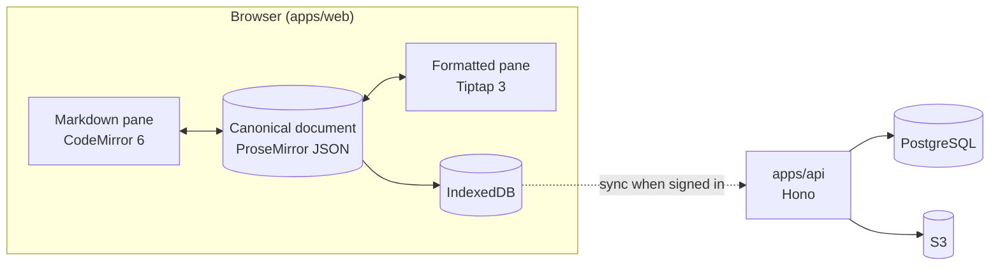

<div align="center">

<a href="https://markdownstudio.com">
  
</a>

<h1>Markdown Studio</h1>

<p><strong>One document. Two ways in.</strong></p>

<p>
An open-source Markdown editor where the source and the formatted page are both editable.<br>
Linked notes, math and diagrams built in. Runs in your browser, works offline, embeds in your app.
</p>

<p>
  <a href="https://markdownstudio.com"><strong>Try it</strong></a> ·
  <a href="#quick-start">Quick start</a> ·
  <a href="#embed-it-in-your-app">Embed</a> ·
  <a href="#self-hosting">Self-host</a> ·
  <a href="apps/web/docs/README.md">Docs</a> ·
  <a href="CONTRIBUTING.md">Contribute</a>
</p>

[](https://github.com/Perssonify/Markdown-Studio/actions/workflows/ci.yml)
[](https://github.com/Perssonify/Markdown-Studio/contribute)

</div>

<br>

<picture>
  <source media="(prefers-color-scheme: dark)" srcset=".github/assets/screenshot-dark.png">
  
</picture>

## Why Markdown Studio

Markdown tools usually make you choose. Write raw syntax and imagine the result, or type into a rich editor and hope the Markdown it saves is clean. Markdown Studio puts both on screen, and both are real editors.

- **Two views, one document.** CodeMirror 6 edits the Markdown and Tiptap 3 edits the formatted page. Both work on one ProseMirror document, so they can't drift apart.
- **Real Markdown out.** Tables, task lists, KaTeX math, Mermaid diagrams and callouts come back as tidy Markdown, in CommonMark, GitHub Flavored Markdown or Markdown Extra.
- **Notes that connect.** `[[Wiki links]]`, backlinks and a relationship map of your whole library.
- **Yours to run.** Local-first, offline after one visit, no analytics, and embeddable in your own product.

## Features

| Area | What you get |
| --- | --- |
| **Editing** | Split, Markdown-only or formatted-only views · draggable divider · scrolling synced by heading · table grid picker · clickable task lists · regex find and replace with scope filters |
| **Rich content** | KaTeX math with a live formula preview · Mermaid diagrams · ABC music notation · callouts (note, tip, important, warning, caution) · collapsible sections · footnotes · emoji shortcodes · right-to-left text |
| **Linked notes** | `[[Note]]` and `[[Note#Heading]]` links · backlinks, outgoing and broken links for every note · a relationship map with folders as clusters · a Cards board for quick capture |
| **Never lose work** | Autosave · undo history per note · version history, restored in place or as a copy · deleted notes recoverable for up to 30 days · a guard that stops a blank editor saving over a full note · live sync between tabs |
| **Import and export** | In: Markdown, HTML, plain text, Word, JSON, ZIP and TAR (password-protected ZIPs too), and links from GitHub, Google Drive or Dropbox. Out: Markdown, HTML, Word, PDF (via print), JSON and a whole-library ZIP |
| **Sync and share** | Optional Google sign-in syncs notes, folders and images across devices · share a note or a folder as a link that carries its own content and opens without an account |
| **Privacy** | No analytics or telemetry · images from other sites can be blocked · the URL-import relay asks before it's used |
| **App** | Installable PWA · works offline after the first visit · light, dark and six accent colours · focus mode · phone layout · keyboard shortcuts and a guided tour |

## Quick start

### Use it online

Open **[markdownstudio.com](https://markdownstudio.com)** and sign in with Google. Your library syncs across your devices, and share links open without an account.

### Run it locally

You need [Bun](https://bun.sh) 1.4.0 (pinned in `package.json`), Node.js 24 (see [`.node-version`](.node-version)) and Git.

```bash
git clone https://github.com/Perssonify/Markdown-Studio.git
cd Markdown-Studio
bun install --frozen-lockfile
bun run dev
```

Open <http://localhost:5173>. With no backend configured, the editor opens straight away with three starter notes saved in your browser. `bun run dev` also starts the API on <http://localhost:4000>; to run only the editor, use `bun run --cwd apps/web dev`.

> [!TIP]
> Most issues (editing, rendering, import and export, the UI) only need the editor. You don't need Docker, a database, Google keys or an AWS account to work on them.

<details>
<summary><strong>Run the backend too</strong> (sign-in, cloud sync and the backend tests)</summary>
<br>

```bash
cp apps/api/.env.example apps/api/.env
bun run db:up        # PostgreSQL 17 (port 5440) and an S3-compatible store (port 9540) in Docker
bun run db:migrate   # create the tables
curl http://localhost:4000/health   # {"status":"ok","db":"up","storage":"up"}
```

Sign-in uses Google, so it also needs your own OAuth client in `apps/api/.env`. The steps are in [Google sign-in: the OAuth client](apps/api/README.md#google-sign-in-the-oauth-client). With it, <http://localhost:5173> opens on the sign-in screen and your library syncs to the local database and S3.

</details>

## Embed it in your app

The editor that runs markdownstudio.com also ships as a React component and an iframe embed.

```tsx
import { PerssonifyEditorIntegration } from "@perssonify/editor";
import "@perssonify/editor/styles.css";
import "katex/dist/katex.min.css";

export function NotesEditor() {
  return (
    <PerssonifyEditorIntegration
      onContentChange={({ docId, markdown }) => saveDraft(docId, markdown)}
    />
  );
}
```

Or drop in the prebuilt iframe shell (`bun run --cwd apps/web build:embed`, output in `apps/web/dist-embed/`) and configure it from the URL:

```html
<iframe src="/editor/?mode=split&theme=light&chrome=minimal" title="Markdown editor"></iframe>
```

What you control:

- **Storage:** plug in your own adapter, or let the editor keep notes in IndexedDB
- **Look:** light or dark, six accent presets or any colour, and CSS variables for the rest
- **Chrome:** full, minimal or none
- **Behaviour:** read-only mode and the starting view
- **Control:** a `postMessage` bridge to read Markdown or HTML, add and update notes, switch theme and view, and export

`@perssonify/editor` isn't on npm yet. Until it is, build it from this repository with `bun run --cwd apps/web build` (output in `apps/web/dist/`). Theming, storage adapters, events and the iframe bridge are covered in the [integration guide](apps/web/docs/integration-guide.md).

<details>
<summary><strong>Iframe URL parameters</strong></summary>
<br>

| Param | Values | Effect |
| --- | --- | --- |
| `mode` / `view_mode` | `split`, `md`, `html` | Starting view (the user's stored choice wins later) |
| `theme` | `light`, `dark` | Colour scheme (default `dark`) |
| `accent` | `amber`, `blue`, `violet`, `emerald`, `rose`, `mono` | Accent preset |
| `accentColor` | any CSS colour | Custom accent, overrides `accent` |
| `chrome` | `full`, `minimal`, `none` | How much interface to show (default `full`) |
| `bg` | `transparent` or a CSS colour | Panel background |
| `readonly` | `true` | Editing off, toolbar hidden, view locked |
| `allowed_origin` | comma-separated origins | Who may drive the editor over `postMessage` |

Details and security notes: [iframe embed build](apps/web/docs/integration-guide.md#6-iframe-embed-build-dist-embed).

</details>

## Self-hosting

**Editor only, no backend.** Build a static site and serve it anywhere:

```bash
bun run --cwd apps/web build:app   # output in apps/web/dist-app/
```

Serve `dist-app/` with a fallback to `index.html` for unknown paths. There are no accounts: every visitor's notes stay in their own browser. Without the server-side import relay, importing from a link works only for sites that allow cross-origin requests.

**With accounts and sync.** You'll need Node.js 24, PostgreSQL 17, an S3-compatible bucket and a Google OAuth client.

1. Build the editor with accounts on: `bun run --cwd apps/web build:app:accounts`
2. Configure the API from [its settings table](apps/api/README.md#settings-env-see-envexample), then build and start it: `bun run --cwd apps/api build && bun run --cwd apps/api start`
3. Create the tables: `bun run db:migrate` (reads `DATABASE_URL`)
4. Serve both on one origin: `/api/*` to the API, everything else to `dist-app/` with the `index.html` fallback

The maintainers deploy to Vercel ([`vercel.json`](vercel.json)); AWS CDK stacks for the same app live in [`infra`](infra/README.md).

## How it works

Neither pane is the source of truth. Both edit one canonical ProseMirror document, and the Markdown is generated from it. The sync engine is hash-gated and debounced, so an edit in one pane never echoes back into the other. Notes persist to IndexedDB, and when you're signed in they sync to the API in the background.



One [Turborepo](https://turborepo.com) with one Bun lockfile:

| Path | What it is | Read more |
| --- | --- | --- |
| [`apps/web`](apps/web) | The editor (Vite and React): the standalone app, the iframe embed and the `@perssonify/editor` library | [README](apps/web/README.md) · [docs](apps/web/docs/README.md) |
| [`apps/api`](apps/api) | The backend (Hono on Node 24): Google sign-in, cloud sync, S3 file storage and the URL-import relay | [README](apps/api/README.md) |
| [`packages/db`](packages/db) | Drizzle ORM schema and SQL migrations for PostgreSQL 17 | [README](packages/db/README.md) |
| [`infra`](infra) | AWS CDK stacks. Maintainers only; contributors never need it | [README](infra/README.md) |

**Built with:**

- **Editor:** React, TypeScript, Vite, CodeMirror 6, Tiptap 3 and ProseMirror, Tailwind CSS, shadcn/ui
- **Rendering:** marked, Turndown, KaTeX, Mermaid, abcjs
- **Backend:** Hono, Better Auth, Drizzle ORM, PostgreSQL, Amazon S3
- **Tooling:** Bun, Turborepo, Vitest, Playwright, ESLint

## Documentation

| Read this | When you want to know |
| --- | --- |
| [Engineering docs index](apps/web/docs/README.md) | Where everything is documented. Start here |
| [Local development](apps/web/docs/local-development.md) | Run modes, seed data and recipes (a toolbar command, a Tiptap node, a storage field) |
| [Architecture](apps/web/docs/architecture.md) | The mental model and the design decisions |
| [Data pipeline](apps/web/docs/data-pipeline.md) | How content moves: ingest, sync, persist |
| [Features](apps/web/docs/features.md) | What each feature does and which files implement it |
| [Gotchas](apps/web/docs/gotchas.md) | Known traps. Read before touching the sync engine |
| [Integration guide](apps/web/docs/integration-guide.md) | Embedding the editor in your own app |
| [API](apps/api/README.md) · [Database](packages/db/README.md) | The backend's endpoints, settings and schema |
| [Changelog](apps/web/CHANGELOG.md) | What changed in each release |

## Contributing

Bug fixes, features, tests, docs and translations are all welcome. The full guide is [CONTRIBUTING.md](CONTRIBUTING.md); the short version:

1. **Pick an issue.** Start with [`good first issue`](https://github.com/Perssonify/Markdown-Studio/issues?q=is%3Aissue%20is%3Aopen%20label%3A%22good%20first%20issue%22) or [`help wanted`](https://github.com/Perssonify/Markdown-Studio/issues?q=is%3Aissue%20is%3Aopen%20label%3A%22help%20wanted%22), and comment before you start so two people don't build the same thing. For a bigger change, open an issue to discuss it first.
2. **Fork and branch** from `main`, as `fix/…` or `feat/…`.
3. **Make the change and test it.** Editor tests live in [`apps/web/src/__tests__/`](apps/web/src/__tests__) and must be `.js` or `.jsx`.
4. **Run what CI runs:** `bun run lint && bun run typecheck && bun run test && bun run build`
5. **Open a pull request** saying what changed, why and how you checked it. For UI changes, add screenshots in light and dark mode.

> [!IMPORTANT]
> A few rules protect people's documents:
> - **Don't rename the `perssonify` identifiers** (the `pf:` storage keys, the `perssonify-*` databases and file formats, the `@perssonify/editor` package). They are on-disk contracts, and renaming them orphans users' documents ([why](apps/web/docs/data-contracts.md)).
> - **A new Tiptap node or mark** must also be registered in `apps/web/src/engine/serialize-doc.ts`, or export silently breaks.
> - **Read [`apps/web/CLAUDE.md`](apps/web/CLAUDE.md) before a structural change.** It records the editor's invariants, and most "obvious cleanups" undo a deliberate fix.

Using an AI coding assistant? [`CLAUDE.md`](CLAUDE.md), [`apps/web/CLAUDE.md`](apps/web/CLAUDE.md) and [`AGENTS.md`](AGENTS.md) give it the same context.

<details>
<summary><strong>Where to start for a given issue</strong></summary>
<br>

Paths are under `apps/web/src/` unless noted.

| If the issue is about | Start in |
| --- | --- |
| Markdown and formatted-pane conversion, round-trip fidelity | [`engine/`](apps/web/src/engine) |
| Custom nodes: wiki links, math, callouts, details | [`extensions/`](apps/web/src/extensions) |
| Panes, toolbar, menus, dialogs, the map, Cards | [`ui/`](apps/web/src/ui) |
| Notes, folders, saving, version history | [`store/`](apps/web/src/store) |
| Sign-in and cloud sync in the browser | [`app/`](apps/web/src/app) |
| Interface text and translations | [`i18n/`](apps/web/src/i18n) ([guide](apps/web/docs/i18n.md)) |
| API routes | [`apps/api/src/modules/`](apps/api/src/modules) |
| Database tables | [`packages/db/src/schema/`](packages/db/src/schema) |

The [codebase tour](apps/web/docs/codebase-tour.md) has a fuller "where does X live?" table.

</details>

<details>
<summary><strong>All commands</strong></summary>
<br>

Run from the repository root.

| Command | What it does |
| --- | --- |
| `bun run dev` | The editor (:5173) and the API (:4000) together |
| `bun run lint` | ESLint across every package (zero errors; warnings are the tracked backlog) |
| `bun run typecheck` | TypeScript across every package |
| `bun run test` | Every package's tests. Database tests run only after `bun run db:up` |
| `bun run build` | The editor's app, library and embed builds, and the API bundle |
| `bun run db:up` / `db:down` | Start or stop the local PostgreSQL and S3 in Docker |
| `bun run db:generate` | Write the next migration after a change in `packages/db/src/schema` |
| `bun run db:migrate` | Apply migrations to `DATABASE_URL` |
| `bun run --cwd apps/web e2e` | The real-browser test campaign ([e2e/README.md](apps/web/e2e/README.md)) |

</details>

## Community and support

- **Questions:** [open an issue](https://github.com/Perssonify/Markdown-Studio/issues/new?labels=question) with the `question` label
- **Bugs:** use the [bug report form](https://github.com/Perssonify/Markdown-Studio/issues/new?template=bug_report.yml)
- **Ideas:** use the [feature request form](https://github.com/Perssonify/Markdown-Studio/issues/new?template=feature_request.yml)
- **Security issues:** never in a public issue. Report them privately as described in [SECURITY.md](SECURITY.md)

Everyone taking part is expected to follow the [Code of Conduct](CODE_OF_CONDUCT.md).

## Browser support

Safari 16.4+ (and every browser on iOS and iPadOS 16.4+), Chrome and Edge 111+, Firefox 128+. Older browsers get a message naming these versions instead of a broken page.

## Acknowledgements

Markdown Studio stands on [CodeMirror](https://codemirror.net), [Tiptap](https://tiptap.dev) and [ProseMirror](https://prosemirror.net), [marked](https://marked.js.org), [Turndown](https://github.com/mixmark-io/turndown), [KaTeX](https://katex.org), [Mermaid](https://mermaid.js.org), [abcjs](https://www.abcjs.net), [Hono](https://hono.dev), [Drizzle](https://orm.drizzle.team) and [Better Auth](https://www.better-auth.com). Thank you to everyone who maintains them.

## Contributors

<a href="https://github.com/Perssonify/Markdown-Studio/graphs/contributors">
  
</a>

## License

© 2026 [Perssonify Labs](https://labs.perssonify.com/)
