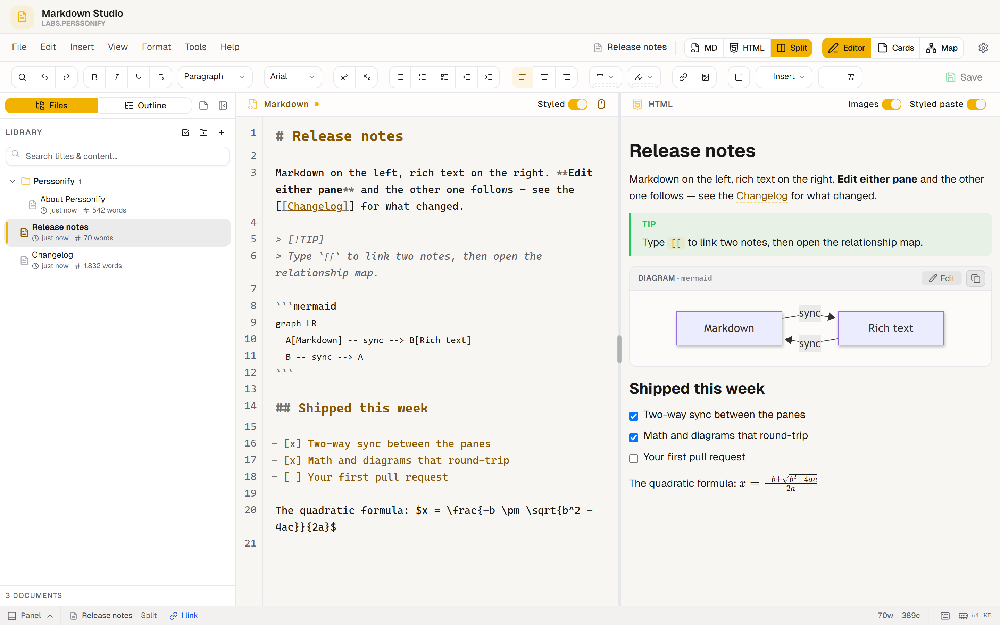

<div align="center">

<a href="https://markdownstudio.com">
  
</a>

<h1>Markdown Studio</h1>

<p><b>One document. Two ways in.</b></p>

<p>Write the Markdown or edit the finished page.<br>Both views are live, and they always agree.</p>

<p>
  <a href="https://markdownstudio.com"><b>Open the app</b></a> ·
  <a href="apps/web/docs/README.md">Docs</a> ·
  <a href="https://github.com/Perssonify/Markdown-Studio/contribute">Good first issues</a> ·
  <a href="https://github.com/Perssonify/Markdown-Studio/issues/new?template=bug_report.yml">Report a bug</a>
</p>

[](LICENSE)
[](https://github.com/Perssonify/Markdown-Studio/stargazers)
[](CONTRIBUTING.md)

</div>

<br>

<picture>
  <source media="(prefers-color-scheme: dark)" srcset=".github/assets/screenshot-dark.png">
  
</picture>

## Why Markdown Studio?

Most Markdown editors make you pick a side. Plain-text editors show the syntax and leave the result to your imagination. Rich-text editors show the result and quietly decide what gets saved.

Markdown Studio gives every note one document with two editors attached: CodeMirror for the Markdown and Tiptap for the formatted page. Edit either one and the other is rebuilt from the same source, so they never drift apart.

## Features

- **Two editable views.** Split, Markdown only or formatted only, with both panes scrolled to the same heading.
- **Linked notes.** `[[Note]]` and `[[Note#Heading]]` links, links in and out for every note, and a map of how it all connects.
- **Rich content.** KaTeX math, Mermaid diagrams, sheet music, callouts, task lists and right-to-left text.
- **Hard to lose work.** Autosave, version history, and deleted notes you can recover for up to 30 days.
- **In and out.** Import Markdown, HTML, Word, JSON and ZIP archives. Export to Markdown, HTML, Word, PDF and JSON.
- **Works offline.** Install it as an app. Notes live in your browser first and sync across devices when you sign in.
- **Share with a link.** The note travels inside the link, and whoever opens it needs no account.
- **Embeddable.** Drop the editor into your own product as a React component or an iframe.

## Quick start

**Just want to write?** Open [markdownstudio.com](https://markdownstudio.com) and sign in with Google.

**Want to run the code?** You need [Bun](https://bun.sh) 1.4 and [Node.js](https://nodejs.org) 24.

```bash
git clone https://github.com/Perssonify/Markdown-Studio.git
cd Markdown-Studio
bun install --frozen-lockfile
bun run dev
```

Then open <http://localhost:5173>. No setup or accounts needed: the editor runs in your browser with a few starter notes. To turn on sign-in and sync, follow the [API guide](apps/api/README.md).

## Embed it

```tsx
import { PerssonifyEditorIntegration } from "@perssonify/editor";
import "@perssonify/editor/styles.css";
import "katex/dist/katex.min.css";

<PerssonifyEditorIntegration
  initialMode="split"
  onSave={({ docId, markdown }) => saveDoc(docId, markdown)}
/>
```

The package isn't on npm yet, so build it with `bun run --cwd apps/web build`. The [integration guide](apps/web/docs/integration-guide.md) covers every prop, the iframe version and theming.

> [!NOTE]
> Using Markdown Studio in a commercial product needs a commercial license. Write to [hello@markdownstudio.com](mailto:hello@markdownstudio.com).

## Contributing

Contributions are welcome, and most fixes need only the editor running, no backend.

1. Pick a [good first issue](https://github.com/Perssonify/Markdown-Studio/contribute) and comment to claim it.
2. Read [CONTRIBUTING.md](CONTRIBUTING.md), especially the house rules that keep people's notes safe.
3. Before you open a pull request, run `bun run lint && bun run typecheck && bun run test`.

> [!TIP]
> **Using AI is welcome.** Claude Code, Cursor, Copilot or any other assistant can help you fix an issue here. Point it at [`CLAUDE.md`](CLAUDE.md) and [`apps/web/CLAUDE.md`](apps/web/CLAUDE.md) so it follows the same rules we do. Just own the result: read every line, run the tests yourself, and mention in your pull request that AI helped.

Questions go in [issues](https://github.com/Perssonify/Markdown-Studio/issues), security reports go through [SECURITY.md](SECURITY.md), and everyone here follows our [Code of Conduct](CODE_OF_CONDUCT.md).

## Star history

If Markdown Studio is useful to you, a star helps other people find it.

<a href="https://www.star-history.com/?repos=perssonify%2Fmarkdown-studio&type=date&legend=top-left">
  <picture>
    <source media="(prefers-color-scheme: dark)" srcset="https://api.star-history.com/svg?repos=perssonify/markdown-studio&type=date&theme=dark&legend=top-left">
    <source media="(prefers-color-scheme: light)" srcset="https://api.star-history.com/svg?repos=perssonify/markdown-studio&type=date&legend=top-left">
    
  </picture>
</a>

## Everyone who has contributed

<a href="https://github.com/SyedMoin-Lab" title="SyedMoin-Lab"></a>
<a href="https://github.com/claude" title="Claude"></a>
<a href="https://github.com/Perssonify/Markdown-Studio/graphs/contributors"></a>

## License

Markdown Studio is source-available under [CC BY-NC 4.0](LICENSE). You're free to use, share and adapt it for non-commercial purposes, as long as you credit Perssonify Labs. For commercial use, write to [hello@markdownstudio.com](mailto:hello@markdownstudio.com).

Code published before the switch to CC BY-NC 4.0 stays under the MIT License it was released with.

<br>

<p align="center">
  <sub>Built by <a href="https://labs.perssonify.com">Perssonify Labs</a> · Copyright © 2026</sub>
</p>
