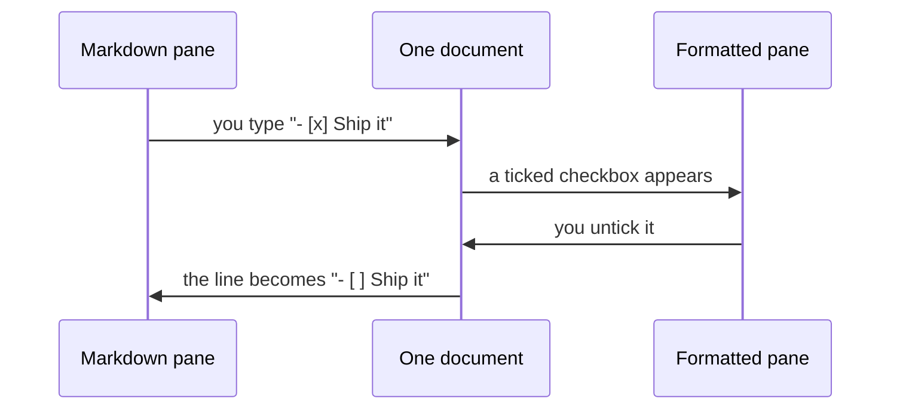
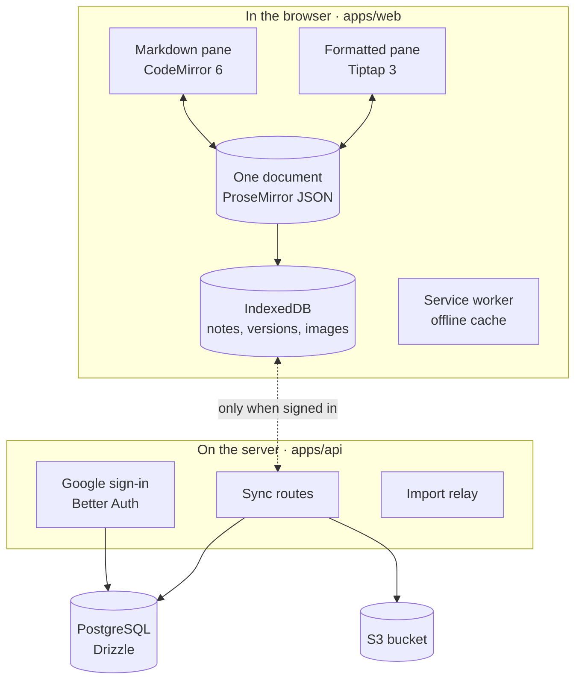

<div align="center">

<a href="https://markdownstudio.com">
  
</a>

# Markdown Studio

### One document. Two ways in.

A local-first Markdown editor with two live, editable views of every note:<br>
the syntax you type and the page you'll publish.

**[Open the app](https://markdownstudio.com)** · [Run it locally](#run-it-on-your-machine) · [Embed it](#put-it-in-your-product) · [Host it](#host-your-own) · [Read the docs](apps/web/docs/README.md)

[](https://github.com/Perssonify/Markdown-Studio/actions/workflows/ci.yml)
[](LICENSE)
[](CODE_OF_CONDUCT.md)

</div>

<picture>
  <source media="(prefers-color-scheme: dark)" srcset=".github/assets/screenshot-dark.png">
  
</picture>

<p align="center"><sub><a href="#overview">Overview</a> · <a href="#what-you-get">What you get</a> · <a href="#start-here">Start here</a> · <a href="#put-it-in-your-product">Embed</a> · <a href="#host-your-own">Self-host</a> · <a href="#under-the-hood">Under the hood</a> · <a href="#how-we-test">Testing</a> · <a href="#contributing">Contributing</a> · <a href="#faq">FAQ</a></sub></p>

## Overview

Writing Markdown usually means picking a side. A plain-text editor shows you syntax and leaves the result to your imagination. A rich-text editor shows you the result and quietly decides what Markdown to save.

Markdown Studio refuses to pick. Each note is one structured document with two editors attached: CodeMirror 6 for the Markdown and Tiptap 3 for the formatted page. Change either view and the other is rebuilt from the same document, so they always agree.



Around that core sits a full writing environment: folders, `[[wiki links]]`, a relationship map, a Cards board, version history, offline support, optional sync, and an embeddable build for your own product. The whole thing is MIT licensed.

## What you get

<table>
<tr>
<td valign="top" width="33%">

**Write**

- Split, Markdown-only or formatted-only views
- Scroll both panes to the same heading
- KaTeX math with a live formula preview
- Mermaid diagrams and ABC sheet music
- Callouts, footnotes, collapsible sections
- Right-to-left text, per paragraph

</td>
<td valign="top" width="33%">

**Connect**

- `[[Note]]` and `[[Note#Heading]]` links
- Links in, links out and broken links for each note
- A relationship map with folders as clusters
- A Cards board for quick capture
- Regex find and replace with scope filters

</td>
<td valign="top" width="33%">

**Protect**

- Autosave and per-note undo
- Version history, restored in place or as a copy
- Deleted notes recoverable for up to 30 days
- A guard against blank saves over full notes
- Open tabs kept in step with each other

</td>
</tr>
<tr>
<td valign="top">

**Move**

- Bring in Markdown, HTML, text, Word, JSON
- Unpack ZIP and TAR archives, locked ZIPs too
- Paste links from GitHub, Google Drive, Dropbox
- Take out Markdown, HTML, Word, PDF, JSON
- Export the whole library as one ZIP

</td>
<td valign="top">

**Sync and share**

- Optional Google sign-in
- Notes, folders and images on every device
- Share a note or folder as a single link
- The content rides inside the link itself
- Recipients need no account

</td>
<td valign="top">

**Make it yours**

- Light, dark or system theme
- Six accents, adjustable type and width
- Focus mode
- Installs as an app, works offline
- No analytics or tracking code

</td>
</tr>
</table>

## Start here

| You want to | Go to |
| --- | --- |
| Write something right now | [markdownstudio.com](https://markdownstudio.com), sign in with Google |
| Hack on the code | [Run it on your machine](#run-it-on-your-machine) |
| Ship the editor inside your app | [Put it in your product](#put-it-in-your-product) |
| Run your own copy | [Host your own](#host-your-own) |

### Run it on your machine

| Tool | Version | Needed for |
| --- | --- | --- |
| [Bun](https://bun.sh) | 1.4.0 (pinned) | Installing, building, running |
| [Node.js](https://nodejs.org) | 24 | The API and the build tooling |
| [Docker](https://www.docker.com) | any recent | Only the optional local database and storage |

```bash
git clone https://github.com/Perssonify/Markdown-Studio.git
cd Markdown-Studio
bun install --frozen-lockfile
bun run dev
```

Visit <http://localhost:5173>. No configuration is needed: without a backend, the editor skips sign-in and greets you with three starter notes kept in your browser. The same command also boots the API on port 4000. For the editor alone, run `bun run --cwd apps/web dev`.

> [!TIP]
> Bugs in editing, rendering, import, export and the interface can all be fixed with just the editor running. Leave the database and cloud keys for later.

<details>
<summary><b>Turn on sign-in and sync locally</b></summary>
<br>

1. Copy the API settings: `cp apps/api/.env.example apps/api/.env`
2. Start PostgreSQL 17 and a local S3 in Docker: `bun run db:up`
3. Create the tables: `bun run db:migrate`
4. Create a Google OAuth client and add its ID and secret to `apps/api/.env` ([step by step](apps/api/README.md#google-sign-in-the-oauth-client))
5. Check the API: `curl http://localhost:4000/health` should report `"db":"up"` and `"storage":"up"`

Reload <http://localhost:5173> and you'll land on the sign-in screen, with your library syncing to the local database and bucket.

</details>

## Put it in your product

Markdown Studio is also a component. Drop it into a React app:

```tsx
import { PerssonifyEditorIntegration } from "@perssonify/editor";
import "@perssonify/editor/styles.css";
import "katex/dist/katex.min.css";

export function DocsEditor({ dark }: { dark: boolean }) {
  return (
    <PerssonifyEditorIntegration
      isDark={dark}
      initialMode="split"
      chrome="minimal"
      onSave={({ docId, markdown }) => api.saveDoc(docId, markdown)}
    />
  );
}
```

Or host the prebuilt iframe (`bun run --cwd apps/web build:embed` writes it to `apps/web/dist-embed/`) and drive it from any framework:

```html
<iframe
  id="editor"
  src="/editor/?mode=split&theme=light&allowed_origin=https://app.example.com"
  title="Markdown editor"
></iframe>
```

```js
import { createEditorClient } from "@perssonify/editor";

const client = createEditorClient(document.getElementById("editor"));
client.on("onContentChange", ({ docId, canonical }) => saveDraft(docId, canonical));
await client.call("setMode", { mode: "html" });
```

| Control | React component | Iframe |
| --- | --- | --- |
| Storage | Your own adapter via `storageAdapter` | Mirror changes from bridge events |
| Theme and accent | `isDark`, `accent`, `accentColor`, `themeVars` | URL params, `setTheme`, `setAccent` |
| Interface chrome | `chrome`: full, minimal or none | `?chrome=`, `setChrome` |
| Starting view | `initialMode` | `?mode=`, `setMode` |
| Read-only | `readOnly` | `?readonly=true` |

The package isn't published to npm yet. Build it from this repo with `bun run --cwd apps/web build` and the output lands in `apps/web/dist/`. Every prop, event and bridge command is documented in the [integration guide](apps/web/docs/integration-guide.md).

## Host your own

| Setup | Accounts and sync | What you need | Build command |
| --- | --- | --- | --- |
| Static editor | No. Notes live in each visitor's browser | Any static host that can fall back to `index.html` | `bun run --cwd apps/web build:app` |
| Full stack | Yes, with Google sign-in | Node.js 24, PostgreSQL 17, an S3-compatible bucket, a Google OAuth client | `bun run --cwd apps/web build:app:accounts` plus the API |

The static build lands in `apps/web/dist-app/`. It has no server-side import relay, so importing from a link works only for sites that allow cross-origin requests.

<details>
<summary><b>Full-stack checklist</b></summary>
<br>

1. Build the editor with accounts: `bun run --cwd apps/web build:app:accounts`
2. Fill in the API settings described in [apps/api/README.md](apps/api/README.md#settings-env-see-envexample)
3. Build and start the API: `bun run --cwd apps/api build`, then `bun run --cwd apps/api start`
4. Create the tables: `bun run db:migrate` (uses `DATABASE_URL`)
5. Put both behind one origin: route `/api/*` to the API and everything else to `dist-app/`, falling back to `index.html`

For reference, the hosted app runs on Vercel ([`vercel.json`](vercel.json)), and [`infra`](infra/README.md) holds AWS CDK stacks for the same setup.

</details>

## Under the hood



The sync between panes is hash-gated and debounced, so an edit made in one view never bounces back as a second edit in the other.

```text
markdown-studio/
├── apps/
│   ├── web/                 the editor: standalone app, iframe embed, npm library
│   │   ├── src/engine/      converting between Markdown and the document
│   │   ├── src/extensions/  wiki links, math, callouts and other custom nodes
│   │   ├── src/ui/          panes, toolbar, dialogs, Cards, the map
│   │   ├── src/store/       notes, folders, saving, version history
│   │   ├── src/app/         sign-in and cloud sync on the browser side
│   │   ├── src/i18n/        every interface string, ready for translation
│   │   └── e2e/             the real-browser test campaign
│   └── api/                 Hono backend: auth, sync, file storage, import relay
├── packages/db/             Drizzle schema and SQL migrations
├── infra/                   AWS CDK stacks, for maintainers
└── vercel.json              how the hosted app is served
```

| Layer | Built with |
| --- | --- |
| Editing | CodeMirror 6, Tiptap 3, ProseMirror |
| Rendering | marked, Turndown, KaTeX, Mermaid, abcjs |
| Interface | React, TypeScript, Vite, Tailwind CSS, shadcn/ui |
| Backend | Hono, Better Auth, Drizzle ORM, PostgreSQL, Amazon S3 |
| Tooling | Bun, Turborepo, Vitest, Playwright, ESLint |

## How we test

People trust an editor with work they can't get back, so every pull request has to clear:

- **Over 2,700 unit tests** across the editor, the API and the database package
- **A React 18 run** alongside React 19, so the library works for both
- **The backend against real PostgreSQL and S3**, plus a contract test that runs the browser's sync code against the actual API
- **Real-browser suites in Chromium:** data-loss sequences, fault injection, simulated user journeys, the embed bridge, the published library on a host page, an enforced Content Security Policy, and offline use through the service worker
- **The core suites again in Firefox and WebKit**

## Roadmap

- Publish `@perssonify/editor` to npm
- More interface languages (the translation catalog is ready; English ships today)
- A Pro plan for the hosted app, with more storage and longer version history

Got an idea? [Suggest a feature](https://github.com/Perssonify/Markdown-Studio/issues/new?template=feature_request.yml).

## Contributing

New contributors are very welcome, and you don't need to touch the backend to make a real difference.

1. **Find something to work on.** Browse [issues for first-timers](https://github.com/Perssonify/Markdown-Studio/contribute) or anything tagged `help wanted`, and leave a comment so nobody doubles up. For larger ideas, open an issue to talk it through first.
2. **Branch off `main`** as `fix/your-change` or `feat/your-change`.
3. **Prove it works.** Add editor tests under `apps/web/src/__tests__/` (as `.js` or `.jsx` files), then run the same gate CI does: `bun run lint && bun run typecheck && bun run test && bun run build`
4. **Open the pull request** with what changed, why, and how you checked it. Interface changes need light and dark screenshots.

> [!WARNING]
> **House rules that keep people's notes safe**
> - Keep every `perssonify` identifier as it is: the `pf:` keys, the `perssonify-*` databases and file formats, and the package name. Existing libraries depend on them ([details](apps/web/docs/data-contracts.md)).
> - Register any new Tiptap node or mark in `apps/web/src/engine/serialize-doc.ts`, or exports will quietly drop it.
> - Before a structural change, read [`apps/web/CLAUDE.md`](apps/web/CLAUDE.md). Many tempting cleanups would undo a deliberate fix.

Pairing with an AI coding assistant? Point it at [`CLAUDE.md`](CLAUDE.md), [`apps/web/CLAUDE.md`](apps/web/CLAUDE.md) and [`AGENTS.md`](AGENTS.md) so it learns the same rules.

The full guide lives in [CONTRIBUTING.md](CONTRIBUTING.md). For deeper reading, start with the [docs index](apps/web/docs/README.md), then the [architecture](apps/web/docs/architecture.md), the [data pipeline](apps/web/docs/data-pipeline.md) and the [gotchas](apps/web/docs/gotchas.md). Releases are recorded in the [changelog](apps/web/CHANGELOG.md).

<details>
<summary><b>Handy commands</b></summary>
<br>

```bash
bun run dev            # editor on :5173 and API on :4000
bun run lint           # ESLint, zero errors allowed
bun run typecheck      # TypeScript in every package
bun run test           # all unit tests (run db:up first for the database ones)
bun run build          # app, library, embed and API builds
bun run db:up          # local PostgreSQL and S3 in Docker (db:down stops them)
bun run db:generate    # write a migration after a schema change
bun run db:migrate     # apply migrations to DATABASE_URL
bun run --cwd apps/web e2e   # the real-browser campaign
```

</details>

## FAQ

<details>
<summary><b>Why is the package called <code>@perssonify/editor</code>?</b></summary>
<br>
The editor started life under the Perssonify name, and that name is baked into how existing installs store notes: storage keys, database names and file formats. Renaming any of it would strand people's libraries, so it stays.
</details>

<details>
<summary><b>Do I need the backend to contribute?</b></summary>
<br>
No. Without one, the editor runs fully in your browser. You only need the API, PostgreSQL and S3 to work on sign-in or sync.
</details>

<details>
<summary><b>Can I use it in a commercial product?</b></summary>
<br>
Yes. The MIT License lets you use, modify and ship it, commercially or not, as long as the copyright notice stays with the code.
</details>

<details>
<summary><b>Is there AI built in?</b></summary>
<br>
No. The one AI-adjacent feature is Copy as AI prompt, which copies a note together with the notes linked to and from it, ready to paste into whatever assistant you use.
</details>

<details>
<summary><b>Can several people edit a note at once?</b></summary>
<br>
No. It's built for one writer at a time. Share links hand someone their own editable copy instead.
</details>

<details>
<summary><b>Which browsers work?</b></summary>
<br>
Safari 16.4 or later (and any browser on iOS or iPadOS 16.4 or later), Chrome and Edge 111 or later, and Firefox 128 or later. Older browsers see a message listing these versions rather than a broken page.
</details>

## Get help

| Need | Where to go |
| --- | --- |
| Ask a question | [New issue with the `question` label](https://github.com/Perssonify/Markdown-Studio/issues/new?labels=question) |
| Report a bug | [Bug report form](https://github.com/Perssonify/Markdown-Studio/issues/new?template=bug_report.yml) |
| Request a feature | [Feature request form](https://github.com/Perssonify/Markdown-Studio/issues/new?template=feature_request.yml) |
| Report a vulnerability | Privately, as described in [SECURITY.md](SECURITY.md). Never in a public issue |

Everyone in this project's spaces follows our [Code of Conduct](CODE_OF_CONDUCT.md).

## Credits

Markdown Studio would not exist without [ProseMirror](https://prosemirror.net), [Tiptap](https://tiptap.dev), [CodeMirror](https://codemirror.net), [KaTeX](https://katex.org), [Mermaid](https://mermaid.js.org), [abcjs](https://www.abcjs.net), [marked](https://marked.js.org), [Turndown](https://github.com/mixmark-io/turndown), [Hono](https://hono.dev), [Drizzle](https://orm.drizzle.team) and [Better Auth](https://www.better-auth.com). Our thanks to their maintainers.

**Everyone who has contributed**

<a href="https://github.com/SyedMoin-Lab" title="SyedMoin-Lab"></a>
<a href="https://github.com/Perssonify/Markdown-Studio/graphs/contributors"></a>

## License

Released under the [MIT License](LICENSE). Copyright © 2026 [Perssonify Labs](https://labs.perssonify.com/).
