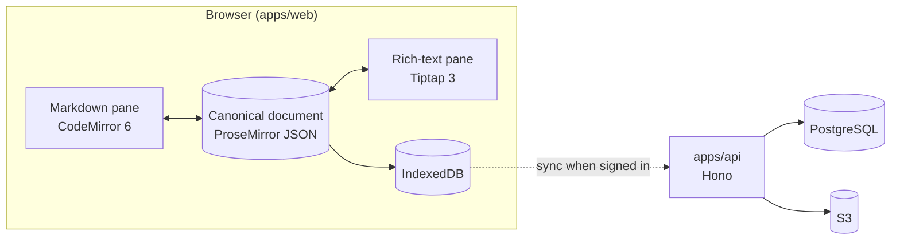

<div align="center">


# Markdown Studio

**Markdown on the left. Rich text on the right. Always in sync.**

A browser-based Markdown editor with two fully editable panes, wiki links, a
relationship map, math and diagrams — as a web app, an iframe embed and a React
library.

[**Try it**](https://markdownstudio.com) ·
[Contributing](CONTRIBUTING.md) ·
[Good first issues](https://github.com/Perssonify/Markdown-Studio/contribute) ·
[Docs](apps/web/docs/README.md) ·
[Report a bug](https://github.com/Perssonify/Markdown-Studio/issues/new?template=bug_report.yml)

[](https://github.com/Perssonify/Markdown-Studio/actions/workflows/ci.yml)
[](LICENSE)
[](https://github.com/Perssonify/Markdown-Studio/issues?q=is%3Aissue%20is%3Aopen%20label%3A%22good%20first%20issue%22)
[](CONTRIBUTING.md)

</div>

<picture>
  <source media="(prefers-color-scheme: dark)" srcset=".github/assets/screenshot-dark.png">
  
</picture>

## Why Markdown Studio

Most Markdown editors make you pick: write raw Markdown and squint at a preview,
or use a rich-text editor and hope the Markdown it saves is clean. Markdown
Studio gives you both, side by side, and either side can be edited.

- **Two panes, one document.** CodeMirror 6 for Markdown, Tiptap 3 (ProseMirror)
  for rich text. Both are views of one canonical ProseMirror document, so they
  never drift apart.
- **Everything round-trips.** Tables, task lists, KaTeX math, Mermaid diagrams,
  ABC music, callouts, footnotes and front matter come back out as clean
  Markdown — CommonMark, GitHub Flavored or Markdown Extra.
- **Linked notes.** `[[wiki links]]`, backlinks, a force-directed relationship
  map and a Cards board.
- **Local-first.** Documents live in the browser (IndexedDB) and the app works
  offline. Signing in with Google syncs documents, images and folders across
  devices.
- **Hard to lose work.** Autosave, version history, protection against a blank
  document overwriting a full one, and whole-library ZIP backups.
- **Gets your content in and out.** Markdown, HTML, Word, PDF, JSON and ZIP/TAR
  archives, plus import from a URL.
- **Embeddable.** The same editor ships as a React component and an iframe
  embed with a host API ([integration guide](apps/web/docs/integration-guide.md)).

## Quick start

You need [Bun](https://bun.sh) **1.4.0** (pinned in `package.json`), Node.js
**24** (see [`.node-version`](.node-version)) and Git. Docker is only needed for
the backend.

```bash
git clone https://github.com/Perssonify/Markdown-Studio.git
cd Markdown-Studio
bun install --frozen-lockfile
bun run dev
```

Open <http://localhost:5173>. The editor needs no configuration: with no
backend settings it opens straight into the editor with three starter
documents, saved in your browser. `bun run dev` also starts the API on
<http://localhost:4000>; to run only the editor, use `bun run --cwd apps/web dev`.

> [!TIP]
> Most issues — editing, rendering, import and export, the UI — only need the
> editor. You don't need Docker, a database, Google keys or an AWS account to
> work on them.

<details>
<summary><strong>Running the backend (optional)</strong> — for sign-in, cloud sync and the backend's tests</summary>

<br>

```bash
cp apps/api/.env.example apps/api/.env
bun run db:up        # PostgreSQL 17 (port 5440) and an S3-compatible store (port 9540) in Docker
bun run db:migrate   # create the tables
curl http://localhost:4000/health   # {"status":"ok","db":"up","storage":"up"}
```

Sign-in uses Google, so it also needs your own OAuth client in
`apps/api/.env` — see [Google sign-in: the OAuth client](apps/api/README.md#google-sign-in-the-oauth-client).
With it, <http://localhost:5173> opens on the sign-in screen and your library
syncs to the local database and S3.

</details>

## How the code is organised

One [Turborepo](https://turborepo.com) with one Bun lockfile:

| Path | What it is | Read more |
| --- | --- | --- |
| [`apps/web`](apps/web) | The editor (Vite + React): the standalone app, the iframe embed and the npm library `@perssonify/editor`. | [README](apps/web/README.md) · [docs](apps/web/docs/README.md) |
| [`apps/api`](apps/api) | The backend (Hono on Node 24): Google sign-in (Better Auth), cloud sync, file storage on S3, and the URL-import relay. | [README](apps/api/README.md) |
| [`packages/db`](packages/db) | Drizzle ORM schema and SQL migrations for PostgreSQL 17. | [README](packages/db/README.md) |
| [`infra`](infra) | AWS CDK stacks. Maintainers only — you don't need it to contribute. | [README](infra/README.md) |



Where to start for a given kind of issue (paths under `apps/web/src/` unless
noted):

| If the issue is about… | Start in |
| --- | --- |
| Markdown ↔ rich-text conversion, round-trip fidelity | [`engine/`](apps/web/src/engine) |
| Custom nodes: wiki links, math, callouts, details | [`extensions/`](apps/web/src/extensions) |
| Panes, toolbar, menus, dialogs, the map, Cards | [`ui/`](apps/web/src/ui) |
| Documents, folders, saving, version history | [`store/`](apps/web/src/store) |
| Sign-in and cloud sync in the browser | [`app/`](apps/web/src/app) |
| Interface text and translations | [`i18n/`](apps/web/src/i18n) ([guide](apps/web/docs/i18n.md)) |
| API routes | [`apps/api/src/modules/`](apps/api/src/modules) |
| Database tables | [`packages/db/src/schema/`](packages/db/src/schema) |

The [codebase tour](apps/web/docs/codebase-tour.md) has a fuller "where does X
live?" table, and [architecture.md](apps/web/docs/architecture.md) explains the
design.

## Contributing

Contributions are welcome — bug fixes, features, tests, docs and translations.
The full guide is [CONTRIBUTING.md](CONTRIBUTING.md); the short version:

1. **Pick an issue.** Start with
   [`good first issue`](https://github.com/Perssonify/Markdown-Studio/issues?q=is%3Aissue%20is%3Aopen%20label%3A%22good%20first%20issue%22)
   or [`help wanted`](https://github.com/Perssonify/Markdown-Studio/issues?q=is%3Aissue%20is%3Aopen%20label%3A%22help%20wanted%22).
   Comment on the issue before you start, so a maintainer can assign it to you
   and two people don't work on the same thing. For a larger change, open an
   issue to discuss it first.
2. **Fork and branch** from `main`: `fix/…` or `feat/…`.
3. **Make the change and test it.** Editor tests go in
   [`apps/web/src/__tests__/`](apps/web/src/__tests__) and must be `.js` or
   `.jsx` files. The editor suite is large; while you work, run the files you
   touched, e.g. `cd apps/web && bunx vitest run src/__tests__/sync-engine.test.js`.
4. **Run the checks** that CI runs:

   ```bash
   bun run lint && bun run typecheck && bun run test && bun run build
   ```

5. **Open a pull request.** The template asks what changed, why and how you
   verified it. Add screenshots for UI changes, in light and dark mode if you
   changed colours.

> [!IMPORTANT]
> A few rules protect people's documents. Please read these before you change code:
>
> - **Don't rename the `perssonify` identifiers** — the `pf:` storage keys, the
>   `perssonify-*` databases and file formats, the `@perssonify/editor` package.
>   They are on-disk contracts; renaming them orphans users' documents
>   ([why](apps/web/docs/data-contracts.md)).
> - **A new Tiptap node or mark** must also be registered in
>   `apps/web/src/engine/serialize-doc.ts`, or export silently breaks.
> - **Read [`apps/web/CLAUDE.md`](apps/web/CLAUDE.md) before a structural
>   change.** It records the invariants of the editor, and most "obvious
>   cleanups" undo a deliberate fix.

Using an AI coding assistant? [`CLAUDE.md`](CLAUDE.md), [`apps/web/CLAUDE.md`](apps/web/CLAUDE.md)
and [`AGENTS.md`](AGENTS.md) give it the same context.

## Commands

Run from the repository root:

| Command | What it does |
| --- | --- |
| `bun run dev` | The editor (:5173) and the API (:4000) together. |
| `bun run lint` | ESLint across every package (zero errors; warnings are the tracked backlog). |
| `bun run typecheck` | TypeScript across every package. |
| `bun run test` | Every package's tests. The database tests run only after `bun run db:up`; otherwise they are skipped. |
| `bun run build` | The editor's app, library and embed builds, and the API bundle. |
| `bun run db:up` / `db:down` | Start / stop the local PostgreSQL and S3 in Docker. |
| `bun run db:generate` | Write the next migration after a change in `packages/db/src/schema`. |
| `bun run db:migrate` | Apply migrations to `DATABASE_URL`. |
| `bun run --cwd apps/web e2e` | The browser test campaign ([e2e/README.md](apps/web/e2e/README.md)). |

## Documentation

| Read this | When you want to know… |
| --- | --- |
| [Engineering docs index](apps/web/docs/README.md) | Where everything is documented — start here. |
| [Local development](apps/web/docs/local-development.md) | Run modes, seed data and recipes (add a toolbar command, a Tiptap node, a storage field). |
| [Architecture](apps/web/docs/architecture.md) | The mental model and the design decisions. |
| [Data pipeline](apps/web/docs/data-pipeline.md) | How content moves: ingest → sync → persist. |
| [Features](apps/web/docs/features.md) | What each feature does and which files implement it. |
| [Gotchas](apps/web/docs/gotchas.md) | Known traps — read before touching the sync engine. |
| [Integration guide](apps/web/docs/integration-guide.md) | Embedding the editor in your own app. |
| [API](apps/api/README.md) · [Database](packages/db/README.md) | The backend's endpoints, settings and schema. |
| [Changelog](apps/web/CHANGELOG.md) | What changed in each release. |

## Embedding the editor

The editor is also a React component and an iframe embed:

```tsx
import { PerssonifyEditorIntegration } from "@perssonify/editor";
import "@perssonify/editor/styles.css";

<PerssonifyEditorIntegration
  onContentChange={({ docId, markdown }) => saveDraft(docId, markdown)}
/>
```

`@perssonify/editor` is not on npm yet. Until it is, build it from this
repository with `bun run --cwd apps/web build` (output in `apps/web/dist/`).
Theming, storage adapters, events and the iframe bridge are in the
[integration guide](apps/web/docs/integration-guide.md).

## Browser support

Safari 16.4+ (and every browser on iOS / iPadOS 16.4+), Chrome and Edge 111+,
Firefox 128+. Older browsers get a message naming these versions instead of a
broken page.

## Getting help

- **Questions** — [open an issue](https://github.com/Perssonify/Markdown-Studio/issues/new?labels=question) with the `question` label.
- **Bugs** — use the [bug report form](https://github.com/Perssonify/Markdown-Studio/issues/new?template=bug_report.yml).
- **Ideas** — use the [feature request form](https://github.com/Perssonify/Markdown-Studio/issues/new?template=feature_request.yml).
- **Security issues** — never in a public issue. See [SECURITY.md](SECURITY.md).

## Deployment

For maintainers. The site and API run on Vercel as one project
([`vercel.json`](vercel.json)): the `web` service serves the editor and `/api/*`
goes to the `api` service. The AWS stacks in [`infra`](infra/README.md)
describe the same app on CloudFront and Lambda. Contributors never need either.

## Contributors

<a href="https://github.com/Perssonify/Markdown-Studio/graphs/contributors">
  
</a>

## License

[MIT](LICENSE) © 2026 [Perssonify Labs](https://labs.perssonify.com/).

Markdown Studio is built on [CodeMirror](https://codemirror.net),
[Tiptap](https://tiptap.dev) and [ProseMirror](https://prosemirror.net),
[marked](https://marked.js.org), [Turndown](https://github.com/mixmark-io/turndown),
[KaTeX](https://katex.org), [Mermaid](https://mermaid.js.org),
[abcjs](https://www.abcjs.net), [Hono](https://hono.dev),
[Drizzle](https://orm.drizzle.team) and [Better Auth](https://www.better-auth.com).
