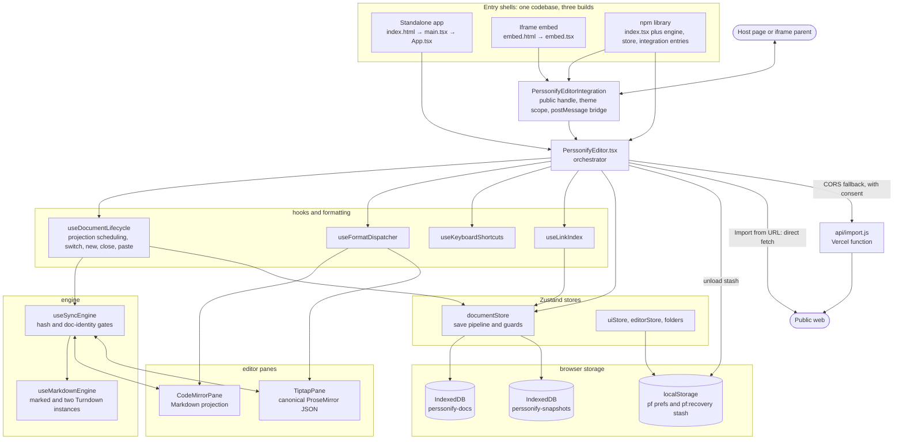
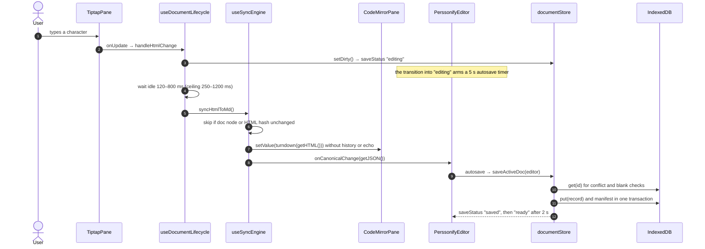

# Markdown Studio — Onboarding Report

> Written 2026-09-28 against `@perssonify/editor` **1.77.0**; revised 2026-09-29 against the code after the production-readiness audit fixes (findings A001–A114). `package.json:3` still says 1.77.0.
> Audience: engineers joining the project who need to understand it, check that it matches its docs, and start contributing.

**How this report was produced**

- **The first pass (1.77.0) was read-only.** Nothing was installed, built, run or changed. That checkout had no `node_modules` and no `.git`, so library internals, commit history and branch settings could not be checked.
- **The revision re-checked every section against the current code.**
  - Line numbers were re-derived.
  - Each §8 finding is now marked still open, partly fixed, or fixed. Fixed ones are listed once, in §8.10, with the audit finding ID.
  - Where a claim could only be settled by running code, that piece was run in isolation (for example the tar-header loop in IMP-1).
  - The unit suite at this revision: 196 files, 2,126 tests (`bunx vitest run --maxWorkers=3`).
- **Coverage.** Every manifest, config, CI file and doc was read. The source was read module by module:
  - entry points, the orchestrator, the document lifecycle and the sync engine
  - stores, persistence, import/export and the relay
  - the integration API, UI surfaces, tooling, the unit tests and the browser tests

  Each High-severity finding in §8 was re-verified by re-reading the cited lines.
- **Labels in §8:**
  - **Confirmed** means the code path was read and the behaviour follows directly from it.
  - **Suspected** means the code points that way, but the outcome depends on runtime or library behaviour that could not be run or read here.
- Line numbers refer to this checkout. What was skipped is listed at the end.

---

## 1. What this is

Markdown Studio (npm package `@perssonify/editor`) is a dual-pane Markdown editor. A CodeMirror 6 pane shows raw Markdown and a TipTap 3 (ProseMirror) pane shows rich text. Both edit the same document and stay in sync. The stored source of truth is ProseMirror JSON; Markdown is a projection of it.

It serves two groups:
- **Writers and note-takers** who want Markdown's portability without giving up WYSIWYG editing.
- **Product teams** who embed the editor in their own apps, either as a React library or as an iframe.

Everything runs in the browser:
- Documents are stored in the browser (IndexedDB) on this device. There is no account and no server copy.
- There is no analytics or telemetry. Errors go to a small, redacted diagnostics ring that stays in the browser until the user copies it.
- The only server code is a Vercel function, the URL-import relay. It is used only when "Import from URL" is blocked by CORS and the user has agreed to it (asked once, remembered, changeable in Settings ▸ Privacy).
- Images referenced in a document load from their hosts unless Settings ▸ Privacy ▸ Block remote images is on.
- The standalone app works offline after one online visit.

On top of editing, it provides:
- a multi-document library with folders and `[[wiki links]]`
- a relationship map and a cards board
- version history
- import and export for Markdown, HTML, JSON, DOCX, PDF and ZIP

---

## 2. Tech stack

| Area | Technology | Declared (`package.json`) | Resolved (`bun.lock`) | Notes |
|---|---|---|---|---|
| Language | TypeScript, strict mode | `^6.0.3` | 6.0.3 | 6.0 is the newest release every tool here can use; TypeScript 7 type-checks the project but has no JavaScript API for typescript-eslint yet ([workflows.md ▸ TypeScript 7](docs/workflows.md#typescript-7)). Only `src/` is type-checked (`tsconfig.json:38`). Tests, e2e, `api/`, `build/` and `scripts/` are plain JS. `noImplicitAny` is on; `src/types/` holds declarations for untyped packages (turndown). |
| UI runtime | React, React DOM | dev `^19.3.0`, peer `^18.3.0 \|\| ^19.0.0` | 19.3.0 | `@types/react` / `@types/react-dom` are `^19.3.0` (19.3.0 / 19.3.0), matching the runtime. The type gate and the unit suite must also pass on React 18.3.1 and its types, for library consumers still on 18 (the local check is in [workflows.md](docs/workflows.md#verify-gate-and-deploys)). |
| Rich-text engine | TipTap 3 (ProseMirror via `@tiptap/pm`) | every `@tiptap/*` package at `3.31.3` (dev), peer `^3.31.3` | 3.31.3 | One version across the set, pinned by `pkg-lockfile.test.js`. `@tiptap/extension-list` is declared. |
| Markdown pane | CodeMirror 6, `@lezer/highlight` | view `^6.39.14`, state `^6.5.4`, lang-markdown `^6.5.0`, commands, search, language | 6.39.14, 6.5.4, 6.5.0 | Peers of the library. |
| Markdown → HTML | marked, marked-emoji, marked-footnote | `^18.0.14`, `^2.0.3`, `^1.4.0` | 18.0.14, 2.0.3, 1.4.0 | Configured per instance in `src/engine/build-marked.ts`. Wiki links are a marked inline extension (`src/engine/wiki-link-marked.ts`). `breaks: true` is always on. |
| HTML → Markdown | Turndown | `7.2.4` | 7.2.4 | GFM rules are hand-written in `src/engine/turndown-rules.ts`; `turndown-plugin-gfm` is not used. The engine adds an escaper and a linear-time top-level conversion (`turndownLinear`). |
| State | Zustand | peer `^5.0.0`, dev `^5.0.12` | 5.0.12 | |
| UI kit | Tailwind CSS v4, shadcn/ui (`base-mira`) on Base UI, lucide-react, sonner, next-themes, cva, clsx, tailwind-merge, tw-animate-css | tailwind `4.3.3`, base-ui `^1.3.0`, lucide `^0.577.0` (peer `^0.577.0 \|\| ^1.0.0`), sonner `^2.0.7`, next-themes `^0.4.6` (peer `^0.4.0`) | 4.3.3, 1.3.0, 0.577.0, 2.0.7, 0.4.6 | Generated primitives live in `src/components/ui/`. The library bundles Base UI and sonner on purpose. |
| Math, diagrams, music, code | KaTeX, Mermaid, abcjs, lowlight | `^0.18.1`, `^11.17.2`, `^6.6.4`, `^3.3.0` | 0.18.1, 11.17.2, 6.6.4, 3.3.0 | All lazy-loaded. An override keeps a single KaTeX (Mermaid asks for `^0.16`). |
| Import / export | fflate (zip/gzip), @zip.js/zip.js (encrypted zip), mammoth (DOCX in), docx (DOCX out) | `^0.8.3`, `^2.8.34`, `^1.12.0`, `^9.7.1` | 0.8.3, 2.8.34, 1.12.0, 9.7.1 | zip.js, mammoth and docx are lazy-loaded. |
| Persistence | IndexedDB, localStorage | — | — | Two databases, `perssonify-docs` and `perssonify-snapshots`, both at version 1. Records carry a `schemaVersion` (currently 1). |
| Build | Vite 8 (Rolldown), @vitejs/plugin-react, @tailwindcss/vite, vite-plugin-pwa (Workbox), custom PostCSS plugins | vite `8.1.5`, plugin-react `6.0.4`, pwa `^1.3.0` | vite 8.1.5 (rolldown 1.1.5), pwa 1.3.0 (workbox-build 7.4.1) | Three configs: `vite.config.ts` (library; externals derived from `package.json` by `build/externals.mjs`, minified with oxc), `vite.app.config.ts`, `vite.embed.config.ts`. |
| Unit tests | Vitest, jsdom, Testing Library, jest-dom, fake-indexeddb | `4.1.11`, `29.1.1`, `^16.3.2`, `^6.9.1`, `^6.2.5` | same | Only `src/__tests__/*.test.{js,jsx}` is collected. |
| Lint | ESLint (flat config), typescript-eslint, eslint-plugin-react-hooks | `^10.11.0`, `^8.71.0`, `^7.1.1` | 10.11.0 | `bun run lint`: zero errors required, warnings allowed. |
| Browser tests | Custom Node runner, playwright-core (Chromium; Firefox and WebKit for five suites) | `1.62.1` | 1.62.1 | In `e2e/`. |
| Server code | One Vercel Node function using `undici` | `^7.30.0` (a dependency) | 7.30.0 | `api/import.js` |
| Tooling | Bun 1.4.0 as package manager (`packageManager`); Node | engines: `^20.19.0` or `>=22.12.0` | — | `bun.lock` is committed and installed with `--frozen-lockfile` by the verify gate and on Vercel. `bun run` executes Vite with Node. |
| Hosting | Vercel (static SPA plus one function); no CI | — | — | `vercel.json` |

---

## 3. Architecture

### 3.1 Three products from one codebase

| Product | Entry chain | Build → output | How it ships |
|---|---|---|---|
| **Standalone app** | `index.html` → `src/main.tsx` (fonts, palette, diagnostics capture, prompted service-worker updates, `ThemeProvider`) → `src/App.tsx` (router, URL params, remote-image policy, tour) → `PerssonifyEditor` | `bun run build:app` → `dist-app/`, with a PWA service worker and `third-party-licenses.txt` | Vercel runs `bun run build:app && node scripts/strip-sourcemaps.mjs` and serves `dist-app/` (`vercel.json:2-5`). |
| **Iframe embed** | `embed.html` → `src/embed.tsx` (URL params; `allowedOrigins` from `src/integration/embed-origins.ts`) → `PerssonifyEditorIntegration` → `PerssonifyEditor` | `bun run build:embed` → `dist-embed/index.html`, relative base, no service worker | Built by `bun run build:embed`. **Not deployed by this repo** (see API-5). |
| **npm library** | `src/index.tsx`, plus the `./engine`, `./store` and `./integration` entries | `bun run build` → `dist/` (ES + CJS + `.d.ts` + `styles.css`); dependencies and peers stay external | Published by hand by an owner (`npm publish` from `apps/web`, after the verify gate — [deployment.md ▸ Publishing](docs/deployment.md#publishing-the-npm-package)). Claiming the `@perssonify` scope and 2FA are owner actions (A006). |

### 3.2 How the parts communicate

| Channel | Used for | Where |
|---|---|---|
| Function calls, props, imperative refs | Orchestrator ↔ hooks ↔ panes. Pane handles such as `getValue`, `setValue`, `setHTML`, `getJSON` and `isComposing`. | `src/PerssonifyEditor.tsx`, `src/ui/panes/editorPanes/index.tsx` |
| Zustand stores | Document state and save status, UI preferences, derived link index, folder tree | `src/store/documents/documentStore.ts`, `uiStore.ts`, `editorStore.ts`, `folders.ts` |
| IndexedDB | Documents, the manifest, prefs; the version-history snapshot ring | `src/store/persistence/idb-storage-adapter.ts`, `src/store/history/snapshot-store.ts` |
| localStorage / sessionStorage | UI preferences (`pf:*`), the crash-recovery stash, the diagnostics ring, the durability canary, one-shot handoffs | `src/store/preferences/uiStore.ts`, `src/store/persistence/crash-recovery.ts`, `src/utils/diagnostics.ts`, `src/store/persistence/storage-durability.ts` |
| `window.postMessage` | Iframe host ↔ embed | `src/integration/host-bridge.ts` |
| Web Worker | Find & Replace regular expressions: a Worker built from a Blob, terminated after 1.5 s; a guarded main-thread fallback where a CSP forbids `blob:` workers | `src/formatting/find-worker.ts` |
| HTTP (`fetch`) | "Import from URL": a direct fetch first, then — only with the user's consent — the `/api/import` relay. Otherwise only the app's own files (lazy chunks, the service worker's precache and hourly update check). | `src/store/importExport/url-import.ts`, `api/import.js`, `src/pwa/sw-updates.ts` |
| Service worker | Offline copy of the standalone app: every chunk precached, navigations network-first, prompted updates | `vite.app.config.ts:27-124`, `public/sw-recover.js`, `src/pwa/sw-updates.ts` |

There are no message queues, websockets, background jobs, server databases or auth providers.

### 3.3 Component diagram



### 3.4 Startup (standalone app)

1. **`index.html`, before anything else loads:**
   - A `no-referrer` meta (`index.html:20`) and a blocking script that applies the stored theme and palette before first paint (`:24-41`).
   - A boot watchdog (`:43-103`) recovers a load that can never boot. It acts only on evidence: a `<script>` or `<link>` that failed to load, or an uncaught error from the app's own bundle (a file under `/assets/`). It waits a 4 s grace period, never acts offline and runs at most once per 30 s. It then unregisters service workers, clears caches, leaves a `pf:boot-recovered` note and reloads once.
2. **`src/main.tsx`:**
   - Installs the local diagnostics capture and the save-problem watcher (`:19-20`) and applies the palette (`:23`).
   - On `vite:preloadError` (a chunk that could not be fetched), reloads only when online, with nothing unsaved and not within 10 s of the last such reload (`:31-34`, `src/utils/app-health.ts`).
   - Registers the service worker with prompted updates (`:39`, `src/pwa/sw-updates.ts`). A new version waits for the user's **Reload**; nothing reloads an open tab by force.
   - Sets `__PF_BOOTED` (`:43`).
   - Renders `ThemeProvider` (storage key `perssonify-theme`, default `system`) around `<App/>` (`:49-67`).
3. **`src/App.tsx`:**
   - Installs the "Block remote images" policy when the user has turned it on (`:19`, `src/utils/remote-images.ts`).
   - Reads `?import_url=` during render (`:37-41`). It only pre-fills the importer and never fetches.
   - Applies and then strips `?readonly` and `?view_mode`. It also strips `?ads`, which is honoured only in development builds (`:51-82`).
   - Mounts `PerssonifyEditor` with `initialDocument` (Welcome), `starterDocuments`, `durabilityNotices` and routing callbacks (`:165-192`).
   - Lazy-loads `/about`, `/help` and the tour. Routes are `/`, `/about`, `/help` and `/graph` (`src/app/router.tsx:14-20`).
4. **`PerssonifyEditor`'s one-shot init effect (`src/PerssonifyEditor.tsx:1496-1679`):**
   1. Loads prefs: sync mode, markdown features, folder tree, and view mode (with the one-shot `pf:session-view-mode` handoff).
   2. Calls `documentStore.initialize()` (`src/store/documents/documentStore.ts:763-878`), which:
      - reads the document list (rebuilt from the stored documents when it is missing or out of step);
      - adopts any `pf:recovery` stash as unsaved drafts, each with the revision it was written against;
      - activates the last open document. If another tab has since overtaken that document's draft, it opens in the terminal `conflict` status.

      A second call, on a remount, re-activates the open document without hydrating it.
   3. Checks for a wiped library (`noteLibraryAtBoot`, `:1550`). If IndexedDB is empty but the `pf:library-canary` remembers documents, nothing is seeded, and a notice explains the loss.
   4. Either hydrates the editor with that document, or seeds the starters when storage is empty and no wipe was detected:
      - Hydration goes through `hydrateEditorWithDoc`. Content from a newer build opens read-only instead of blank.
      - The starters are the Welcome document, the Changelog and "About Perssonify".
   5. Sets `initDoneRef = true` (`:1670`). **Autosave and ⌘S do nothing until this point.**

### 3.5 End-to-end flow: a keystroke in the rich pane until it is on disk

1. TipTap `onUpdate` (`src/ui/panes/tiptapPane/index.tsx:278`) → `EditorLayout` → `PerssonifyEditor.handleHtmlChange` (`src/PerssonifyEditor.tsx:761-764`). That also starts the host's 300 ms `onContentChange` timer (`:651-662`).
2. `useDocumentLifecycle.handleHtmlChange` (`src/hooks/useDocumentLifecycle.ts:285-303`) calls `documentStore.setDirty()` (`src/store/documents/documentStore.ts:1168-1173`, status becomes `editing`). It also schedules a projection. The wait comes from `src/hooks/sync-schedule.ts:62-80`:
   - idle delay = `clamp(120, 1.5 × cost, 800)` ms
   - max-wait ceiling = `clamp(250, 8 × cost, 1200)` ms
   - "cost" is a moving average of how long recent projections actually took.
3. The timer fires. While the Markdown pane is mid-IME-composition it retries every 120 ms. Then it calls `useSyncEngine.syncHtmlToMd` (`src/engine/useSyncEngine.ts:108-178`):
   - It skips if the ProseMirror doc node is unchanged, or if the HTML hash matches the last one.
   - Otherwise it converts with `htmlToMd` (Styled) or `htmlToCleanMd` (Clean): `cleanHtmlForTurndown` → `turndownLinear` (Turndown plus the escaper, in runs of 64 top-level blocks) → `normalizeMarkdown` (`src/engine/useMarkdownEngine.ts:238-239`).
4. `CodeMirrorPane.setValue` applies a minimal diff. The change is kept out of undo history and change events are suppressed, so it does not echo back (`src/ui/panes/codeMirrorPane/index.tsx:441-482`).
5. `onCanonicalChange(editor.getJSON())` calls `documentStore.updateDerived`, which recomputes counts and fidelity (`src/store/documents/documentStore.ts:1567-1585`). In library mode it also emits the host `onChange`.
6. The **transition** into `editing` arms a 5-second autosave timer (`src/PerssonifyEditor.tsx:1844-1858`; `AUTOSAVE_MS`, `src/constants.ts:63`). Because it is armed on the transition, a save lands about 5 s after the first unsaved keystroke, not 5 s after typing stops.
7. `autosave` (`src/PerssonifyEditor.tsx:1738-1805`) flushes pending projections, then calls `saveActiveDoc` (`src/store/documents/documentStore.ts:969-1165`), which runs these steps in order:
   1. Refuses a document locked read-only (content from a newer build, or content the schema cannot load) with a terminal `blocked`.
   2. The hydration chokepoint: refuse unless the editor holds the active document.
   3. `storage.get` plus a multi-tab drift check. If the stored copy is more than 2 s newer than this tab's base, it parks a terminal `conflict`. A read that fails (a `StorageReadError`, as opposed to a missing record) writes nothing, reports `error`, and is retried.
   4. Re-checks ownership after the await, and refuses a document that is being deleted.
   5. The blank-over-content backstop, which parks a terminal `blocked`.
   6. Snapshots the old version into the version-history ring, without waiting for it.
   7. Re-reads the latest title and metadata, then calls `storage.save`.

   It resolves `true` only when the write committed. A `StorageQuotaError` parks the terminal `full` ("Storage full — not saving").
8. `IndexedDBStorageAdapter.save` (`src/store/persistence/idb-storage-adapter.ts:554-651`), all in **one transaction**:
   - stamps `updated` (unless `_preserveUpdated` is set)
   - reads the record's previous size, or walks every document when a host has set a `maxBytes` cap
   - `put`s the record and rewrites the manifest, rebuilding the manifest from the documents first if it is missing or unreadable

   A browser `QuotaExceededError` becomes a `StorageQuotaError`.
9. The status goes `saved`, then `ready` after 2 s (`documentStore.ts:1147`). The new document list triggers an incremental link-index update 600 ms later (`src/hooks/useLinkIndex.ts:157-207`), and the status bar re-renders.

Edits in the Markdown pane are the mirror image: CodeMirror update listener → `handleMdChange` → `syncMdToHtml` → `preprocessMarkdown` + marked → `tiptap.setHTML(..., emitUpdate:false)`.



### 3.6 Switching documents

1. A library row's selection (`src/ui/workspace/folderTree/index.tsx:860, 954`) → `handleSelectDocFromPanel` (`src/PerssonifyEditor.tsx:947-950`) → `handleSwitchDoc` (`src/hooks/useDocumentLifecycle.ts:509-561`).
2. `handleSwitchDoc` bumps `switchGenRef`, ends any IME composition, caches a dirty draft, captures undo history and runs `autosaveOnLeave`.
3. `documentStore.switchToDoc` (`src/store/documents/documentStore.ts:1203-1273`):
   - bumps its own `switchSeq`
   - optimistically sets `activeDocId` and sets `hydratedDocId = null`, so saves are refused in the meantime
   - reads the record and prefers a cached draft. A record that cannot be read is treated like a missing one, and the user is told "That document could not be opened".
4. `hydrateEditorWithDoc` (`src/hooks/useDocumentLifecycle.ts:454-490`):
   - `setCanonical` pushes content into both panes and drops their undo history (`src/engine/useSyncEngine.ts:227-256`)
   - restores a validated cached undo stack, if one exists
   - calls `markHydrated`. The exception is content the live schema cannot load, or content from a newer build: that is shown as a read-only copy and is **not** marked hydrated, so no save can persist the copy.

Every await is followed by a generation check, so an older switch can't hydrate over a newer one.

### 3.7 The only server call: Import from URL

1. `UrlImportDialog` → `fetchImportResource` (`src/store/importExport/url-import.ts:362-455`). First it rewrites provider share links (`src/store/importExport/import-url-normalize.ts`).
2. It fetches directly, with `credentials: "omit"` and `no-referrer`. On a thrown network or CORS error, `fetchDirectOrProxy` (`:292-352`) considers the relay, but only with the user's consent (`:258-270`):
   - Consent is a stored answer in `pf:import-relay`, or the one-time question the dialog asks through `confirmRelay`.
   - Without consent it stops with the download-and-drop guidance.
   - With consent it retries through the same-origin `/api/import?url=`.
3. `api/import.js` handles the request:
   - GET only. CORS is granted to `https://markdownstudio.com` and its `www` host only (`:47`, `:296-297`).
   - `Sec-Fetch-Site` must be `same-origin` or `none` (`:311-315`). This stops browser pages, not scripts (SEC-1).
   - Per-IP rate limit of 40 requests/min per warm instance (`:253-266`).
   - http(s) only, ports 80 and 443 only.
   - Resolves the host and fetches only **global-unicast** addresses. This is an allowlist; the only IPv4-in-IPv6 form accepted is a plain `::ffff:` mapping, which is re-checked as IPv4 (`:55-142`, `assertPublicUrl` at `:147-175`).
   - An undici `Agent` pins the vetted IPs to the connection (`:179-190`).
   - Follows at most 5 redirects manually, re-validating each hop (`:195-220`). 20 s timeout per hop; `vercel.json` caps the function at 25 s.
   - Refuses bodies over 4,000,000 bytes with a 413 and a message the client shows (`:34-36`, `:225-249`).
   - The response is forced to `application/octet-stream` + `attachment` + CSP `sandbox`. The real type is passed in `X-Upstream-Content-Type` (`:348-354`).
   - Writes one JSON log line per request, with the host only, never the path or query (`:275-281`).
4. The bytes go through archive detection or the 5 MB text path, then `handleImportUrl` (`src/PerssonifyEditor.tsx:2362`) → `importItems` → `ingest` → new documents. Imports are converted headlessly and persisted without activating each one.

### 3.8 Invariants the design depends on

`CLAUDE.md` explains each of these at length. All of them were checked against code.

- The canonical copy is TipTap's ProseMirror JSON; Markdown is a projection of it.
- The `force*` sync callbacks have **empty dependency arrays** and call through refs (`src/engine/useSyncEngine.ts:190-202`). Adding a dependency brings back the render-loop crash.
- Composition (IME and dictation) guards apply only to the pane a projection **writes**. A stuck composition flag expires after 8 s (`COMPOSITION_STALL_MS`).
- `hydratedDocId` is the save chokepoint. Every path that pushes content into the editor must call `markHydrated`.
- Two generation guards work together: `switchGenRef` protects editor hydration and `switchSeq` protects the store's `activeDocId`. Every async path that hydrates the editor must re-check after each await.
- The terminal save statuses (`blocked`, `conflict`, `full`) never re-arm autosave. A real edit resumes saving; for `full`, so does freeing space.
- Schema parity. A node or mark added to `TiptapPane` must also be added to `SERIALIZE_EXTENSIONS` (`src/engine/serialize-doc.ts`), to `KNOWN_ELEMENTS` (`src/store/importExport/ingest.ts`), and given a Turndown rule. With no rule, Turndown silently strips the tag.
- `pf:*` / `perssonify-*` identifiers are on-disk contracts. Do not rename them.

---

## 4. Directory map

| Path | Purpose |
|---|---|
| `src/PerssonifyEditor.tsx` | The orchestrator component (2,989 lines). Everything is wired here. |
| `src/main.tsx`, `src/App.tsx`, `src/app/router.tsx` | Standalone app: boot, shell, four-route history router |
| `src/pwa/` | `sw-updates.ts`: prompted service-worker updates and the hourly update check |
| `src/embed.tsx` | Iframe-embed shell: URL params → `PerssonifyEditorIntegration` |
| `src/index.tsx` | Library root entry (public exports) |
| `src/engine/` | Markdown ⇄ HTML ⇄ ProseMirror conversion and bidirectional sync: `useSyncEngine`, `useMarkdownEngine` (`createMarkdownEngine`), `build-marked`, `wiki-link-marked`, `turndown-rules`, `preprocessor`, `html-cleaner`, `css-safety`, `serialize-doc`, `math-marked`, `emoji-map` |
| `src/store/` | Zustand stores; the document model and `schema-version`; storage adapters; recovery nets (snapshots, history cache, crash stash) and `storage-durability`; ingest, import/export, archives and URL import; link index; graph, cards, outline and search helpers; console commands |
| `src/hooks/` | Lifecycle glue: `useDocumentLifecycle`, `sync-schedule`, `useKeyboardShortcuts`, `useLinkIndex`, `useDialogs`, `useActiveHeading`, `useTickWhileActive`, `use-mobile` |
| `src/formatting/` | Command dispatcher; Markdown text, table, case and selection helpers; Find & Replace's single matcher (`find-engine`) and its Worker (`find-worker`) |
| `src/extensions/` | Custom TipTap nodes, marks and plugins: WikiLink, Math, Callout, Details, Emoji, Frontmatter, SizedImage, ThemeImage, BackgroundColor and TableCellAlign. It also holds the view-only plugins BidiAuto, UnresolvedWikiLinks, AltGraphPassthrough and ListKeymapNoTab, and `cm-bidi` for the Markdown pane. Three deprecated, unwired nodes remain: BlockId, FieldBlock, TransclusionBlock. |
| `src/integration/` | Public embedding API: `PerssonifyEditorIntegration`, the postMessage `host-bridge`, `embed-origins`, `deprecation`, `prompt-builder`, `associations` |
| `src/ui/` | Feature components: panes, toolbar, menu bar, workspace panel, cards, map, find/replace, status bar, durability notices, sheets, dialogs |
| `src/ui/pages/` | The routed `/about` and `/help` pages |
| `src/components/ui/` | Generated shadcn/Base UI primitives. Several are unused (§8.8). |
| `src/data/` | The shortcut table, first-run starter documents, and About-page credits |
| `src/theme/` | Accent palettes and `sanitizeCssColor`, theme hooks, and the unused `createTheme` |
| `src/utils/`, `src/lib/` | `quickHash`, the `[DIAG]` logger, the diagnostics ring, app health, build gates, safe storage, URL safety, the remote-image policy, AltGr detection, reduced motion; `cn()` |
| `src/__tests__/` | 196 Vitest files (153 `.test.js`, 43 `.test.jsx`) plus `setup.js` and `converter-harness.js` |
| `api/` | `import.js`, the only server code (a Vercel function) |
| `build/` | `scope-css.mjs`, a PostCSS plugin that scopes the **library** stylesheet so it cannot restyle the host page; `externals.mjs`, the library's externals derived from `package.json` |
| `e2e/` | Browser test campaign: `run.mjs`, `lib.mjs`, 12 `cases/`, 28 hand-run `probes/`, host-page `fixtures/` |
| `scripts/` | `doc-anchors.mjs` (checks and fixes line anchors in `docs/*.md`); `third-party-licenses.mjs` (the licence notice, run by `build:app`); `strip-sourcemaps.mjs` (moves the maps out of `dist-app/`, run by Vercel after the build); `live-preview-walkthrough.mjs` (unreferenced; defaults to **production**) |
| `docs/` | Engineering docs, `deployment.md`, `decisions.md` and `runbooks/`. Start at `docs/README.md`. |
| `public/` | Icons, `brand/` images used by the Welcome document, `sw-recover.js`, `third-party-licenses.txt`, `.well-known/security.txt`, and an orphaned `site.webmanifest` |
| `marketing/` | Product copy kit, not code |
| `.github/` | PR template, issue forms, README screenshots |
| Root files | `package.json`, `bun.lock`, `vite*.ts`, `vitest.config.js`, `eslint.config.js`, `tsconfig*.json`, `vercel.json`, `components.json`, `index.html`, `embed.html`, `.gitattributes`, plus `CLAUDE.md`, `HANDOVER.md`, `PRODUCT.md`, `CHANGELOG.md`, `SECURITY.md`, `CONTRIBUTING.md`, `LICENSE` |

---

## 5. Key files to read first

| # | File | Why |
|---|---|---|
| 1 | `CLAUDE.md` | The team's list of invariants. Each paragraph records a bug that happened and the rule that now prevents it. Read it before any structural change, and check a claim against the code before relying on it. |
| 2 | `src/PerssonifyEditor.tsx` | The hub. Navigate it by line range: props 100-241, store selectors 280-425, sync engine 565-573, lifecycle 672-765, imperative handle 1188-1358, import pipeline 1417-1495, init 1496-1679, save and autosave 1688-1858, unload stash 1860-1923, `handleAction` 1979-2178, cards 2455-2668, render 2678-2989. |
| 3 | `src/engine/useSyncEngine.ts` | The core idea in about 300 lines: two projections, their gates, and the force variants with empty dependencies. |
| 4 | `src/hooks/useDocumentLifecycle.ts` | Projection scheduling, plus every path that leaves a document and the generation guard on each. |
| 5 | `src/store/documents/documentStore.ts` | `saveActiveDoc`, `switchToDoc`, `initialize`, `patchDocById` and `clearLocalData`: the data-integrity core. |
| 6 | `src/store/documents/document.ts` | The `DocumentRecord` shape, title resolution (`resolveDocTitle`), and what gets serialized. |
| 7 | `src/store/persistence/idb-storage-adapter.ts`, `src/store/persistence/storage-adapter.ts` | Persistence, adapter selection, the self-healing manifest, quota handling. |
| 8 | `src/engine/useMarkdownEngine.ts`, `build-marked.ts`, `turndown-rules.ts`, `html-cleaner.ts` | The two converters and their pre- and post-passes. |
| 9 | `src/ui/panes/tiptapPane/index.tsx` | The live schema (extension list at 220-245), the paste hook (262-276) and the pane handle. |
| 10 | `src/ui/panes/codeMirrorPane/index.tsx` | The Markdown pane: compartments, composition handling, minimal-diff `setValue`. |
| 11 | `src/store/importExport/ingest.ts` | Import formats, the HTML sanitizer, and residual analysis. |
| 12 | `src/integration/PerssonifyEditorIntegration.tsx`, `src/integration/host-bridge.ts`, `src/integration/embed-origins.ts` | The public API, the iframe protocol and who the embed will talk to. |
| 13 | `src/main.tsx`, `src/App.tsx`, `src/embed.tsx`, `index.html`, `src/pwa/sw-updates.ts` | Boot, routing, URL params, the boot watchdog and updates. |
| 14 | `api/import.js` | The only server code, and it is internet-facing. |
| 15 | `package.json`, `vite.config.ts`, `vite.app.config.ts`, `vercel.json`, `docs/workflows.md`, `e2e/README.md` | How the project is built, tested and deployed. |

---

## 6. Data

### 6.1 The document record (`src/store/documents/document.ts:32-61`)

`serializeForStorage` (`:418-438`) persists these fields:

| Field | Meaning |
|---|---|
| `id` | From `generateId()` (`:96`). |
| `title`, `userTitle`, `titlePinnedByUser` | `title` is the display title; `userTitle` holds an explicit rename, and `titlePinnedByUser` records whether a real user action set it. `resolveDocTitle` (`:211-226`) picks: a pinned rename, otherwise the first heading, otherwise the first paragraph (up to 60 characters). |
| `origin` | **Layer 1, immutable.** `{format, raw, source, timestamp, alternates}`. It keeps the **full raw imported input**. |
| `canonical` | **Layer 2.** ProseMirror JSON, the source of truth. `sanitizeCanonicalNode` (`src/store/documents/canonical-sanitize.ts`) strips dangerous URLs and validates colours, fonts, alignment and theme-image sources at the import and storage-load boundary. |
| `residuals` | **Layer 3.** `ResidualItem[]`: what ingest could not represent. Shown in `ResidualsDialog`. |
| `ingestReport` | Fidelity summary. May include `preIngestHtml` (up to 50K characters). |
| `metadata`, `tags` | Values from `:::fields:::` blocks, the card fields `cardColor`/`cardPinned`, and tags. |
| `created`, `updated` | ISO timestamps. The adapter re-stamps `updated` on every save unless `_preserveUpdated` is set. |
| `schemaVersion` | The canonical format version it was written in. It is never downgraded. Content with a newer version opens read-only. |

Never persisted:
- `_ingestHtml`, `fidelityReport`, `_persistedCanonical`, `_preserveUpdated`
- `markdownCache` and `htmlCache`, which are never written in production

The manifest row, `DocumentSummary` (`:83-92`), is `{id, title, updated, created, wordCount, tags, hasResiduals, originFormat}`.

### 6.2 IndexedDB

| Database | Version | Object store | Key | Index | Value |
|---|---|---|---|---|---|
| `perssonify-docs` (`src/store/persistence/idb-storage-adapter.ts:126-133`) | 1 | `documents` | out-of-line: the document id | — | JSON string of a `DocumentRecord` |
| | | `meta` | `"__manifest"`, `"__prefs"` | — | JSON strings |
| `perssonify-snapshots` (`src/store/history/snapshot-store.ts:60-63`) | 1 | `snapshots` | `id`, auto-increment | `byDoc` on `docId` | `{id, docId, ts, reason, title, bytes, words, hash, canonical}` plus an ordering `seq` |

- **No app-level cap.** The limit is the browser's quota, read from `navigator.storage.estimate()`. A host can set a hard `maxBytes`, which is checked inside the write transaction.
- **The document list heals itself.** `list()` compares the manifest with the ids actually stored and rebuilds it from the documents when it is missing, unreadable or out of step. Writes rebuild it first as well.
- **Read errors are errors.** `get()` returns `null` only for a genuine miss and throws `StorageReadError` otherwise.
- **Upgrade handling:**
  - `onupgradeneeded` creates missing stores.
  - `onversionchange` closes the connection, so a newer build's upgrade in another tab is not blocked. This tab's storage calls then fail with a message to reload it.
  - A database already upgraded by a newer build is opened at its own version as long as the stores still exist.
  - The snapshot database also closes on `versionchange`.
- **Host storage.** A host's `storageConfig` can rename the documents database (`dbName`). It can also namespace or switch off the snapshot database and the crash stash.
- **Snapshot ring (version history):**
  - Limits: 20 snapshots per document, 12 MB in total, 30 days.
  - The newest snapshot of a document that still exists is never evicted. A deleted document's `pre-delete` copy expires with the 30-day limit like any other.
  - Throttled to one per 90 s per document, except a large shrink, which is always recorded as `pre-clear`. Also records `pre-delete`, `pre-restore` and `manual`.
  - An in-memory fallback ring uses negative ids; a session-wide `seq` orders snapshots taken in the same millisecond.
- **Fallback when `indexedDB` is undefined** (`src/store/persistence/storage-adapter.ts:485-535`): a `window.storage` shim, then a localStorage adapter (keys `doc:{id}`, `doc:__manifest`, `doc:__prefs`), then memory. The choice is made by feature detection only; see DI-10.

### 6.3 Prefs (`meta.__prefs`)

- `lastActiveDocId`
- `syncMode`: `styled` or `clean`
- `editorMode`: `md`, `html` or `split`
- `markdownFeatures`
- `folderTree`: `{folders, docParents, docOrder, expanded}`. Documents are stored flat; the folder hierarchy exists **only** here.
- `historyMemory`

### 6.4 Browser keys

These are on-disk contracts. Do not rename them.

- **localStorage:**
  - `pf:*` UI prefs in `src/store/preferences/uiStore.ts`: workspace, paste-styled, case-content-only, show-ads (it has an effect only in development builds), read-only, context-menu, console, keyboard-shortcuts, font-size, line-height, reading-width, spellcheck, focus-mode, docnav-width, workspace-tab.
  - Find/Replace `pf:fr-*`, `pf:card-view`, `pf:tour-seen-v1`.
  - Durability (`src/store/persistence/storage-durability.ts`): `pf:library-canary`, `pf:last-full-backup`, `pf:content-since`, `pf:backup-nudge-snoozed-until`, `pf:persist-requested-at`, `pf:install-tip-snoozed-until`.
  - Privacy and gates: `pf:import-relay` (the relay consent), `pf:block-remote-images`, `pf:admin` (shows the Admin settings in a production build).
  - Diagnostics: `pf:diagnostics` (the redacted error ring, no document content) and `pf:boot-recovered` (written by the watchdog).
  - **Document text:** `pf:recovery` (the unload stash) and `pf:card-draft` (the Cards composer's unsaved note).
  - `perssonify-theme`, `perssonify-theme-mode` (integration only), `perssonify-palette`, `perssonify-diag`.
- **sessionStorage:** `pf:session-view-mode`, `pf:preload-reload-at`, `pf:boot-recover-at`.

### 6.5 Migrations

There is no migration framework; both databases are at version 1. Records carry a `schemaVersion` (`CURRENT_SCHEMA_VERSION = 1`, `src/store/documents/schema-version.ts:27`). Content from a newer version, or content the schema cannot load, opens as a read-only copy.

A few fixes are applied as records and prefs are read:
- `titlePinnedByUser` back-fill (`src/store/documents/document.ts:133-135`)
- workspace tab `map` → `outline` (`src/store/preferences/uiStore.ts:210-211`)
- reading width px → ch (`migrateReadingWidth`, `uiStore.ts:142`)
- legacy `pf:fr-headings` → `pf:fr-scope` (`src/ui/find/findReplace/index.tsx:106`)

### 6.6 Export and backup formats

- **`perssonify-document` envelope**, `_version "1.1.0"`, built by `toExportEnvelope` (`src/store/importExport/import-export.ts:283-301`):
  - Fields: `{_format, _version, schemaVersion, id, title, canonical, origin, residuals, ingestReport, metadata, tags, created, updated}`.
  - `origin.raw` and the clipboard `alternates` are left out.
  - It does **not** carry `titlePinnedByUser` (see DI-8).
- **Full backup:**
  - `perssonify-backup-YYYYMMDD-HHMMSSmmm.zip`, one envelope per document at `<folder path>/<title>.json`.
  - On import it is treated as a backup only if **every** entry is an envelope (`src/store/importExport/archive.ts:362-366`).
  - The crash screen's **Export my documents** builds the same kind of ZIP without the editor (`src/utils/emergency-backup.ts`). Its envelope differs; see IMP-3.
- **Other exports:** Markdown (Clean or Styled), standalone HTML, DOCX (generated from Markdown by `docx`), PDF (browser print), a zip of `.md` files, and graph JSON.

### 6.7 External APIs and integrations

- **Import relay** `/api/import` (§3.7). It is the only server endpoint, and it is used only with the user's consent.
- **Provider link rewriting** (`src/store/importExport/import-url-normalize.ts`):
  - Google Drive → `drive.usercontent.google.com/download`
  - Google Docs → `/export?format=html`. This path is broken; see IMP-2.
  - Google Sheets → CSV
  - GitHub blob → `raw.githubusercontent.com`
  - Dropbox → `dl=1`
- **postMessage bridge** (`src/integration/host-bridge.ts`):
  - Host → editor: `{type:"perssonify", action, payload, requestId}`. Editor → host: `{type:"perssonify", version:"1.0", event, payload, timestamp}`.
  - 21 actions: `setDocuments`, `addDocuments`, `updateDocument`, `appendToDocument`, `importContent`, `openDocument`, `setFieldSchemas`, `setTheme`, `setMode`, `setAccent`, `setChrome`, `setAssociations`, `getCanonicalDocument`, `getMarkdown`, `getHTML`, `getGraph`, `getDocuments`, `getActiveDocument`, `getAssociations`, `copyAsPrompt`, `exportAs`.
  - Events: `ready`, `onChange`, `onContentChange`, `onSave`, `onLinkClick`, `onGraphUpdate`, `response`.
  - The editor side accepts only allowlisted origins; the embed works them out in `src/integration/embed-origins.ts` (SEC-2). The client side also checks `event.source`. Calls time out after 10 s on the client. Unknown actions reject.
- **Host callbacks** (library props): `onChange`, `onContentChange` (debounced 300 ms), `onSave` (explicit saves that committed), `onLinkClick`, `onGraphUpdate`, `onReady`, `onStorageMetricsChange`, `onStorageQuotaExceeded`. `setErrorReporter` (exported) lets a host receive the redacted diagnostics entries.
- **Not present:** analytics, telemetry, external error reporting, authentication, cookies (except one in the unused `sidebar.tsx`), and any third-party API. Placeholder ads render only in development builds.

---

## 7. Run it locally

### 7.1 Prerequisites

- **Bun 1.4.0**, the version that produced `bun.lock` (`packageManager` in `package.json`).
- **Node `^20.19.0` or `>=22.12.0`.** Vite 8 runs on Node even when started with `bun run`, and the e2e runner is plain Node.
- **Chromium**, for e2e only. Install it through playwright-core (below) or point `E2E_CHROME` at an existing binary. Firefox and WebKit are needed only to run the engine suites locally (`E2E_BROWSER=firefox|webkit`).

### 7.2 Commands

All scripts are defined in `package.json:75-98`.

```bash
bun install --frozen-lockfile  # what the verify gate and Vercel run
bun run dev                  # standalone app at http://localhost:5173 (vite.app.config.ts)
bun run lint                 # ESLint; must report 0 errors (warnings are allowed)
bunx tsc --noEmit            # type gate; always pass --noEmit (see BLD-8)
bun run test                 # vitest run (jsdom)
bun run test:watch
bun run test:coverage        # v8 coverage over all of src/
bunx vitest run src/__tests__/sync-engine.test.js   # one file
bun run build:app            # dist-app/ + third-party-licenses.txt (Vercel then strips the sourcemaps)
bun run build:embed          # dist-embed/ (index.html, relative base)
bun run build                # dist/ library (ES + CJS) + .d.ts via tsconfig.build.json
bun run preview              # serve dist-app/
```

**Browser (e2e) campaign.** See `e2e/README.md`. Build all three outputs first:

```bash
bun run build:app && bun run build:embed && bun run build
bunx playwright-core install chromium        # Linux may need --with-deps; add firefox webkit for E2E_BROWSER
bun run e2e                                  # every suite except perf
bun run e2e:harness   # also: e2e:smoke, e2e:deep, e2e:dataloss, e2e:library, e2e:bridge,
                      #       e2e:journeys, e2e:faults, e2e:stress, e2e:csp, e2e:pwa, e2e:perf
```

Before trusting an e2e result, know two runner behaviours:
- `e2e/run.mjs` refuses to start without `dist-app/index.html`. Any console error fails a case.
- The `library` and `bridge` suites **pass with zero checks** if `dist/` or `dist-embed/` is missing (TST-2).

**Pre-PR gate** (there is no CI — run it before opening a PR and again before merging it):
- `bun run lint`
- `bunx tsc --noEmit`
- `bun run test`
- `bun run build:app`, `bun run build`, `bun run build:embed`
- the e2e suites

### 7.3 Environment variables

Nothing is **required**. The product reads no environment variables at runtime, and there is no `.env` or `.env.example`. These are optional:

| Variable | Read at | Effect | Default |
|---|---|---|---|
| `VITE_PERSSONIFY_DIAG=true` | `src/utils/diag.ts:16` (build time) | Turns on `[DIAG]` console logging | off |
| `?diag=1` URL param, or `localStorage["perssonify-diag"]="1"` | `src/utils/diag.ts:20-21` | Same, at runtime | off |
| `VITE_EMBED_ALLOWED_ORIGINS` | `src/embed.tsx:43` (build time, embed only) | Comma-separated origins the embed's bridge may ever talk to; every other origin is refused | unset (no deploy-time filter) |
| `E2E_CHROME` | `e2e/lib.mjs:23` | Chromium executable | Playwright's registry, then a Linux-only directory scan |
| `PLAYWRIGHT_BROWSERS_PATH` | `e2e/lib.mjs:28` | Directory to scan for Chromium | `/opt/pw-browsers` |
| `E2E_APP_DIR`, `E2E_EMBED_DIR`, `E2E_DIST_DIR` | `e2e/lib.mjs:14-15`, `e2e/cases/library.mjs:17` | Build output locations | `dist-app`, `dist-embed`, `dist` |
| `E2E_JSON` | `e2e/lib.mjs:428-429` | Path for a JSON report (overwritten by each suite) | unset |
| `E2E_LONG_ROUNDS` | `e2e/cases/stress.mjs:156` | Number of stress rounds | 8 |
| `DIR`, `REPS`, `THROTTLE`, `OUT` | `e2e/cases/perf.mjs:13-20, 90` | Perf target, repetitions, CPU throttle, output directory | app dir, 1, 4, `.` |
| `PREVIEW_URL`, `PW_CHROMIUM` | `scripts/live-preview-walkthrough.mjs:4, 46` | Walkthrough target. **Defaults to production.** | `https://markdownstudio.com` |

Two build-time values also matter:
- **`__APP_VERSION__`** is injected from `package.json` by all three Vite configs. Vitest does not define it, so tests see `VERSION = "1.4.0"` (`src/constants.ts:31-32`).
- **Vercel** needs no project env vars. The relay reads only request headers.

### 7.4 Local gotchas

- **`bun run dev` does not serve `/api/import`.** The dev server's SPA fallback returns `index.html` with a 200. Once the relay is allowed, the importer tries to ingest that page. Test the relay with `src/__tests__/import-relay.test.js`, or run it with `vercel dev`.
- **Never run a bare `tsc` or `bunx tsc`.** The root config emits `.js` and `.d.ts` files next to the sources (BLD-8).
- **The app build registers a service worker that prompts for updates.** After a rebuild, `bun run preview` shows "A new version of Markdown Studio is ready" and changes nothing until you press Reload or close every tab. If an old build still sticks, unregister the worker in DevTools → Application.
- **Test files must be `.test.js` or `.test.jsx`.** Files ending in `.ts` or `.tsx` are silently ignored (`vitest.config.js:16`).

### 7.5 Reset local data

Run this in the browser console:

```js
indexedDB.deleteDatabase('perssonify-docs');
indexedDB.deleteDatabase('perssonify-snapshots');
Object.keys(localStorage)
  .filter((k) => k.startsWith('pf:') || k.startsWith('perssonify-'))
  .forEach((k) => localStorage.removeItem(k));
location.reload();
```

In the app, Settings ▸ Local data ▸ **Erase all local data** (`clearLocalData({ preferences: true })`) clears the documents, version history, the stash and every `pf:` key. It leaves the `perssonify-*` theme keys and the service worker's caches.

---

## 8. Health check

Each item carries an ID, a severity (High, Medium or Low), a status (Confirmed or Suspected), and evidence as `path:line`. "Confirmed" means the defect follows directly from code that was read.

This revision re-checked every item from the 1.77.0 pass:
- Items that are still open, or only partly fixed, stay in §8.1–§8.9. A partly fixed item says what the audit fix changed and what remains.
- Items that are fixed are listed once, in §8.10, with the audit finding ID.
- API-12 and UI-15 are new in this revision.

### 8.0 Read these first

| ID | Finding | Severity | Status |
|---|---|---|---|
| DI-2 | Rich-pane paste strips `data-*` node identity and edits the pasted text | High | Confirmed |
| API-1 | `onContentChange` (and `onSave`) can report doc A's id with doc B's content | High (library hosts) | Confirmed |
| DI-7 | Full backups above the import limits cannot be restored | Medium–High | Confirmed |
| IMP-3 | Deleted content still ships: the crash-screen backup exports `origin.raw`, and every export carries `preIngestHtml` | Medium (privacy) | Confirmed |
| UI-1 | Every new user's first-run library contains broken `[[Welcome]]` links, now drawn as broken | Medium | Confirmed |
| API-5 | The in-app embed snippet points at a page that isn't deployed; the full app answers there instead | Medium | Confirmed |
| IMP-1 | A crafted `.tar` or `.tgz` hangs the tab | Medium | Confirmed |
| SEC-1 | The import relay is a bounded GET proxy for non-browser clients; the real limits are owner setup | Medium | Confirmed |
| DI-10 | When IndexedDB exists but won't open, nothing is saved all session | Medium | Confirmed |

### 8.1 Data integrity and persistence

- **DI-2: Rich-pane paste rewrites what is pasted.** `High` · `Confirmed`
  - Every `text/html` paste, including copy-paste inside the editor, bypasses ProseMirror's own paste handling.
  - It goes through regex sanitizers that remove `class="…"`, `id="…"`, `data-*="…"` and ` on…=` from the **raw HTML string, including text content**. The result is inserted with `insertContent`. (`lang` and `dir` are no longer stripped.)
  - Copying and pasting within the editor loses the `data-*` identity of wiki links, task items, math, callouts and front matter.
  - Pasted code such as `<div class="x">` or `onClick={f}` silently loses those substrings.
  - Evidence: `src/ui/panes/tiptapPane/index.tsx:262-276`, `src/hooks/useDocumentLifecycle.ts:305-335`, `src/engine/html-cleaner.ts:176-184`.
- **DI-5: The blank-save backstop cannot fail closed on the `window.storage` shim.** `Low` · `Confirmed`
  - A029 fixed this for the built-in IndexedDB and localStorage adapters: their `get()` throws on a failed read, and `saveActiveDoc` then writes nothing.
  - `WindowStorageAdapter.get` still turns any rejection into "absent". This is deliberate, because that API also rejects for a missing key.
  - The same adapter cannot enumerate keys. It sets an unreadable document list aside under `doc:__manifest.unreadable` and starts a fresh one.
  - Evidence: `src/store/persistence/storage-adapter.ts:104-122, 146-153, 161-176`.
- **DI-7: Full backups above the import limits cannot be restored.** `Medium–High` · `Confirmed`
  - Restore uses the default archive limits: 5 MB compressed, 5 MB per entry, 20 MB total, 500 entries. Neither the full-backup export nor the crash-screen export has a matching limit.
  - An over-limit backup is reported only as "Skipped 1 file(s)".
  - Non-text zip entries also count toward the limits.
  - Evidence: `src/store/importExport/archive.ts:100-105, 238-241, 258-270, 304-313`, `src/PerssonifyEditor.tsx:2109, 2121, 2161`.
- **DI-8: Restoring a backup does not reproduce the library exactly.** `Medium` · `Confirmed`
  - `updated` is read from the envelope, then re-stamped when the document is saved.
  - Every restored title becomes a pinned user rename, because the envelope carries no `titlePinnedByUser`. Editing the H1 therefore no longer renames the document.
  - Documents under a folder whose name starts with "." are skipped.
  - Empty folders, manual ordering and expand state are not exported.
  - Evidence: `src/store/importExport/ingest.ts:550-551, 570-578`, `src/store/documents/documentStore.ts:961-966`, `src/store/documents/document.ts:537-543`, `src/store/importExport/archive.ts:293-300`.
- **DI-10: No storage fallback when IndexedDB exists but won't open.** `Medium` · `Confirmed`
  - This happens with blocked site data and in some private modes. The adapter is chosen by feature detection only; nothing falls back when `open` fails.
  - Init fails with a 4-second "Failed to initialize" toast. After that, autosave and ⌘S do nothing for the session, because `initDoneRef` never becomes true.
  - What changed (A022): a persistent, non-dismissible strip now says "Not saving — browser storage is unavailable in this window". It is not shown when a host injects its own adapter or mounts with `chrome="none"`.
  - Evidence: `src/store/persistence/storage-adapter.ts:502-506`, `src/PerssonifyEditor.tsx:1671-1676, 1695, 1741, 2914-2921`, `src/store/persistence/storage-durability.ts:415-426`, `src/ui/notices/durabilityNotices/index.tsx:192-204`.
- **DI-15: "Content only" case change can corrupt HTML next to a URL.** `Low–Medium` · `Confirmed` (the option is on by default)
  - The URL mask swallows an adjacent tag placeholder, and the single-pass restore leaves a private-use token in the text.
  - Evidence: `src/formatting/case-transform.ts:111-118`, `src/store/preferences/uiStore.ts:178-179`.
- **DI-16: Smaller gaps.** `Low` · `Confirmed`
  - `renameDoc` and `patchDocById` overwrite content without taking a snapshot. These paths serve host `updateDocument`/`appendToDocument`, the unload draft flush, and the unmount write-through. Card saves now snapshot when the note holds something a card cannot carry, and when the save is refused.
  - A rename that lands while `saveActiveDoc` awaits its write and the listing is reverted in memory. The store's `activeDoc` and tab title are replaced by the record built before the rename, and the next save can write the old title back.
  - Prefs writes do read-modify-write from a stale copy.
  - The `$` escaping this item used to list is fixed (A040).
  - Evidence: `src/store/documents/documentStore.ts:1097-1136, 1338-1504`, `src/PerssonifyEditor.tsx:1291-1294, 1337, 1901-1908`, `src/hooks/useDocumentLifecycle.ts:357-360, 1023-1030`, `src/store/history/history-cache.ts:128-130`.

### 8.2 Library, embed and host API

- **API-1: `onContentChange` can pair one document's id with another's content.** `High` for hosts · `Confirmed`
  - This callback is the documented way for a host to autosave.
  - It captures `docId` when the timer is scheduled, but reads the content 300 ms later. The timer is not cleared on a document switch.
  - So a switch within 300 ms of typing reports doc A's id with doc B's content.
  - `onSave` after ⌘S has the same shape in a narrower window. It pairs the `activeDoc.id` captured when the handler was created with pane content read after the save's awaits.
  - Evidence: `src/PerssonifyEditor.tsx:651-662, 1700-1716`.
- **API-3: `storageAdapter` alone does not isolate storage, despite its doc comment.** `Medium` · `Confirmed`
  - Importing the store opens `perssonify-docs` when the module loads.
  - Snapshots go to `perssonify-snapshots`, and the unload stash to `localStorage["pf:recovery"]`, unless the host also passes `storageConfig` with a `namespace`, or with `snapshots: false` / `crashRecovery: false` (A103). UI preferences still write `pf:*` keys.
  - A remount ignores a different `storageAdapter` and logs a warning. One editor per page is supported, and switching storage needs a page load (A106).
  - Evidence: `src/store/documents/documentStore.ts:393, 520-533, 744-748`, `src/store/persistence/idb-storage-adapter.ts:252-257`, `src/PerssonifyEditor.tsx:106-117, 1364-1370`.
- **API-5: The in-app embed snippet points at a page that isn't deployed.** `Medium` · `Confirmed`
  - The Share/embed builder targets `/embed.html`, but the Vercel build emits only the app.
  - On markdownstudio.com the rewrite therefore serves the **full app** inside the iframe: there is no bridge, the `theme`/`accent`/`chrome`/`bg` params are ignored, and it registers the PWA worker. That path is also exempt from anti-framing (SEC-5).
  - Evidence: `src/ui/share/linkBuilder/index.tsx:205-206`, `vite.app.config.ts:134-135`, `vercel.json:2, 9-11, 13-14, 24-31`.
- **API-7: A host's `setMode` value is not validated.** `Low–Medium` · `Confirmed`
  - An unknown value hides both panes and is persisted to prefs.
  - Evidence: `src/integration/host-bridge.ts:130-133`, `src/store/preferences/uiStore.ts:222`, `src/ui/panes/editorPanes/index.tsx:301-303`, `src/PerssonifyEditor.tsx:449-453`.
- **API-8: `ready` is emitted twice, before initialization finishes.** `Low–Medium` · `Confirmed`
  - It is sent when the bridge is created and again from a 500 ms timer, both before `initialize()` completes.
  - A host that seeds when `getDocuments()` returns an empty list can therefore re-seed on every load.
  - Evidence: `src/integration/host-bridge.ts:217-219`, `src/integration/PerssonifyEditorIntegration.tsx:375-390, 410-419`.
- **API-10: The library touches the host page.** `Low` · `Confirmed`
  - `diag.ts` reads the host page's `?diag=1` and its localStorage.
  - The accent picker (View ▸ Appearance, Settings) writes `data-palette` on the host's `<html>` and writes `perssonify-palette` to its storage. It is reachable in any full-chrome library mount.
  - Evidence: `src/utils/diag.ts:14-25`, `src/theme/palette.ts:67-75`, `src/ui/settings/themeControls/index.tsx:80-84`.
- **API-12: `clearLocalData()` leaves the Cards draft behind.** `Low–Medium` (shared devices) · `Confirmed`
  - `clearLocalData()` is the documented call for a host's logout. It erases documents, history, the stash, drafts and the canary.
  - Only `clearLocalData({ preferences: true })` removes `pf:*` keys, and `pf:card-draft` is one of them. That key holds the Cards composer's unsaved note text, and it is not namespaced by `storageConfig`.
  - Evidence: `src/store/documents/documentStore.ts:540, 555-591`, `src/ui/cards/cardsView/index.tsx:97-111`.

### 8.3 Import, export and the relay

- **IMP-1: A crafted `.tar` or `.tgz` hangs the tab.** `Medium` · `Confirmed` (reproduced on a copy of `parseTar`)
  - A negative size field (for example `-1000`) makes `parseTar` step back to the same header forever.
  - The main thread is blocked, so the unload stash cannot run either.
  - Evidence: `src/store/importExport/archive.ts:159-193` (`:166, 168, 170`).
- **IMP-2: Google Docs URL import can never succeed.** `Medium` · `Confirmed`
  - The normalizer requests `/export?format=html`. The guard against Google sign-in pages then rejects any HTML response from a provider whose name starts with `google`.
  - Evidence: `src/store/importExport/import-url-normalize.ts:95-101`, `src/store/importExport/url-import.ts:435-443`.
- **IMP-3: Exports still carry imported content the user may have deleted.** `Medium` (privacy) · `Confirmed`
  - Fixed by A079: File ▸ Export JSON and the full backup now omit `origin.raw` and the clipboard alternates.
  - Still open: the crash screen's **Export my documents** builds its own envelope and exports the full `origin`, raw input and alternates included. It also has no `schemaVersion`.
  - Still open: every envelope carries `ingestReport.preIngestHtml`, up to 50,000 characters of the original import.
  - The raw input, the alternates and `preIngestHtml` are still stored with each record and count against the browser quota.
  - Evidence: `src/store/importExport/import-export.ts:283-301`, `src/utils/emergency-backup.ts:77-93`, `src/store/importExport/ingest.ts:496, 598-599`, `src/store/documents/document.ts:418-438`.
- **IMP-5: Direct-fetch timeouts are misclassified.** `Low` · `Confirmed`
  - `AbortSignal.timeout()` rejects with `TimeoutError`, but the code checks for `AbortError`.
  - A slow host is therefore treated as a CORS failure. The user is asked the relay question first (if it is unanswered), then gets a "blocks direct browser access" message instead of "timed out".
  - Evidence: `src/store/importExport/url-import.ts:273-283, 315, 322-350`.
- **IMP-6: URL import of `.tar`, `.tgz` and `.gz` is broken.** `Low–Medium` · `Confirmed`
  - The extension is stripped from the name, gzip is renamed `.zip`, and tar is decoded as text.
  - A `.docx` URL yields "no importable text documents".
  - A relayed download never recovers its file name, because the relay sends `Content-Disposition: attachment` with no filename.
  - Evidence: `src/store/importExport/url-import.ts:133-137, 179-185, 403-405, 420-430`, `api/import.js:351`.
- **IMP-7: Extension handling differs by import path.** `Low` · `Confirmed`
  - `.mdown` is plain text via file import, but Markdown via archive or URL.
  - `.txt` is text via file import, but Markdown via URL.
  - Evidence: `src/store/importExport/import-export.ts:66-76`, `src/store/importExport/archive.ts:142-149`, `src/store/importExport/url-import.ts:115-123`.
- **IMP-8: Decompression limits aren't enforced while inflating.** `Low–Medium` · `Confirmed` (measured)
  - gzip decompression is described as bounded, but the whole input is pushed in one call before the limit is checked. A 204,682-byte gzip produced one 209,715,200-byte chunk before the guard could fire.
  - Limits for encrypted zips trust the sizes the archive declares.
  - Plain zips are bounded, because the output is allocated from declared sizes that have already been checked.
  - Evidence: `src/store/importExport/archive.ts:83-89, 208-223`.

### 8.4 Security

- **SEC-1: The relay is a bounded GET proxy for non-browser clients.** `Medium` · `Confirmed`
  - `Sec-Fetch-Site` cannot be forged by page JavaScript, but `curl` can send `same-origin`.
  - What bounds it now (A010, A013, A074):
    - global-unicast destinations only
    - ports 80 and 443
    - 4,000,000 bytes, 20 s per hop, 5 redirects
    - 40 requests/min per IP per warm instance
    - one log line per request
  - The real rate limit, spend alerts and a kill switch are owner setup in Vercel (`docs/import-relay.md` ▸ Operating it).
  - Evidence: `api/import.js:18-23, 34-40, 253-266, 311-317`.
- **SEC-2: The embed bridge trusts whoever frames it, unless the build says otherwise.** `Medium–Low` · `Confirmed` (mechanism)
  - Without `?allowed_origin=`, the embed trusts the framer the browser reports (`location.ancestorOrigins`), otherwise the origin of `document.referrer`.
  - A deploy-time allowlist (`VITE_EMBED_ALLOWED_ORIGINS`) filters everything when it is set. No build in this repo sets it.
  - Improved (A072): where `ancestorOrigins` exists, a requested origin must be the real framer, and an unframed page gets no partner.
  - Still true: a build without the allowlist gives any framing page the full read/write API. Browsers' third-party storage partitioning mitigates this, except for same-site framers and webviews without partitioning.
  - The embed keeps its database name, because a separate one would orphan existing embed users' documents.
  - Evidence: `src/integration/embed-origins.ts:61-91`, `src/embed.tsx:37-45`, `src/integration/host-bridge.ts:118-194`.
- **SEC-3: No XSS path was found for imported content.** Positive, `Confirmed`
  - HTML import goes through an inert `DOMParser` and `sanitizeForIngest`:
    - an element denylist
    - an allowlist for styles
    - `class`, `id` and `name` stripped (a few classes are kept)
    - checked URL attributes
  - Without a DOM, `sanitizeForIngest` fails closed. JSON imports pass `sanitizeCanonicalNode`.
  - The rich pane only accepts content that fits its schema.
  - Every `dangerouslySetInnerHTML` that renders document content is escaped or sanitized. That covers the card faces and the opened card.
  - Mermaid runs with `securityLevel: "strict"`, and its CSS-bearing config keys can be set only by `initialize()`. KaTeX uses its default `trust: false`.
  - Links open with `noopener,noreferrer`, and only for http(s), mailto, tel and protocol-relative URLs.
  - Evidence: `src/store/importExport/ingest.ts:446-483, 536-538`, `src/ui/cards/cardsView/index.tsx:548, 578, 1038`, `src/PerssonifyEditor.tsx:2509-2514`, `src/ui/panes/diagramPreview/index.tsx:49-60`, `src/hooks/useLinkIndex.ts:322-334`, `src/utils/url-safety.ts:17-22`.
- **SEC-4: The public `ingest()` can return unsanitized HTML.** `Low–Medium` · `Confirmed`
  - It is exported from `@perssonify/editor/store`. For Markdown input it returns marked's output unsanitized: `` and `javascript:` links pass through.
  - A consumer that renders `result.html` gets XSS.
  - Fixed (A073): without a DOM, its fallback now escapes everything.
  - Evidence: `src/store/importExport/ingest.ts:475-482, 500-502`, `src/store/index.ts:2`.
- **SEC-5: Security headers are in place, with two gaps.** `Low–Medium` · `Confirmed`
  - Fixed (A068):
    - A hash-pinned CSP ships report-only on every page. `e2e/cases/csp.mjs` runs the app with it enforced; switching it to enforcing is an owner decision.
    - Anti-framing is enforced everywhere except `/embed.html` (`frame-ancestors 'none'` and `X-Frame-Options: DENY`).
    - nosniff, `Referrer-Policy: no-referrer` and a restrictive Permissions-Policy apply to every path.
  - Still open: on the app's domain, `/embed.html` serves the full app (API-5), so the full app can be framed at that path.
  - Still open: print export writes into an unsandboxed same-origin iframe. Its content is the schema-constrained rich-pane HTML.
  - Evidence: `vercel.json:9-43`, `src/store/importExport/print-export.ts:14-38`.
- **SEC-6: The client's pre-check misses IPv4-mapped addresses.** `Low` · `Confirmed`
  - Fixed on the server (A074): the relay fetches only global-unicast addresses, which covers every range this item used to list.
  - Still open on the client: the direct-fetch pre-check misses IPv4-mapped and IPv4-compatible literals. The URL parser rewrites `[::ffff:127.0.0.1]` to `::ffff:7f00:1` before `isPrivateHost` sees it.
  - The server check applies only to the relay path; the direct browser fetch runs first.
  - Evidence: `api/import.js:55-142`, `src/store/importExport/url-import.ts:54, 73-94`.
- **SEC-7: Host `themeVars` are not sanitized.** `Low` · `Confirmed`
  - They are merged into CSS variables without going through `sanitizeCssColor`. The host controls this value, and the iframe embed builds it only from a sanitized `bg`, so this affects library hosts only.
  - Evidence: `src/integration/PerssonifyEditorIntegration.tsx:401-406`.

### 8.5 UI, UX and accessibility

- **UI-1: First-run wiki links are broken.** `Medium` · `Confirmed`
  - The Changelog and "About Perssonify" starters link to `[[Welcome]]` three times.
  - The welcome document's title is derived from its first heading, `# Markdown Studio`. `App.tsx` passes `title: "Welcome"` only as a fallback, and it is deliberately not pinned.
  - The resolver matches exact titles only, so every new user starts with three broken links. Since A058 they are also drawn as broken.
  - The starter test hard-codes `WELCOME_TITLE = "Welcome"`, so it cannot catch this.
  - Evidence: `src/data/starter-documents.ts:39, 280, 374`, `src/constants.ts:93-95`, `src/App.tsx:168-171`, `src/PerssonifyEditor.tsx:1594-1604`, `src/store/links/link-index.ts:193-221`, `src/__tests__/starter-documents.test.js:38`.
- **UI-4: Notes can't be edited from the board on narrow phones.** `Medium` · `Confirmed`
  - Below 480 px, a card with no saved view preference opens in Preview, and the Preview/Write toggle is hidden.
  - Evidence: `src/ui/cards/cardsView/index.tsx:922-928, 1099-1110`, `src/styles.css:254`.
- **UI-6: ⌘F while typing in the Find panel closes it.** `Low` · `Confirmed`
  - The panel renders inside the editor container, so the global ⌘F handler toggles it shut. ⌘H and ⌥⌘F still work, because they open rather than toggle.
  - Fixed (A060, A067): the highlights, the count and Replace All now come from one match set.
  - Evidence: `src/hooks/useKeyboardShortcuts.ts:123`, `src/PerssonifyEditor.tsx:1946-1949, 2763-2768`, `src/ui/find/findReplace/index.tsx:926-933`.
- **UI-13: The "Collapsible details" feature flag does nothing.** `Low` · `Confirmed`
  - Nothing reads it.
  - Evidence: `src/store/preferences/settings.ts:39-40, 85`, `src/ui/settings/settingsSheet/index.tsx:55`.
- **UI-14: Most lazy chunks have no local error boundary.** `Low` · `Confirmed`
  - Only Find/Replace has one. A failed WorkspacePanel, GraphView or CardsView chunk falls through to the top-level boundary, which replaces the whole editor with the crash screen.
  - Evidence: `src/PerssonifyEditor.tsx:86-89, 2764-2768, 2785-2809, 2876-2906`.
- **UI-15: A failed card pin or colour change is not rolled back on the board.** `Low` · `Confirmed`
  - The board applies the change at once and re-reads the card if the write rejects. The editor's handler catches the error and only shows a toast, so the rollback never runs, and the board shows the unsaved state until it is reopened.
  - Evidence: `src/ui/cards/cardsView/index.tsx:457-477`, `src/PerssonifyEditor.tsx:2600-2612`.

### 8.6 Build, packaging and dependencies

- **BLD-1: Nothing tests loading the built library's JavaScript.** `Medium` · `Confirmed`
  - The root cause is fixed (A104). The CJS build no longer names its chunks `.js` inside a `"type": "module"` package, and a packed tarball was mounted in a scratch consumer.
  - Nothing in the repo loads `dist/*.js` or `dist/*.cjs`, though. `e2e/cases/library.mjs` loads only `dist/styles.css`.
  - Evidence: `vite.config.ts:45, 63-71`, `src/__tests__/pkg-library-build.test.js:75-76`, `e2e/cases/library.mjs:28-38`.
- **BLD-7: No `prepack` or `prepublishOnly` script.** `Low` · `Confirmed`
  - `npm publish` would ship whatever `dist/` holds.
  - Publishing is manual: the release steps build and run the built-package checks first ([deployment.md ▸ Publishing](docs/deployment.md#publishing-the-npm-package)), and the double-shipping of dependencies is fixed (A104). Only `sonner` and `@base-ui/react` are bundled, both on purpose.
  - Evidence: `package.json:75-98`, `build/externals.mjs:41-48`.
- **BLD-8: tsconfig pitfalls.** `Low–Medium` · `Confirmed`
  - The root `tsconfig.json` has `"noEmit": false` and `"declaration": true` but no `outDir`. A bare `tsc` writes `.js` and `.d.ts` files beside the sources.
  - The type gate doesn't cover `api/`, `e2e/`, `build/`, `scripts/`, the Vite configs or any test. ESLint now lints them, but lint is not type-checking.
  - Evidence: `tsconfig.json:11-13, 39`, `tsconfig.build.json:4-5`.
- **BLD-10: Override drift.** `Low` · `Confirmed`
  - `overrides` pin exact versions of `vite`, `rollup`, `postcss` and `picomatch`, plus a `katex` range. The exact pins block patch updates.
  - `postcss` and `picomatch` are direct dependencies of Vite 8.1.5, and `rollup` reaches `workbox-build`.
  - Vercel now installs with `--frozen-lockfile`, like the verify gate.
  - Evidence: `package.json:221-227`, `vercel.json:5`.

### 8.7 Tests

**Inventory:**
- 196 Vitest files; a run executes 2,126 tests. No `.skip`, `.only`, `.todo` or `.fails`.
- 12 e2e suites; `bun run e2e` runs all but `perf`. There are also 28 hand-run probes.
- There is no CI: the whole gate is run by hand before a PR is opened and merged ([workflows.md ▸ Verify gate and deploys](docs/workflows.md#verify-gate-and-deploys)). Harness, surfaces, surfaces-deep, dataloss and floor also run on Firefox and WebKit (A100).

**Findings:**

- **TST-1: The orchestrator is thinly tested.** `Medium` · `Confirmed`
  - Better than at 1.77.0: `PerssonifyEditor` is now rendered in six test files. Those cover boot seeding, remount, ⌘S, the import loop, `importContent`, a feature toggle and the card save path. The real `initialize()` runs in two store tests.
  - `onContentChange` is covered (`behave-editor-commands.test.jsx`). Several store tests still stub `initialize()`.
  - Since A108, sixteen behavioural suites (`behave-*.test.jsx`) mount the real editor and judge outcomes by storage, both panes, toasts and downloads. Coverage over all of `src/` is 81.8% of lines (71.2% before them); `PerssonifyEditor` with `src/editor/` went from 46% to 85%.
  - Evidence: `src/__tests__/persistence-remount.test.jsx`, `persistence-import-content.test.jsx`, `hydration-guard.test.js:91`.
- **TST-2: Two e2e suites can pass without testing anything.** `Medium` · `Confirmed`
  - The `library` and `bridge` suites exit green with zero checks when their build output is missing. Nothing builds them first automatically, so build all three outputs before `bun run e2e`.
  - Evidence: `e2e/cases/library.mjs:28-31`, `e2e/cases/bridge.mjs:18-21`, `e2e/lib.mjs:457`.
- **TST-3: Vitest does not define the app version.** `Low` · `Confirmed`
  - Tests see `VERSION = "1.4.0"`. The coverage scope is fixed (A108).
  - Evidence: `vitest.config.js:12-27`, `src/constants.ts:31-32`.
- **TST-5: Tests that can't fail, or no longer describe the code.** `Low` · `Confirmed`
  - The starter-documents test hard-codes the Welcome title (UI-1).
  - The shortcut-coverage test checks only 8 of the table's 34 rows, and only by string presence. Its ninth key, "Indent / Outdent", matches no row (the row is "Indent / Outdent list item"). Behavioural chord tests were added beside it.
  - The `conflict-provenance.test.js` header still says the test is "deliberately RED", but the fix has shipped.
  - `fidelity.test.js` uses a `highlight` mark that the live schema doesn't have.
  - Evidence: `src/__tests__/starter-documents.test.js:38`, `src/__tests__/keyboard-shortcuts.test.js:367-384`, `src/__tests__/conflict-provenance.test.js:6-11`, `src/__tests__/fidelity.test.js:101-110`.
- **TST-6: e2e hygiene.** `Low` · `Confirmed`
  - 21 of the 28 probes are referenced by nothing, and none runs automatically.
  - `e2e:perf -- <label> <sizes>` can't work, because the runner treats extra arguments as suite names.
  - The Chromium discovery fallback only works on Linux.
  - Evidence: `e2e/run.mjs:30-47`, `e2e/lib.mjs:22-37`, `e2e/cases/perf.mjs:9`.
- **TST-7: The doc-anchor gate has blind spots.** `Low` · `Confirmed`
  - It never scans `docs/runbooks/`, and its link pattern allows only one `../`.
  - It skips anchors that have no backticked identifier: 46 of the 159 anchors in the files it scans, at this revision.
  - Range anchors never match.
  - The CLI now works on Windows.
  - Evidence: `scripts/doc-anchors.mjs:34-44, 111`.

### 8.8 Dead code (Confirmed by importer grep)

- **Unused shadcn primitives:**
  - `src/components/ui/sidebar.tsx`: 728 lines. It writes a cookie and binds ⌘E.
  - `select.tsx`, `toggle-group.tsx`.
  - `toggle.tsx`: used only by the dead toggle-group.
  - `skeleton.tsx`: used only by the dead sidebar.
- **Unused public exports:**
  - `createTheme` (`src/theme/index.ts:32`), exported by `src/index.tsx:20`.
  - `BlockId`, `FieldBlock` and `TransclusionBlock`: exported but not wired into the editor or the serializer. They are now `@deprecated` with a development warning (A105). `nanoid` is a dependency only for `BlockId`.
- **Unused constants:** `THEME_KEYS`, `STORAGE_KEY`, `SYNC_MODE_KEY` and `FONT_SIZE_MAP` (`src/constants.ts:40-43, 77-78, 84-91`).
- **Unused within other modules:**
  - 12 of the 15 icons in `src/ui/chrome/icons/index.tsx`
  - `dialogs/index.tsx` `ConfirmDialog`; `useNewDocPrompt`; the `useDialogs` confirm
  - the AdUnit `right-rail` variant
  - `StorageAdapter.search`, and the `markdownCache`/`htmlCache` fields, which are read with fallbacks but never written
  - every helper in `src/utils/index.ts` except `quickHash`
  - dispatcher commands that no UI sends: `clearAll`, `unlink`, `tableAddRowBefore`, `tableAddCol`, `tableAddColBefore`, `tableDeleteCol`
  - the devDependency `rollup` (imported nowhere) and a `vaul` match left in `vite.chunks.ts:89`
- **Orphaned files:**
  - `public/site.webmanifest`: not linked from anywhere, and its colours differ from the PWA manifest.
  - `scripts/live-preview-walkthrough.mjs`: nothing runs it.

### 8.9 Comments and config vs code

| Where | Says | Reality |
|---|---|---|
| `src/PerssonifyEditor.tsx:106-110` | With `storageAdapter`, no localStorage or IndexedDB is touched | See API-3 |
| `src/PerssonifyEditor.tsx:113-116`, `src/integration/PerssonifyEditorIntegration.tsx:79` | `storageConfig` is ignored when an adapter is given | It still configures the snapshot database and the crash stash (`src/PerssonifyEditor.tsx:1364-1370`) |
| `api/import.js:5-6`, `src/store/importExport/url-import.ts:151-153, 191-192` | "No third party ever sees the request"; `viaProxy` means "the public CORS proxy (content transited a third party)" | `viaProxy` means the first-party relay. The hosting provider handles, and may log, the request (§3.7) |
| `src/ui/find/findReplace/index.tsx:926-933` | The global shortcut listener cannot see the panel's keys | It can; ⌘F in the panel closes it (UI-6) |
| `src/PerssonifyEditor.tsx:1943` | `frWithReplace` | The state is `frMode` |
| `src/PerssonifyEditor.tsx:92, 778, 786`, `src/ui/workspace/workspacePanel/index.tsx:129, 155, 162` | A `DocNavPanel` component | `src/ui/workspace/docNavPanel/index.tsx` exports only `TocList` and `EmptyOutline` |
| `tsconfig.build.json:4-5` | The root tsconfig is noEmit | `tsconfig.json:13` has `"noEmit": false` |
| `.gitignore:11-12` | See `docs/migration-markdown-studio.md` | That file doesn't exist |
| `.gitignore:4` | `vite.app.config.ts` moves the sourcemaps | `scripts/strip-sourcemaps.mjs` does, after the build |

Drift in the Markdown docs themselves (README, `docs/`, `CLAUDE.md` and the rest) was reconciled with the code in this revision (A111) and is not tracked here.

**Limitations the team already documents:**
- No live cross-tab sync. Another tab's save leaves this tab on a terminal `conflict`, and a reload keeps it there.
- Heading-anchor links resolve by heading text (NFKC-normalised, keeping letters, numbers and marks).
- Footnotes round-trip, but the rich pane has no footnote node: it shows the rendered reference, heading and list.
- Very large documents are still converted in full on every projection. Rich→Markdown is linear-time now, but a 1.6 MB document takes seconds (A083).
- Browser storage eviction. Persistent storage is now requested, backups are nudged and a wiped library is detected (`docs/runbooks/documents-disappeared.md`).

### 8.10 Resolved since 1.77.0

| ID | Was | Fixed by |
|---|---|---|
| DI-1 | Rich→Markdown merged soft line breaks | A037 |
| DI-3 | After a reload, the unload stash overwrote a version another tab had saved | A018, A027; patches respect the conflict too (A028) |
| DI-4 | Remounting the library editor could overwrite the active document | A024 (remount supported; one editor per page, A106) |
| DI-6 | A corrupt manifest shrank the library to one document | A030 |
| DI-9 | Formatting shortcuts typed into text inputs edited the hidden document | A025 |
| DI-11 | The app never called `navigator.storage.persist()` | A017 (standalone app; a library mount has the Settings button only) |
| DI-12 | Table cells lost formatting, and aliased wiki links in cells broke | A044, A045 |
| DI-13 | Front matter containing `<ul `, `<ol ` or `<li ` was wiped | A047 |
| DI-14 | The heading-attribute regex crossed lines | A039 (the curly syntax is off by default) |
| API-2 | "Changes saved" and host `onSave` fired when nothing was written | A026 |
| API-4 | `importContent` skipped the leave-document path | A034 (it persists the import) |
| API-6 | `copyAsPrompt` left linked documents empty | Fixed (95ea805) |
| API-9 | Props and API that do nothing | A105: still accepted and inert, now `@deprecated` with one development warning |
| API-11 | Ads could appear in a full-chrome embed | A078: placeholder ads exist only in development builds |
| IMP-4 | Relay responses over 4.5 MB failed with a generic message | A013: a 4,000,000-byte cap and a 413 the client shows |
| UI-2 | Wiki-link resolution disagreed with itself | A059 (one exact resolver) |
| UI-3 | Cards pin and colour didn't show until the board was reopened | A056 (see UI-15) |
| UI-5 | Every card save reloaded the whole library | A087 |
| UI-7 | Map wheel zoom stopped working after the first open | A065 |
| UI-8 | Headings were capped at 40 | A063 |
| UI-9 | Markdown-pane link and image inserts discarded the URL | Fixed (4b72331); images ask for alt text (A096) |
| UI-10 | Broken-link styling never applied | A058 |
| UI-11 | Collapsed tray focusable, tour captured Enter, invisible row menus, unlabelled search | A093, A094, A096 |
| UI-12 | Version history was easy to damage | A023, A036 |
| BLD-2 | Packages imported but not declared | A101 |
| BLD-3 | Packages declared but never imported | A101 |
| BLD-4 | TipTap versions were skewed | A113 (3.31.3 as one set) |
| BLD-5 | React 19 types against a React 18 runtime | A113 |
| BLD-6 | The library build's minifier might not be installed | Fixed (9d26809; now oxc) |
| BLD-9 | Lazy dependencies ended up in eager chunks | A084 |
| BLD-11 | The credits list was out of date | A077 (a licence notice generated from the build) |
| TST-4 | CI workflow issues | Moot: the CI workflows have been removed |

---

## 9. Open questions

1. **Embed hosting.** Integrators self-host `dist-embed/` (the embed keeps its database name, A072). Should `/embed.html` exist on markdownstudio.com at all? Today it serves the full app, frameable (API-5, SEC-5).
2. **Relay runtime.** The repo does not pin the Vercel function's Node version; `docs/import-relay.md` asks an owner to. Does the userland undici 7 `Agent` work as a `dispatcher` for that runtime's built-in `fetch`? The tests stub `fetch`.
3. **Autosave timing.** Which is intended: a save 5 s after the first unsaved edit (current code) or after an idle pause?
4. **Welcome title.** Should the Welcome document be pinned as "Welcome", or should the starter documents link to `[[Markdown Studio]]` (UI-1)?
5. **Hidden settings.** `docs/deployment.md` lists branch protection and Vercel's Bun version as owner settings (A005, A014); `docs/import-relay.md` adds the function's Node version. Whether any of them is set cannot be seen from the repo.
6. **History claims.** This repository's history starts at the 1.77.0 import (`0fed016`). The commits the docs cite (`84d7099` auth removal, `41e831e…` import point, `2e29275`) belong to the predecessor repository and can't be checked here.
7. **Missing doc.** Where did `docs/migration-markdown-studio.md` go (`.gitignore:11-12`), and how is the marketing-kit zip regenerated?
8. **Browser support.** Answered (A097): the floor is Safari/iOS 16.4, Chrome/Edge 111 and Firefox 128, which is what Tailwind v4 needed anyway. Below it `index.html` and `embed.html` show a message instead of loading the app, so the lookbehind still in the lazily loaded Find & Replace chunk (`src/ui/find/findReplace/index.tsx:132`) is above the floor.
9. **Editor settings.** Is the `js/ts.tsdk.path` key in `.vscode/settings.json` intended? The long-standing key is `typescript.tsdk`.

Answered since 1.77.0:
- **Publishing:** an owner publishes by hand, once the scope is claimed (A006; `docs/deployment.md`).
- **Remounting:** supported, one editor per page (A024, A106).
- **Relay access:** a bounded proxy, with the platform limits as owner setup (A010).
- **Authoring-only nodes:** deprecated (A105).
- **Ads:** development builds only (A078).

---

## What was not covered

- **Third-party library internals** (marked, Turndown, TipTap/ProseMirror, CodeMirror, Mermaid, fflate, zip.js, undici). They were read only where a finding depended on them (fflate for IMP-8, marked for SEC-4 and the tab expansion). Any other finding that depends on how they behave is marked Suspected.
- **Runtime behaviour.** No dev server, build or e2e run was used for this report. The unit-suite figure comes from a run of the suite. A few behaviours were run in isolation: the tar loop, `AbortSignal.timeout`, gzip inflation, marked's handling of `onerror` and `javascript:`, and URL parsing of IPv6 literals.
- **GitHub and Vercel settings.** The history before the 1.77.0 import is also not available.
- **Skimmed only:**
  - `src/styles.css` (tokens, variants and utilities)
  - most of `src/components/ui/*` (checked for usage only)
  - `docs/backlog.md`, `docs/v1-to-current-changelog.md`, `docs/why-markdown-studio.md` (headings and claims)
  - e2e probe bodies (headers only)
  - `marketing/` (README only)
  - `public/` assets
