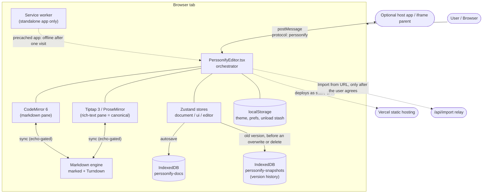
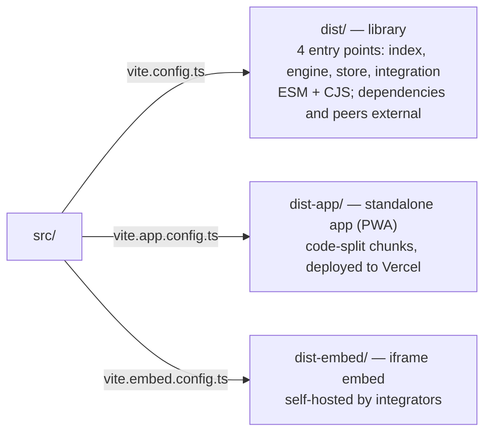
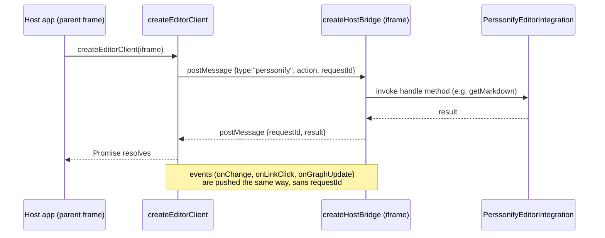

# Architecture — The Mental Model

> Read [features.md](features.md) first if you want the *what*. This doc is the *how*.

## The one idea that explains everything

There are three representations of a document, and exactly one of them is the truth:

- **Markdown text** — what you see/edit in the CodeMirror pane. A *projection*.
- **HTML** — the transport format between the two engines. *Ephemeral*.
- **ProseMirror JSON ("canonical")** — what Tiptap holds and what gets persisted. **The source of truth.**

Every feature is some transformation between these three, guarded by an echo gate (a content hash on the markdown side, the ProseMirror doc node itself on the rich side) so the two panes don't echo each other into an infinite loop. If you internalize *"canonical is PM JSON, markdown and HTML are derived,"* the rest of the codebase follows.

## System context

This is a **client-only single-page app**: no application backend, no database server, no accounts, no auth provider. Documents are stored in the browser (IndexedDB) on the user's device — there is no server copy. Everything in the "Browser tab" box below runs in the user's browser; the only server-side pieces are the static hosting and the optional URL-import relay.

External "services" are minimal by design:
- **IndexedDB** — document storage (`perssonify-docs`), plus a sidecar database for version history (`perssonify-snapshots`). See [database.md](database.md).
- **localStorage** — theme (`perssonify-theme`), the `pf:`-prefixed prefs, and the synchronous unload stash (`pf:recovery`). These names are frozen on-disk contracts — see [data-contracts.md](data-contracts.md).
- **Vercel** — static hosting, the security headers (a report-only CSP and enforced anti-framing — see [deployment.md](deployment.md#content-security-policy)), and exactly one serverless function, [`api/import.js`](../api/import.js): the same-origin fallback relay for "Import from URL", used only when a direct fetch is CORS-blocked **and** the user has agreed to it (asked once, remembered, changeable in Settings ▸ Privacy). It is the **only server-side code in the product**, and it is internet-facing, so most of the file is refusals rather than fetching — see **[import-relay.md](import-relay.md)** for the request path, the threat model, its limitations and how to harden it further. No middleware — the old edge-middleware auth was removed, see [auth.md](auth.md).
- **Remote images** that a document references are fetched by the browser from their own hosts, unless Settings ▸ Privacy ▸ Block remote images is on (it takes effect on the next load).
- **No analytics or telemetry.** Errors go into a small, redacted diagnostics ring ([src/utils/diagnostics.ts](../src/utils/diagnostics.ts)) that stays on the device until the user copies it — see [decisions.md](decisions.md).
- **Optional host app** — when embedded, communicates over `postMessage`. See [#embedding--integration](#embedding--integration).

## Component breakdown

| Area | Path | Responsibility | Owns | Delegates |
|------|------|----------------|------|-----------|
| Orchestrator | [src/PerssonifyEditor.tsx](../src/PerssonifyEditor.tsx) | Wires stores, engines, hooks, panes; handles top-level actions | Refs to both editors, init sequence, action dispatch | All real work to stores/engine/hooks |
| Engine | [src/engine/](../src/engine/) | MD⇄HTML⇄PM-JSON conversion + bidirectional sync | `marked`/Turndown config, echo gate, sync direction | Preprocessing, Turndown rules |
| Store | [src/store/](../src/store/) | State + persistence + link index + ingest | Document model, Zustand stores, storage adapters, version history, unload stash | Conversion to the engine |
| UI | [src/ui/](../src/ui/) | React components | Rendering, local UI state | All mutations to stores/dispatch |
| Formatting | [src/formatting/](../src/formatting/) | Command dispatch + markdown text/table editing + the Find & Replace matcher | Routing a command to the active pane; the one find engine | Tiptap commands / CM6 transactions |
| Extensions | [src/extensions/](../src/extensions/) | Custom Tiptap nodes/marks/plugins (WikiLink, MathNodes, Callout, Details, ThemeImage, …) | Node specs, parse/serialize | — |
| Integration | [src/integration/](../src/integration/) | Embeddable component + iframe bridge + embed origin rules + prompt builder | Public API surface | The editor itself |
| Hooks | [src/hooks/](../src/hooks/) | Lifecycle glue | Debounce, shortcuts, link indexing, dialogs | Stores + engine |

### Three build artifacts from one source

This codebase compiles three ways (see [vite.config.ts](../vite.config.ts), [vite.app.config.ts](../vite.app.config.ts) and [vite.embed.config.ts](../vite.embed.config.ts)):

- **Library build** (`bun run build`): everything in `dependencies` and `peerDependencies` stays external — the list is derived from `package.json` ([build/externals.mjs](../build/externals.mjs)), so declaring a package is what makes it external; the two devDependencies it imports, `sonner` and `@base-ui/react`, are bundled on purpose (pinned by `pkg-manifest.test.js`). Four importable entry points, so a consumer can pull `@perssonify/editor/engine` without the UI. The stylesheet is confined to the editor's own subtrees at build time ([build/scope-css.mjs](../build/scope-css.mjs)).
- **App build** (`bun run build:app`): only packages statically reachable from the entry are grouped into the eagerly preloaded chunks (codemirror / tiptap / lucide / markdown / ui / react-vendor / vendor, [vite.chunks.ts](../vite.chunks.ts)); anything only ever `import()`ed stays in on-demand chunks. A prompting service worker precaches every chunk, so the app works offline after one online visit. Sourcemaps are `hidden`: the build reads them to write the third-party licence notice (`dist-app/third-party-licenses.txt`), and the deploy then moves them out of `dist-app/` ([deployment.md](deployment.md#sourcemaps)).
- **Embed build** (`bun run build:embed`): the iframe shell ([src/embed.tsx](../src/embed.tsx)) → `dist-embed/`, with a relative base so it can be served from any path, and no service worker.

## Concurrency & process model

Almost everything runs on the main thread, and "concurrency" mostly means **async timing**. The exceptions: a Find & Replace **regex** runs in a short-lived Web Worker that is terminated after 1.5 s ([src/formatting/find-worker.ts](../src/formatting/find-worker.ts); where a host's CSP forbids `blob:` workers, a guarded main-thread fallback runs), and the standalone app registers a **service worker** for offline use and prompted updates ([src/pwa/sw-updates.ts](../src/pwa/sw-updates.ts)). There is no cron and no long-lived server process. The things to know:

- **Scheduled sync.** Edits don't project on every keystroke. `useDocumentLifecycle` debounces, with a **max-wait ceiling** so the other pane still advances while you keep typing; both delays come from the measured cost of recent projections, not from document length ([src/hooks/sync-schedule.ts](../src/hooks/sync-schedule.ts), [src/hooks/useDocumentLifecycle.ts](../src/hooks/useDocumentLifecycle.ts)).
- **Re-entrancy guard.** `useSyncEngine` uses a `syncing` ref ([src/engine/useSyncEngine.ts:95](../src/engine/useSyncEngine.ts#L95)) so a sync in progress can't trigger another.
- **Echo gate.** `syncMdToHtml` ([src/engine/useSyncEngine.ts:98](../src/engine/useSyncEngine.ts#L98)) skips markdown whose hash matches the last projection; `syncHtmlToMd` ([:179](../src/engine/useSyncEngine.ts#L179)) first compares the ProseMirror doc node by reference (`lastHtmlDoc`, [:62](../src/engine/useSyncEngine.ts#L62) — free, because PM nodes are immutable) and only then a hash of the serialized HTML. This is what prevents the MD→HTML→MD echo loop. The gates are committed only after a conversion succeeds, so a converter that throws cannot leave them claiming the panes agree.
- **In-flight unsaved state** lives in two places: the `_unsavedEdits` Map in `useDocumentStore` (a per-doc cache used when switching documents, [src/store/documentStore.ts:879](../src/store/documentStore.ts#L879); `_draftBases` beside it records the stored revision each draft was written against) and the live Tiptap editor instance. Persisted state lives in IndexedDB.
- **Autosave** is a single trailing timer (`AUTOSAVE_MS` = 5000), re-armed whenever the save status becomes `editing` and replaced on each change so it doesn't stack. A terminal status never re-arms it: `blocked` (a blank editor over stored content, or content from a newer build shown read-only), `conflict` (another tab wrote the document) or `full` (the browser's storage quota). A real edit resumes saving; for `full`, so does deleting a document or erasing its history.
- **Several tabs share one IndexedDB, and tell each other about every committed write** over a `BroadcastChannel` named after the database (a `storage` event where there is none) — ids and revisions only, never content ([src/store/tab-sync.ts](../src/store/tab-sync.ts)). A receiving tab re-reads its library listing and folder tree; a clean open document is reloaded through the hydration ritual; one with unsaved work parks `conflict` at once and offers Keep mine / Use theirs / Save mine as a copy, the version set aside going to Version history first; one deleted elsewhere stops saving and offers Keep as a new document / Close ([src/editor/useTabSync.ts](../src/editor/useTabSync.ts)). The save guard is still the backstop: a save that finds a revision newer than the one its content is based on refuses and parks `conflict` rather than overwriting the other tab's work ([data-pipeline.md](data-pipeline.md#stage-4--persist-canonical--indexeddb)), and a revision another tab announced counts however close in time it is.

## Key design decisions (ADR-style)

### ADR-1 · Canonical source of truth is ProseMirror JSON
- **Decision:** Persist and treat PM JSON as truth; derive markdown and HTML from it.
- **Context:** Round-tripping markdown↔rich-text loses information in both directions (markdown can't express color; HTML can't always be cleanly re-parsed). A single structured canonical avoids "which pane wins?" ambiguity.
- **Alternatives rejected:** *Markdown-as-truth* (loses styling, alignment, images metadata); *HTML-as-truth* (verbose, ambiguous to re-edit, no clean diff).
- **Consequences:** A **fidelity** concept is required to report what markdown export loses ([src/store/fidelity.ts](../src/store/fidelity.ts)); markdown is a lossy projection, not the archive. JSON export is the lossless format.
- **Date:** Pre-2026 (foundational). Documented 2026-06-22.

### ADR-2 · Echo-gated debounced bidirectional sync
- **Decision:** Sync the two panes through HTML, guarded by an echo gate (a 32-bit content hash; on the rich side, the ProseMirror doc node by reference first) and a debounce with a max-wait ceiling.
- **Context:** Two live editors editing the same logical document will echo each other forever without a guard.
- **Alternatives rejected:** A shared ProseMirror doc rendered to both panes (CodeMirror isn't a ProseMirror view; would require a custom markdown ProseMirror schema — large rewrite); operational transform (overkill for single-user).
- **Consequences:** The `force*` callbacks **must** have empty dependency arrays and call the sync functions through refs (`forceSyncMdToHtml`, [src/engine/useSyncEngine.ts:260](../src/engine/useSyncEngine.ts#L260)) — adding a dependency reintroduces the loop. This is the codebase's sharpest landmine; see [gotchas.md](gotchas.md).
- **Date:** Documented 2026-06-22.

### ADR-3 · Three-layer document model (origin / canonical / residuals)
- **Decision:** Each document keeps its immutable original input (`origin`), the working canonical PM JSON, and a `residuals` array of things ingest couldn't represent.
- **Context:** Importing arbitrary HTML/markdown drops or transforms content; users need a record of what changed, and a path to recover.
- **Alternatives rejected:** Storing only canonical (no provenance, no loss report).
- **Consequences:** Larger records; `residuals` + `ingestReport` power the StatusBar warnings and fidelity UI. See [database.md#the-document-record](database.md#the-document-record).
- **Date:** Documented 2026-06-22.

### ADR-4 · Clean vs Styled markdown serialization
- **Decision:** Two Turndown instances — one strips decorative styling (Clean), one preserves it as inline HTML (Styled).
- **Context:** Some users want portable GFM; others want their colors/fonts to survive.
- **Alternatives rejected:** A single configurable rule set (branchy, error-prone); always-styled (pollutes markdown for users who don't want it).
- **Consequences:** The choice is one ternary on the sync mode, where the engine reads the rich pane (`convert`, [src/engine/useSyncEngine.ts:38](../src/engine/useSyncEngine.ts#L38); the per-block converter takes the same mode); decorative toolbar commands warn in Clean mode.
- **Date:** Documented 2026-06-22.

### ADR-5 · Local-first, no backend
- **Decision:** Store everything in IndexedDB; ship as a static SPA.
- **Context:** The product is a personal editor; no infrastructure to run, and the app keeps working offline once it has been loaded.
- **Alternatives rejected:** A sync backend (cost, auth, privacy surface). Auth was actually built and then **removed** (commit `84d7099`).
- **Consequences:** No multi-device sync, no sharing, no server-side backup. Browser storage eviction is a real risk: the app asks the browser to keep its storage (`navigator.storage.persist()`, after the first save), reminds the user when their last full backup is over 7 days old, and detects a library the browser wiped instead of re-seeding over it (A017) — see [runbooks/documents-disappeared.md](runbooks/documents-disappeared.md).
- **Date:** Auth removed June 2026.

## Custom Tiptap extensions

The rich-text engine is Tiptap StarterKit plus a stack of standard extensions (see [src/ui/TiptapPane.tsx](../src/ui/TiptapPane.tsx)) and the custom nodes/marks in [src/extensions/](../src/extensions/). **Any node the live editor gains must ALSO be registered in [src/engine/serialize-doc.ts](../src/engine/serialize-doc.ts) `SERIALIZE_EXTENSIONS`**, or headless/bulk export silently drops or corrupts it — this is the #1 silent-failure mode (pinned by `serialize-doc.test.js`).

Live custom extensions (registered in TiptapPane + serialize-doc):

- **WikiLink** — extends the Link mark to preserve `data-doc-link`/`data-anchor` so `[[wiki]]` links round-trip and drive the graph/backlinks. The `[[…]]` syntax itself is read by a marked inline extension ([src/engine/wiki-link-marked.ts](../src/engine/wiki-link-marked.ts)), so it never fires inside code.
- **BackgroundColor** — a `backgroundColor` attribute on the `textStyle` mark (highlight); NOT the stock `<mark>`.
- **MathInline / MathBlock** (`MathNodes.tsx`) — KaTeX-rendered `$…$` / `$$…$$` with source round-trip.
- **Callout** — GitHub admonitions `> [!NOTE|TIP|…]` (`content: block+`).
- **Details / Summary** — collapsible `

` (round-trips as raw HTML).
- **EmojiNode** — `:shortcode:` emoji node for full round-trip.
- **ThemeImage** — `<picture>` with `prefers-color-scheme` sources, resolved to the in-app theme.
- **SizedImage** — keeps `width`/`height` on the Image node (serialized as an `` tag).
- **TableCellAlign** — an `align` attribute on table cells, so a column's `:--` / `:-:` / `--:` survives the rich pane.
- **FrontmatterBlock** — YAML front-matter card (`---` … `---`).
- **TaskList / TaskItem** — interactive `- [ ]` / `- [x]` (from `@tiptap/extension-list`).

These live nodes are why the canonical schema is richer than plain GFM, and why fidelity detection exists.

Plugins with no schema change, registered in TiptapPane only (so `SERIALIZE_EXTENSIONS` does not need them):

- **UnresolvedWikiLinks** — marks a broken `[[link]]` with a decoration, judged live by the one wiki-link resolver (`createWikiResolver` in [src/store/link-index.ts](../src/store/link-index.ts)) that the link index and the click handler also use.
- **BidiAuto** — gives each text block `dir="auto"` in the view, so right-to-left text renders right-to-left without a `dir` attribute in the stored document.
- **AltGraphPassthrough** — AltGr typing (Ctrl+Alt on Windows) never triggers a Mod-Alt keymap.
- **ListKeymapNoTab** — Tiptap's list keymap without its Tiptap 3.31 Tab binding, so Tab after a list keeps its old meaning.

Exported for compatibility only — **`@deprecated`** re-exports from the package root ([src/index.tsx](../src/index.tsx)) that warn once, in development, when an editor is built with them. Registered in neither the live editor nor the serializer (A105):

- **BlockId** — a global `data-block-id` attribute; markdown form `^id` (does not survive a Markdown round trip).
- **FieldBlock** — atom block for `:::fields … :::` metadata cards.
- **TransclusionBlock** — atom block for `![[…]]` embeds with circular-ref detection.

## Embedding & integration

When used as a library, the public surface is [`<PerssonifyEditorIntegration>`](../src/integration/PerssonifyEditorIntegration.tsx) plus the imperative `EditorHandle`. For cross-origin embedding there's a `postMessage` bridge:

Defined in [src/integration/host-bridge.ts](../src/integration/host-bridge.ts) — `createHostBridge` (iframe side, [:83](../src/integration/host-bridge.ts#L83)), `createEditorClient` (parent side, [:331](../src/integration/host-bridge.ts#L331)). Calls time out after 10s. The bridge's `allowedOrigins` defaults to **`[]` (deny-all)** — an embedder must opt in the parent origins it trusts. The client needs no configuration: it talks only to the iframe's own window, at the origin of the iframe's `src` (or an origin you pass). The shipped embed (`dist-embed/`) resolves its allowlist in [src/integration/embed-origins.ts](../src/integration/embed-origins.ts): a deploy-time `VITE_EMBED_ALLOWED_ORIGINS` has the last word; where the browser reports the framing page, a requested origin must be that page; then `?allowed_origin=` (never `*`), the reported framer, or the referrer; otherwise nothing. An embed built without that allowlist still trusts whichever page frames it (A072).

## Non-goals

This system deliberately does **not** do these things (and where the concern lives instead):

- **No multi-user / collaboration.** Single browser, single user. (Would need a backend + CRDT/OT.)
- **No two editors on one page.** The stores are module singletons shared by every editor in the same page, so the editor claims the page's slot before it touches any of them (`claimEditorInstance` in `documentStore.ts`, `ui/OneEditorPerPage.tsx`): a second editor mounted while one is running renders a message and a console error instead of an editor, and takes over only if the first unmounts. Mount one per page, or one per iframe (the embed build) (A106).
- **No authentication or authorization.** Removed; see [auth.md](auth.md). Any access control must live in the *embedding* host app.
- **No server-side persistence or cross-device sync.** IndexedDB only.
- **No server-rendered output / SEO.** It's an SPA (`rsc: false` in [components.json](../components.json)).
- **No plugin marketplace.** Extensions are compiled in, not loaded at runtime.
