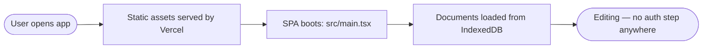

# Authentication & Authorization

> **TL;DR — there is none, by design, as of June 2026.** The app is a local-first, single-user, client-only SPA. There is no login, no session, no roles, no server to authenticate against. The root [`README.md`](../README.md) says the same thing; this doc adds the detail and the history, so you don't go hunting for files that don't exist.

## Identity model

There is no concept of a "user" entity in this codebase. Documents are not owned by anyone; they belong to whoever has the browser tab. The only persisted "identity-ish" data are:

- **Theme preference** — `localStorage["perssonify-theme"]` (via `next-themes`, [src/main.tsx](../src/main.tsx)).
- **App preferences** — the `__prefs` record in IndexedDB (last active doc, sync mode, editor mode, folder tree) and the `pf:`-prefixed keys in localStorage. See [database.md#the-meta-store](database.md#the-meta-store).

None of these identify a person; they're per-browser settings.

## What's authenticated

Nothing. Every feature in [features.md](features.md) is reachable by anyone who loads the page. This is acceptable because:

1. **No shared backend** — there is no data on a server to protect; everything lives in the visitor's own browser (IndexedDB / localStorage).
2. **No multi-tenancy** — one browser profile = one user's data, isolated by the browser's same-origin storage partitioning.
3. **Access control, if needed, belongs to the host.** When embedded via [`<PerssonifyEditorIntegration>`](../src/integration/PerssonifyEditorIntegration.tsx), the *embedding application* is responsible for gating who can open the editor.

## What used to exist (history — so you don't resurrect it by accident)

None of this is in the code any more:

- A `middleware.ts` Vercel Edge gate — **does not exist** (verified: no `middleware.ts` anywhere in the repo). The only server-side file is [`api/import.js`](../api/import.js), the same-origin fallback relay for "Import from URL", which the app uses only after the user has agreed to it (asked once, remembered, changeable in Settings ▸ Privacy) — it is unrelated to auth and reads no secrets.
- A `MARKDOWNEDITOR_PASSWORD` env var with SHA-256 + timing-safe comparison — **not referenced anywhere** in `src/` (verified: no `.env*` files, no password logic).
- A `me_auth` HttpOnly cookie / `POST /__auth` login — **gone**.

The removal is recorded in git:

```
84d7099 refactor: remove login form and authentication logic from App component
```

[`vercel.json`](../../../vercel.json) today is a static SPA config — install with `bun install --frozen-lockfile`, build with `build:app` and then strip the sourcemaps, output `dist-app/`, rewrite everything **except `/api/`, `/assets/` and `/.well-known/`** to `/index.html`, and send security headers (a report-only CSP, enforced anti-framing, `nosniff`, `no-referrer` — see [deployment.md](deployment.md#content-security-policy)). No middleware, and the single serverless function (`api/import.js`) is the import relay, not an auth gate.

> If a future requirement reintroduces auth, do **not** restore the old middleware blindly — design it against the current static-SPA + optional-embed model. Note this doc and [gotchas.md](gotchas.md) when you do.

## Authentication flow



There is no browser→server→token handshake to diagram, because there is no server step. The "session" is simply the browser tab plus its IndexedDB partition.

## Authorization model

No roles, no permissions, no scopes, no per-row checks. The only access *modulation* in the product is by **UI mode / device / build**, not by identity:

- On a narrow viewport (under 768px wide) Split view stacks its panes only when there is height for two, or on a touch device held upright ([src/ui/panes/editorPanes/split-layout.ts](../src/ui/panes/editorPanes/split-layout.ts)).
- Decorative commands are gated by **Clean vs Styled** sync mode, not permissions ([src/ui/chrome/toolbar/index.tsx](../src/ui/chrome/toolbar/index.tsx), `DECORATIVE_CMDS`).
- The Settings ▸ **Admin** section (diagnostics console, context-menu switch) shows only in a development build, or where `localStorage["pf:admin"]` is `"1"` — a per-browser opt-in for support sessions, not a security boundary ([src/utils/build-gates.ts](../src/utils/build-gates.ts)).

## Service-to-service / internal auth

The only cross-boundary channel is the **iframe `postMessage` bridge** used when the editor is embedded ([src/integration/host-bridge.ts](../src/integration/host-bridge.ts)). Its "auth" is **origin checking**:

- `createHostBridge` (inside the editor) takes an `allowedOrigins` option. **Default is `[]` (deny-all)** — the bridge ignores incoming messages until the embedder passes an explicit allowlist of trusted parent origins (or `["*"]` to intentionally accept any). This is a secure-by-default change from the old `["*"]`.
- `createEditorClient` (in the host page) needs no allowlist: it talks only to the iframe's own window, at the origin of the iframe's `src` (or an origin you pass explicitly).
- The shipped iframe embed (`dist-embed/`) resolves its allowlist itself ([src/integration/embed-origins.ts](../src/integration/embed-origins.ts)): a deploy-time `VITE_EMBED_ALLOWED_ORIGINS` has the last word; where the browser reports the framing page (`location.ancestorOrigins`), a requested origin must be that page; then `?allowed_origin=` (a literal `*` is refused), the reported framer, or the referrer's origin; otherwise nothing. See the CSRF/origin note below.

## Common auth gotchas

- **Don't resurrect the removed gate.** If you find a reference to `middleware.ts`, `MARKDOWNEDITOR_PASSWORD`, or a `me_auth` cookie in an old branch, note or doc, it predates commit `84d7099` — none of it is in the current code.
- **`allowedOrigins` defaults to `[]` (deny-all).** If you mount the bridge yourself, pass `createHostBridge` an explicit allowlist ([src/integration/host-bridge.ts](../src/integration/host-bridge.ts)); with none it ignores incoming messages. Passing `["*"]` accepts any origin, meaning any page that can frame the editor can drive its imperative API (read/replace document content) via `postMessage` — opt into that deliberately.
- **The embed trusts its framer unless you build in an allowlist.** Without `VITE_EMBED_ALLOWED_ORIGINS`, whichever page frames `dist-embed/` gets the bridge (A072) — set it for any deployment whose origin holds user documents.
- **CSRF / CORS:** Not applicable in the classic sense — there are no authenticated server endpoints and no cookies used for access. The relevant attack surface is **postMessage origin spoofing**, mitigated by the bridge's origin allowlist. The deployed standalone app cannot be framed at all (`vercel.json` sends `frame-ancestors 'none'` and `X-Frame-Options: DENY` on every path but `/embed.html`), and the relay refuses cross-site browser requests (`Sec-Fetch-Site`) and answers CORS only for the two production origins — see [import-relay.md](import-relay.md).
- **No data-at-rest encryption.** IndexedDB content is plaintext and readable by anything with access to the browser profile / devtools. Don't store secrets in documents.
- **Shared devices:** there is no account to sign out of. **Settings ▸ Local data ▸ Erase all local data** removes every document, all version history, the unload stash and drafts from the browser; a host that runs its own login calls `clearLocalData()` on logout, and can namespace the editor's stores per user with `storageConfig` (A079, A103).
- **Dev vs prod:** identical from an auth standpoint (none). The environment differences are which origin embeds you, and that a development build shows the Admin settings.
