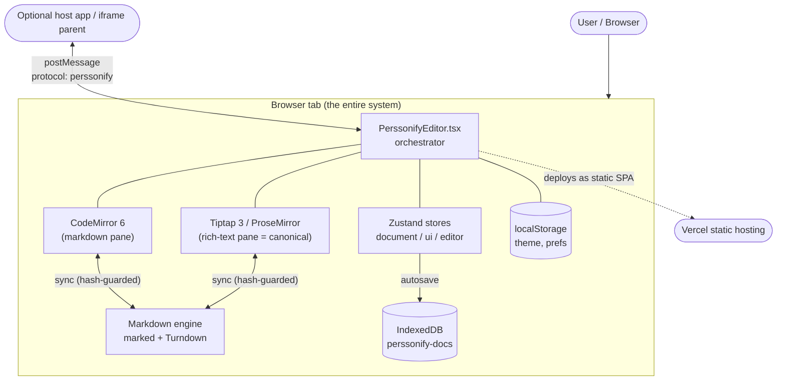
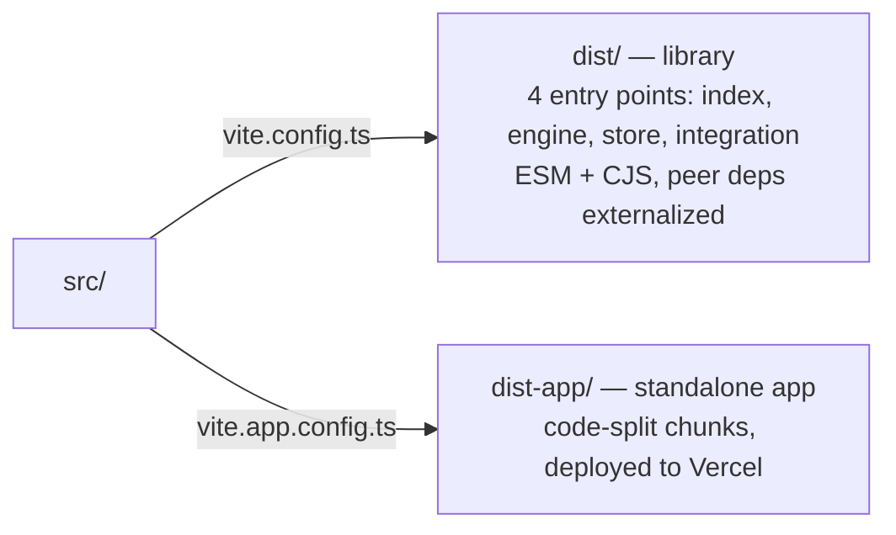
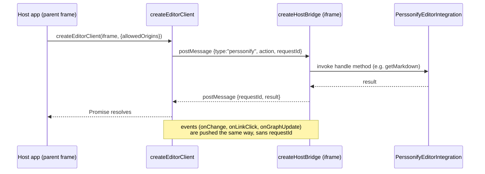

# Architecture — The Mental Model

> Read [features.md](features.md) first if you want the *what*. This doc is the *how*.

## The one idea that explains everything

There are three representations of a document, and exactly one of them is the truth:

- **Markdown text** — what you see/edit in the CodeMirror pane. A *projection*.
- **HTML** — the transport format between the two engines. *Ephemeral*.
- **ProseMirror JSON ("canonical")** — what Tiptap holds and what gets persisted. **The source of truth.**

Every feature is some transformation between these three, guarded by a content hash so the two panes don't echo each other into an infinite loop. If you internalize *"canonical is PM JSON, markdown and HTML are derived,"* the rest of the codebase follows.

## System context

This is a **client-only single-page app**. There is no backend, no API server, no database server, no auth provider. Everything in the diagram below runs in the user's browser tab.

External "services" are minimal by design:
- **IndexedDB** (`perssonify-docs`) — document storage. See [database.md](database.md).
- **localStorage** — theme (`perssonify-theme`) and the `pf:`-prefixed prefs. These names are frozen on-disk contracts — see [data-contracts.md](data-contracts.md).
- **Vercel** — static hosting plus exactly one serverless function, [`api/import.js`](../api/import.js) (the same-origin fallback relay for "Import from URL", used only when a direct fetch is CORS-blocked). It is the **only server-side code in the product**, and it is internet-facing, so most of the file is refusals rather than fetching — see **[import-relay.md](import-relay.md)** for the request path, the threat model, its limitations and how to harden it further. No middleware — the old edge-middleware auth was removed, see [auth.md](auth.md).
- **Optional host app** — when embedded, communicates over `postMessage`. See [#embedding--integration](#embedding--integration).

## Component breakdown

| Area | Path | Responsibility | Owns | Delegates |
|------|------|----------------|------|-----------|
| Orchestrator | [src/PerssonifyEditor.tsx](../src/PerssonifyEditor.tsx) | Wires stores, engines, hooks, panes; handles top-level actions | Refs to both editors, init sequence, action dispatch | All real work to stores/engine/hooks |
| Engine | [src/engine/](../src/engine/) | MD⇄HTML⇄PM-JSON conversion + bidirectional sync | `marked`/Turndown config, hash guard, sync direction | Preprocessing, Turndown rules |
| Store | [src/store/](../src/store/) | State + persistence + link index + ingest | Document model, Zustand stores, IndexedDB adapter | Conversion to the engine |
| UI | [src/ui/](../src/ui/) | React components | Rendering, local UI state | All mutations to stores/dispatch |
| Formatting | [src/formatting/](../src/formatting/) | Command dispatch + markdown text/table editing | Routing a command to the active pane | Tiptap commands / CM6 transactions |
| Extensions | [src/extensions/](../src/extensions/) | Custom Tiptap nodes/marks (WikiLink, MathNodes, Callout, Details, ThemeImage, …) | Node specs, parse/serialize | — |
| Integration | [src/integration/](../src/integration/) | Embeddable component + iframe bridge + prompt builder | Public API surface | The editor itself |
| Hooks | [src/hooks/](../src/hooks/) | Lifecycle glue | Debounce, shortcuts, link indexing, dialogs | Stores + engine |

### Two build artifacts from one source

This codebase compiles two ways (see [vite.config.ts](../vite.config.ts) and [vite.app.config.ts](../vite.app.config.ts)):

- **Library build** (`bun run build`): externalizes React, Tiptap, CodeMirror, etc. as peer deps; emits four importable entry points so a consumer can pull `@perssonify/editor/engine` without the UI.
- **App build** (`bun run build:app`): full bundle with manual chunk splitting (codemirror / tiptap / markdown / react-vendor / vendor), output to `dist-app/`.

## Concurrency & process model

Single-threaded browser JavaScript. There are no workers, no cron, no long-lived server processes. "Concurrency" here means **async timing**, and the things to know are:

- **Scheduled sync.** Edits don't project on every keystroke. `useDocumentLifecycle` debounces, with a **max-wait ceiling** so the other pane still advances while you keep typing; both delays come from the measured cost of recent projections, not from document length ([src/hooks/sync-schedule.ts](../src/hooks/sync-schedule.ts), [src/hooks/useDocumentLifecycle.ts](../src/hooks/useDocumentLifecycle.ts)).
- **Re-entrancy guard.** `useSyncEngine` uses a `syncing` ref ([src/engine/useSyncEngine.ts:28](../src/engine/useSyncEngine.ts#L28)) so a sync in progress can't trigger another.
- **Hash guard.** `quickHash` short-circuits a sync whose content hasn't changed ([src/engine/useSyncEngine.ts:62](../src/engine/useSyncEngine.ts#L62), [:124](../src/engine/useSyncEngine.ts#L124)) — this is what actually prevents the MD→HTML→MD echo loop.
- **In-flight unsaved state** lives in two places: the `_unsavedEdits` Map in `useDocumentStore` (a per-doc cache used when switching tabs, [src/store/documentStore.ts:708](../src/store/documentStore.ts#L708)) and the live Tiptap editor instance. Persisted state lives in IndexedDB.
- **Autosave** is a single trailing timer (`AUTOSAVE_MS = 5000`), replaced on each change so it doesn't stack.

## Key design decisions (ADR-style)

### ADR-1 · Canonical source of truth is ProseMirror JSON
- **Decision:** Persist and treat PM JSON as truth; derive markdown and HTML from it.
- **Context:** Round-tripping markdown↔rich-text loses information in both directions (markdown can't express color; HTML can't always be cleanly re-parsed). A single structured canonical avoids "which pane wins?" ambiguity.
- **Alternatives rejected:** *Markdown-as-truth* (loses styling, alignment, images metadata); *HTML-as-truth* (verbose, ambiguous to re-edit, no clean diff).
- **Consequences:** A **fidelity** concept is required to report what markdown export loses ([src/store/fidelity.ts](../src/store/fidelity.ts)); markdown is a lossy projection, not the archive. JSON export is the lossless format.
- **Date:** Pre-2026 (foundational). Documented 2026-06-22.

### ADR-2 · Hash-guarded debounced bidirectional sync
- **Decision:** Sync the two panes through HTML, guarded by a 32-bit content hash and a debounce.
- **Context:** Two live editors editing the same logical document will echo each other forever without a guard.
- **Alternatives rejected:** A shared ProseMirror doc rendered to both panes (CodeMirror isn't a ProseMirror view; would require a custom markdown ProseMirror schema — large rewrite); operational transform (overkill for single-user).
- **Consequences:** The sync callbacks **must** have empty dependency arrays and go through refs ([src/engine/useSyncEngine.ts:98](../src/engine/useSyncEngine.ts#L98)) — adding a dependency reintroduces the loop. This is the codebase's sharpest landmine; see [gotchas.md](gotchas.md).
- **Date:** Documented 2026-06-22.

### ADR-3 · Three-layer document model (origin / canonical / residuals)
- **Decision:** Each document keeps its immutable original input (`origin`), the working canonical PM JSON, and a `residuals` array of things ingest couldn't represent.
- **Context:** Importing arbitrary HTML/markdown drops or transforms content; users need a record of what changed, and a path to recover.
- **Alternatives rejected:** Storing only canonical (no provenance, no loss report).
- **Consequences:** Larger records; `residuals` + `ingestReport` power the StatusBar warnings and fidelity UI. See [database.md#the-document-record](database.md#the-document-record).
- **Date:** Documented 2026-06-22.

### ADR-4 · Clean vs Styled markdown serialization
- **Decision:** Two Turndown instances — one strips decorative styling (Clean), one preserves it as inline HTML (Styled).
- **Context:** Some users want portable GFM; others want their colors/fonts to survive.
- **Alternatives rejected:** A single configurable rule set (branchy, error-prone); always-styled (pollutes markdown for users who don't want it).
- **Consequences:** The choice is a single branch at [src/engine/useSyncEngine.ts:76](../src/engine/useSyncEngine.ts#L76); decorative toolbar commands warn in Clean mode.
- **Date:** Documented 2026-06-22.

### ADR-5 · Local-first, no backend
- **Decision:** Store everything in IndexedDB; ship as a static SPA.
- **Context:** The product is a personal editor; zero-infra means zero ops and instant offline.
- **Alternatives rejected:** A sync backend (cost, auth, privacy surface). Auth was actually built and then **removed** (commit `84d7099`).
- **Consequences:** No multi-device sync, no sharing, no server-side backup. Browser storage eviction is a real risk — see [runbooks/documents-disappeared.md](runbooks/documents-disappeared.md).
- **Date:** Auth removed June 2026.

## Custom Tiptap extensions

The rich-text engine is Tiptap StarterKit plus a stack of standard extensions (see [src/ui/TiptapPane.tsx](../src/ui/TiptapPane.tsx)) and the custom nodes/marks in [src/extensions/](../src/extensions/). **Any node the live editor gains must ALSO be registered in [src/engine/serialize-doc.ts](../src/engine/serialize-doc.ts) `SERIALIZE_EXTENSIONS`**, or headless/bulk export silently drops or corrupts it — this is the #1 silent-failure mode (pinned by `serialize-doc.test.js`).

Live custom extensions (registered in TiptapPane + serialize-doc):

- **WikiLink** — extends the Link mark to preserve `data-doc-link`/`data-anchor` so `[[wiki]]` links round-trip and drive the graph/backlinks.
- **BackgroundColor** — a `backgroundColor` attribute on the `textStyle` mark (highlight); NOT the stock `<mark>`.
- **MathInline / MathBlock** (`MathNodes.tsx`) — KaTeX-rendered `$…$` / `$$…$$` with source round-trip.
- **Callout** — GitHub admonitions `> [!NOTE|TIP|…]` (`content: block+`).
- **Details / Summary** — collapsible `

` (round-trips as raw HTML).
- **EmojiNode** — `:shortcode:` emoji node for full round-trip.
- **ThemeImage** — `<picture>` with `prefers-color-scheme` sources, resolved to the in-app theme.
- **SizedImage** — keeps `width`/`height` on the Image node (serialized as an `` tag).
- **FrontmatterBlock** — YAML front-matter card (`---` … `---`).
- **TaskList / TaskItem** — interactive `- [ ]` / `- [x]` (from `@tiptap/extension-list`).

Experimental / authoring-only nodes — **exported from the package's public API** (`src/extensions/index.ts`) but NOT wired into the live editor or serializer today; treat as authoring shapes, not shipped behaviour:

- **BlockId** — a global `data-block-id` attribute; markdown form `^id`.
- **FieldBlock** — atom block for `:::fields … :::` metadata cards.
- **TransclusionBlock** — atom block for `![[…]]` embeds with circular-ref detection.

These node types are why the canonical schema is richer than plain GFM, and why fidelity detection exists.

## Embedding & integration

When used as a library, the public surface is [`<PerssonifyEditorIntegration>`](../src/integration/PerssonifyEditorIntegration.tsx) plus the imperative `EditorHandle`. For cross-origin embedding there's a `postMessage` bridge:

Defined in [src/integration/host-bridge.ts](../src/integration/host-bridge.ts) — `createHostBridge` (iframe side, [:53](../src/integration/host-bridge.ts#L53)), `createEditorClient` (parent side, [:274](../src/integration/host-bridge.ts#L274)). Calls time out after 10s. `allowedOrigins` defaults to **`[]` (deny-all)** — embedders must explicitly opt in the parent origins they trust.

## Non-goals

This system deliberately does **not** do these things (and where the concern lives instead):

- **No multi-user / collaboration.** Single browser, single user. (Would need a backend + CRDT/OT.)
- **No authentication or authorization.** Removed; see [auth.md](auth.md). Any access control must live in the *embedding* host app.
- **No server-side persistence or cross-device sync.** IndexedDB only.
- **No server-rendered output / SEO.** It's an SPA (`rsc: false` in [components.json](../components.json)).
- **No plugin marketplace.** Extensions are compiled in, not loaded at runtime.
