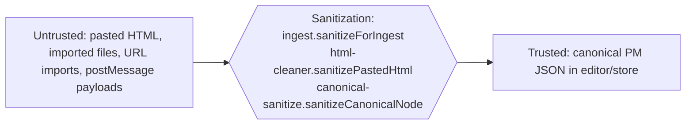

# Data Pipeline — How Content Moves Through the System

> There's no server-side ingest or message queue here. The "pipeline" is the in-browser path content takes: **raw input → ingest → canonical PM JSON → bidirectional sync → IndexedDB**, plus the round-trip back out to markdown/HTML/JSON. Trust boundaries, idempotency, and failure modes all matter even without a server.

## End-to-end diagram

```mermaid
flowchart TD
    subgraph inputs["Producers (untrusted)"]
        typed["User typing"]
        paste["Clipboard paste"]
        file["File import (.md .html .json .txt .docx, .zip)"]
        url["Import from URL (direct fetch, or the relay after consent)"]
        api["Embed API importContent()"]
    end

    typed --> sync
    paste --> clean["html-cleaner.ts<br/>sanitize + CSS→semantic"]
    file --> ingest
    url --> ingest
    api --> ingest

    ingest["ingest.ts<br/>detect format · sanitize · analyze residuals"] --> canonical
    clean --> sync

    subgraph engine["Sync engine (echo-gated)"]
        sync["useSyncEngine.ts<br/>MD ⇄ HTML ⇄ PM JSON"]
    end

    sync --> canonical[("Canonical<br/>ProseMirror JSON<br/>(truth)")]
    canonical --> autosave["documentStore.saveActiveDoc"]
    autosave --> idb[("IndexedDB<br/>documents store")]
    autosave -->|"old version first"| snaps[("IndexedDB<br/>perssonify-snapshots")]

    canonical --> readers
    subgraph readers["Readers / exports"]
        md["Markdown (Turndown)"]
        html["HTML"]
        json["PM JSON envelope"]
        prompt["Copy as Prompt"]
        graph["Knowledge graph"]
    end
```

## Stages, in order

### Stage 1 — Ingest (untrusted input → a document)

- **Code:** [src/store/ingest.ts](../src/store/ingest.ts), entry `ingest()` ([:488](../src/store/ingest.ts#L488)).
- **Input shape:** a raw string + a declared format (`IngestFormat`, [src/store/ingest.ts:31](../src/store/ingest.ts#L31)): `markdown | html | paste-html | text | pmjson`. File imports detect format from extension/MIME in `detectFormat` ([src/store/import-export.ts:66](../src/store/import-export.ts#L66)); a `.docx` is first converted to HTML by a lazily loaded mammoth ([src/store/docx-import.ts](../src/store/docx-import.ts)).
- **What happens:**
  - **markdown** → converted to HTML via the engine (or escaped-wrapped if no engine yet).
  - **text** → split on blank lines, each block wrapped in `<p>`; single newlines are kept as line breaks.
  - **html / paste-html** → `sanitizeForIngest()` ([:446](../src/store/ingest.ts#L446)) strips dangerous elements (`BLOCKED_ELEMENTS`, [:194](../src/store/ingest.ts#L194)) using DOMParser, preserving text; then removes event handlers and dangerous URL schemes, keeps only allow-listed style declarations (an allowlist in [src/engine/css-safety.ts](../src/engine/css-safety.ts), so a CSS escape cannot walk past it), and strips `class`/`id`/`name` except `language-*`, `sr-only`, `wiki-link` and `perssonify-link` (A073).
  - **pmjson** → parsed and structure-checked as a ProseMirror `doc` (or a `perssonify-document` envelope); the attributes renderers write into `style` (colour, highlight, font, alignment, column widths, theme-image sources) are validated by `sanitizeCanonicalNode` ([src/store/canonical-sanitize.ts](../src/store/canonical-sanitize.ts), A070); the envelope's `schemaVersion` is carried through (A021); used as canonical.
- **Output shape:** `{ doc: DocumentRecord, html, needsTiptap }` (`IngestResult`, [:51](../src/store/ingest.ts#L51)). `needsTiptap: true` means the HTML still has to be parsed into canonical PM JSON. Imports do that headlessly — `captureIngestHeadless` ([src/store/headless-ingest.ts](../src/store/headless-ingest.ts)) parses it against the live editor's schema, or `headlessSchema()` when no editor is mounted, and hands the result to `completeIngest()` ([:646](../src/store/ingest.ts#L646)) — then persist the new document without activating it, so a click in the library during a long import can no longer turn a file into an empty "Untitled" (A031).
- **State persisted:** none yet — ingest builds the in-memory record.
- **Guarantees:** Output is **sanitized** (this is the trust boundary, see below). What the schema cannot hold is recorded in `residuals` + `ingestReport` via `analyzeHtml()` ([:238](../src/store/ingest.ts#L238)), HTML comments included (`html-comment`, A050). Known gap: on the HTML path the sanitizer runs first, so the elements it removed (script, iframe, form controls) are not reported.
- **Failure mode:** malformed `pmjson` falls back to wrapping the raw string as a paragraph ([src/store/ingest.ts](../src/store/ingest.ts)); with no DOM parser available `sanitizeForIngest` fails closed — the whole input becomes escaped text.

### Stage 2 — Paste cleaning (clipboard → editor)

- **Code:** [src/engine/html-cleaner.ts](../src/engine/html-cleaner.ts); paste handling in `handlePaste` ([src/ui/TiptapPane.tsx:262](../src/ui/TiptapPane.tsx#L262)) → `handleHtmlPaste` ([src/hooks/useDocumentLifecycle.ts:305](../src/hooks/useDocumentLifecycle.ts#L305)).
- **Input:** `text/html` from the clipboard (Word, Google Docs, web pages — i.e. hostile HTML).
- **What happens:** with **Paste Styled** on (the default), `sanitizePastedHtml()` ([src/engine/html-cleaner.ts:165](../src/engine/html-cleaner.ts#L165)) removes comments, meta/script/style blocks and Office/VML junk, strips `class`/`id`/`data-*` and event handlers (keeping `dir` and `lang`), and keeps an allow-list of CSS properties; with it off, `cleanPasteHtml()` ([:244](../src/engine/html-cleaner.ts#L244)) additionally turns CSS like `font-weight:bold` into semantic `<strong>`/`<em>`/`<u>`/`<del>` and drops the decorative styling.
- **Output:** clean HTML safe to hand to Tiptap.
- **Guarantee:** only allow-listed CSS survives; styling is normalized to semantic tags where possible.
- **Failure mode:** over-aggressive cleaning can drop intentional styling. **Paste Styled** is on by default and keeps more; hold **⇧** while pasting to invert it for that one paste ([src/ui/EditorPanes.tsx](../src/ui/EditorPanes.tsx)).

### Stage 3 — Bidirectional sync (the heart)

- **Code:** [src/engine/useSyncEngine.ts](../src/engine/useSyncEngine.ts); markdown engine [src/engine/useMarkdownEngine.ts](../src/engine/useMarkdownEngine.ts); marked configuration [src/engine/build-marked.ts](../src/engine/build-marked.ts); markdown preprocessing [src/engine/preprocessor.ts](../src/engine/preprocessor.ts); Turndown rules [src/engine/turndown-rules.ts](../src/engine/turndown-rules.ts).
- **Two directions:**

  **MD → canonical** (`syncMdToHtml`, [:108](../src/engine/useSyncEngine.ts#L108)):
  ```
  CM6 text → quickHash gate → preprocessMarkdown → marked.parse → HTML
           → tiptap.setHTML → Tiptap normalizes → editor.getJSON() = canonical
  ```
  The preprocessor only rewrites what must change before marked tokenizes the source: the front-matter block, the `|` of a wiki-link alias (written `\|`, so a GFM table does not split the link across cells), and the opt-in `{key=val}` syntax — off by default, and when on, a group renders only if every key is known and every value validates; anything else stays exactly as written (A039). Code is masked first, with the one fence scanner (`findFencedCodeRanges`) that `normalizeMarkdown` also uses (A046). Wiki links and heading anchors, maths, footnotes, task lists and callouts are marked extensions or renderer overrides in `build-marked.ts`; wiki links are an inline extension ([src/engine/wiki-link-marked.ts](../src/engine/wiki-link-marked.ts)), so they never fire inside code of any kind (A045, A048).

  **canonical → MD** (`syncHtmlToMd`, [:175](../src/engine/useSyncEngine.ts#L175)):
  ```
  PM doc node unchanged? → skip           (reference check, nothing serialized)
  per top-level block (cached on its immutable PM node; only changed blocks do this):
      serialize → cleanHtmlForTurndown → Turndown   (tdInline styled / tdClean clean)
  quickHash gate (combined from the per-block hashes = quickHash(getHTML()))
  → join the blocks with Turndown's own seam rule → normalizeMarkdown → CM6.setValue(md)
  ```
  Both Turndown instances share the base rules and an escaper that backslash-escapes only what would otherwise become live syntax on the next pass: `<` before a tag-like character, `&` before an entity, `N)` at a line start, and `$`, `~~` or a recognised `{…}` group only while maths, strikethrough or the curly syntax is on (A040). Thematic breaks are written `---` (A051); footnotes come back as `[^label]` and `[^label]: text` (A043); a table cell's markdown comes from the same outer conversion, and column alignment survives (A044).

  The projection is incremental (A083, [src/engine/incremental-md.ts](../src/engine/incremental-md.ts)): ProseMirror nodes are immutable, so an edit shares every untouched top-level block with the previous document, and each block's cleaned HTML, content hash and Turndown output are cached on its node. A keystroke converts the block it changed; the rest is joined from the cache. The result is byte-identical to `htmlToMd(editor.getHTML())` — `converter-incremental.test.js` checks that after every step of random edit sequences — because the pieces are cut only where `turndownLinear` may cut (between two blocks Turndown treats as blocks, never after a heading the footnote rule reads past), and the whitespace pass still runs over the joined whole. A `<details>` block is not a block to Turndown, so it is converted together with its neighbours. The whole-document path (`getHTML()` → `htmlToMd`) remains for an engine without the per-block methods, and for exports; it is linear in document length (`turndownLinear`, runs of 64 blocks).

  Exports write hard breaks as `\` + newline so renderers without the app's `breaks: true` dialect keep them ([src/engine/portable-breaks.ts](../src/engine/portable-breaks.ts), A051); the markdown pane's projection is unchanged.

- **Input/output shapes:** strings (markdown ⇄ HTML) on the wire; PM JSON at the canonical end.
- **State persisted:** none directly — sync only updates in-memory editors and fires `onCanonicalChange`.
- **Guarantees & the echo gate:** each direction early-exits when nothing changed — the markdown side on a `quickHash` ([src/utils/index.ts:57](../src/utils/index.ts#L57)) of its text; the rich side first on the ProseMirror doc node itself (`lastHtmlDoc`, [src/engine/useSyncEngine.ts:94](../src/engine/useSyncEngine.ts#L94) — reference equality, no serialization), then on a hash of the HTML. Combined with the `syncing` re-entrancy ref ([:95](../src/engine/useSyncEngine.ts#L95)), this prevents the MD→HTML→MD echo loop. The gates are committed only after a conversion succeeds. This is **at-most-once per content change**, not ordered transactionally — it's a debounced projection, not a log.
- **Backpressure:** handled by a **debounce with a ceiling**, not a queue ([src/hooks/sync-schedule.ts](../src/hooks/sync-schedule.ts)). Two numbers, both derived from a moving average of what recent projections measurably cost on the device in use:
  - `syncDelayFor` — the wait after your last keystroke, clamped to `SYNC_MIN_DELAY_MS`…`SYNC_MAX_DELAY_MS` (120–800ms).
  - `syncMaxWaitFor` — the longest the other pane may lag while changes keep arriving, clamped to `SYNC_MIN_MAX_WAIT_MS`…`SYNC_MAX_MAX_WAIT_MS` (250–1200ms). Without it the debounce was purely trailing and the other pane never updated during continuous typing.

  Only projections that actually RAN are measured — `syncMdToHtml`/`syncHtmlToMd` return a boolean for exactly that, since most calls are gated out by the hash and doc-identity checks and return in microseconds. Document length used to pick the delay directly (300/500/800ms by size); it was a proxy for cost and a poor one, punishing a large note on a fast machine and being too eager on a slow phone.
- **Failure mode:** ⌘Z pressed in the markdown pane cancels the pending projection to protect the undo stack (the ⌘Z branch, [src/hooks/useKeyboardShortcuts.ts:237](../src/hooks/useKeyboardShortcuts.ts#L237), which calls `cancelPendingSync`; like every document chord it acts only with the caret in a pane and the Editor view showing, A025). A converter that throws leaves `syncing` reset (try/finally) and its gate uncommitted, so the next edit or flush retries the projection; until then the panes differ.

### Stage 4 — Persist (canonical → IndexedDB)

- **Code:** `useDocumentStore.saveActiveDoc` ([src/store/documentStore.ts:1012](../src/store/documentStore.ts#L1012)) → storage adapter `save()` → [src/store/idb-storage-adapter.ts](../src/store/idb-storage-adapter.ts).
- **Input:** the active `DocumentRecord` with fresh canonical JSON.
- **What happens:** the save refuses to write when:
  - another tab wrote a revision newer than the one this tab's content is based on (the multi-tab guard, 2 s tolerance) → terminal `conflict`, "Changed in another tab — not saving";
  - the editor is blank and the stored document is not → terminal `blocked` (only the explicit Clear document command may persist a blank);
  - the document holds content from a newer build (or content this build's schema cannot load), shown read-only → terminal `blocked`, "Newer version — read-only" (A021);
  - the stored copy could not be read at all → `error`, retried: it fails closed rather than guess (A029).

  Otherwise it records the old version in the version-history database (throttled; always on a large shrink), `serializeForStorage()` ([src/store/document.ts:418](../src/store/document.ts#L418)) writes the record without its derived caches and stamps `schemaVersion`, and the adapter writes the record and the document list in one transaction. There is no self-imposed size cap (a host may set a hard `maxBytes`): the limit is the browser's quota, and a write it refuses becomes `StorageQuotaError` ([src/store/idb-storage-adapter.ts:88](../src/store/idb-storage-adapter.ts#L88)) and the terminal status `full` (A086).
- **Output / state persisted:** the `documents` store record and the `__manifest` summary list. (`__prefs` — the last active document, sync mode, folder tree — is written by other paths.) See [database.md](database.md).
- **Guarantees:** `saveActiveDoc` resolves `true` only when the write committed, so ⌘S says "Changes saved" and the host's `onSave` fires only then (A026). Renames, card pin/colour and host-bridge patches respect the same multi-tab check (A028). The manifest and the doc are written together, and the listing rebuilds the manifest if it is ever out of step (see [database.md#invariants](database.md#invariants)).
- **Failure mode:** storage full → the status bar reads "Storage full — not saving", the host's `onStorageQuotaExceeded` (or a toast) fires, and autosave stops; deleting a document (or erasing a document's history), a real edit, or an explicit Save retries — see [runbooks/storage-quota-exceeded.md](runbooks/storage-quota-exceeded.md).

### Stage 4b — Unload stash (canonical → localStorage → next boot)

- **Code:** [src/store/crash-recovery.ts](../src/store/crash-recovery.ts) (`stashUnsaved` / `takeStashed`), written by the `beforeunload`/`pagehide` handler in `PerssonifyEditor` and by the editor's own unmount (`releaseEditor` — unmounting is a document-leaving path, A024), and adopted by `useDocumentStore.initialize`.
- **Why it exists:** Stage 4 is asynchronous. `saveActiveDoc` awaits a read before it writes, so a save started during unload is never issued — measured, a sentence typed inside the autosave window and then reloaded away was on neither pane nor disk. The in-memory draft cache does not survive a reload either.
- **What happens:** the handler writes the live canonical (only when `hydratedDocId === activeDocId`) plus every parked draft to `localStorage` under `pf:recovery` — synchronously, the one thing a page being torn down can still do. Each entry carries the revision it was written against and whether the tab was already in conflict (A018), and entries are merged per document, newest first, so a second tab's unload no longer erases the first tab's stash (A027). It honours the same blank-over-content backstop as Stage 4, is bounded to 2MB newest-first, and expires after a week. A host that sets `storageConfig.namespace` (or its own `dbName`) gets its own key, `pf:recovery:<namespace>`, or can turn the stash off with `crashRecovery: false` (A103).
- **Recovery:** `initialize` calls `takeStashed()` **before** activating a document and feeds each entry to `cacheUnsavedEdit`, so the ordinary cached-draft path restores it and the document opens dirty — only for documents that still exist, and only when the stash is newer than the stored copy. The entry's base revision is restored with it, so the multi-tab guard still sees another tab's write: a draft whose base is older than the stored revision reopens in `conflict` instead of arming an autosave, and a conflicted draft that is older than the stored copy is kept in version history rather than dropped. The stash is one-shot — one that survived its own restore would keep resurrecting itself over newer content.
- **Failure mode:** localStorage unavailable or full → nothing is stashed, and the `beforeunload` warning is the only remaining protection. Never throws.

### Stage 5 — Readers (canonical → outputs)

- **Markdown/HTML/JSON export & clipboard:** [src/store/import-export.ts](../src/store/import-export.ts) (`exportAsMarkdown`/`Html`/`Json`). JSON and full-backup exports share `toExportEnvelope` ([src/store/import-export.ts:301](../src/store/import-export.ts#L301)), which stamps `schemaVersion` and leaves out `origin.raw` and the clipboard alternates — text the user may have deleted since (A079).
- **Knowledge graph:** `exportGraph` ([src/store/link-index.ts:411](../src/store/link-index.ts#L411)); every link is resolved by the one wiki-link resolver, `createWikiResolver` ([:193](../src/store/link-index.ts#L193)), which the click handler and the broken-link decoration use too (A059).
- **Copy as Prompt:** `buildContextPrompt` ([src/integration/prompt-builder.ts:232](../src/integration/prompt-builder.ts#L232)).
- All readers derive from canonical; none mutate it.

## Trust boundaries



- **The boundary is sanitization in Stage 1/2**, plus attribute validation of any canonical that is imported or loaded from storage (`sanitizeCanonicalNode`). Once content is canonical PM JSON, it's considered trusted and is rendered without further sanitization.
- **The canonical schema is the Tiptap schema** — anything not expressible as a known node/mark gets dropped during `tiptap.setHTML`, which is itself a (secondary) sanitization step.
- **`pmjson` import is the soft spot:** its structure is checked and its style-bearing attributes are validated, and content this build's schema cannot load opens read-only instead of blank ([src/store/schema-version.ts](../src/store/schema-version.ts)), but its node structure is otherwise taken as given. Treat imported JSON like trusted input only if you trust its source.

## Idempotency

- **Sync is idempotent by the echo gate.** Re-running a sync with identical content is a no-op. Replaying the same edit is safe.
- **Ingest is *not* idempotent** in the sense that each call creates a **new document with a new id** ([src/store/document.ts](../src/store/document.ts) `generateId`). Importing the same file twice yields two documents — there's no dedup.
- **Save is idempotent** per document id — an overwrite, but only of the revision this tab's content is based on; a newer revision from another tab is refused (`conflict`), never overwritten.

## Worked example — paste a styled paragraph and watch it land

1. User pastes Google-Docs HTML into the rich-text pane → Tiptap's `handlePaste` ([src/ui/TiptapPane.tsx:262](../src/ui/TiptapPane.tsx#L262)) hands the `text/html` to `handleHtmlPaste` ([src/hooks/useDocumentLifecycle.ts:305](../src/hooks/useDocumentLifecycle.ts#L305)).
2. With Paste Styled on (the default), `sanitizePastedHtml()` ([src/engine/html-cleaner.ts:165](../src/engine/html-cleaner.ts#L165)) strips Office junk and keeps only allow-listed CSS; with it off (or ⇧ held), `cleanPasteHtml()` ([:244](../src/engine/html-cleaner.ts#L244)) also converts `font-weight:700` → `<strong>`.
3. Cleaned HTML is inserted into Tiptap; the editor normalizes it to canonical PM JSON.
4. The change handler debounces, then `syncHtmlToMd` ([src/engine/useSyncEngine.ts:175](../src/engine/useSyncEngine.ts#L175)) runs: the doc node and the hash differ → in Styled mode `engine.htmlToMd` (Turndown `tdInline`) emits markdown with surviving `<span style>`; in Clean mode `engine.htmlToCleanMd` drops it. CM6 updates.
5. `onCanonicalChange` fires → `updateDerived` ([src/store/documentStore.ts:1610](../src/store/documentStore.ts#L1610)) computes the fidelity report and the word/character counts in one walk (`computeCanonicalStats`, [src/store/fidelity.ts:239](../src/store/fidelity.ts#L239)) and publishes them only when they change; if styling can't be represented in the chosen markdown mode, the report records the loss and the StatusBar shows a fidelity badge.
6. Autosave (≤5s later) → `saveActiveDoc` (after its pre-save checks) → `serializeForStorage` → IndexedDB `documents` store; `__manifest` updated in the same transaction.

That's the full life of one paste: untrusted HTML → sanitized → canonical → projected to markdown → fidelity-checked → persisted.
