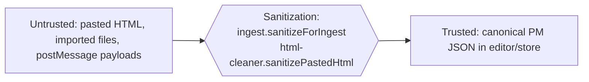

# Data Pipeline — How Content Moves Through the System

> There's no network ingest or message queue here. The "pipeline" is the in-browser path content takes: **raw input → ingest → canonical PM JSON → bidirectional sync → IndexedDB**, plus the round-trip back out to markdown/HTML/JSON. Trust boundaries, idempotency, and failure modes all matter even without a server.

## End-to-end diagram

```mermaid
flowchart TD
    subgraph inputs["Producers (untrusted)"]
        typed["User typing"]
        paste["Clipboard paste"]
        file["File import (.md/.html/.json/.txt)"]
        api["Embed API importContent()"]
    end

    typed --> sync
    paste --> clean["html-cleaner.ts<br/>sanitize + CSS→semantic"]
    file --> ingest
    api --> ingest

    ingest["ingest.ts<br/>detect format · sanitize · analyze residuals"] --> canonical
    clean --> sync

    subgraph engine["Sync engine (hash-guarded)"]
        sync["useSyncEngine.ts<br/>MD ⇄ HTML ⇄ PM JSON"]
    end

    sync --> canonical[("Canonical<br/>ProseMirror JSON<br/>(truth)")]
    canonical --> autosave["documentStore.saveActiveDoc"]
    autosave --> idb[("IndexedDB<br/>documents store")]

    canonical --> readers
    subgraph readers["Readers / exports"]
        md["Markdown (Turndown)"]
        html["HTML"]
        json["PM JSON envelope"]
        prompt["Copy as Prompt"]
        graph["Knowledge graph"]
    end
```

## Stages, in order

### Stage 1 — Ingest (untrusted input → a document)

- **Code:** [src/store/ingest.ts](../src/store/ingest.ts), entry `ingest()` ([:479](../src/store/ingest.ts#L479)).
- **Input shape:** a raw string + a declared format. Formats: `markdown | html | paste-html | text | pmjson` ([src/store/ingest.ts:27](../src/store/ingest.ts#L27)). File imports detect format from extension/MIME in [src/store/import-export.ts:43](../src/store/import-export.ts#L43).
- **What happens:**
  - **markdown** → converted to HTML via the engine (or escaped-wrapped if no engine yet).
  - **text** → split on blank lines, each block wrapped in `<p>`.
  - **html / paste-html** → `sanitizeForIngest()` ([:436](../src/store/ingest.ts#L436)) strips dangerous elements (`BLOCKED_ELEMENTS`, [:189](../src/store/ingest.ts#L189)) using DOMParser, preserving text.
  - **pmjson** → parsed and validated as a ProseMirror `doc` (or a `perssonify-document` envelope); used directly as canonical.
- **Output shape:** `{ doc: DocumentRecord, html, needsTiptap }` ([:47](../src/store/ingest.ts#L47)). `needsTiptap: true` means HTML still has to be run through Tiptap to produce canonical PM JSON; `completeIngest()` ([:625](../src/store/ingest.ts#L625)) captures `editor.getJSON()` afterward.
- **State persisted:** none yet — ingest builds the in-memory record.
- **Guarantees:** Output is **sanitized** (this is the trust boundary, see below). Anything dropped/transformed is recorded in `residuals` + `ingestReport` via `analyzeHtml()` ([:227](../src/store/ingest.ts#L227)).
- **Failure mode:** malformed `pmjson` falls back to wrapping the raw string as a paragraph ([src/store/ingest.ts](../src/store/ingest.ts)); DOMParser-unavailable falls back to regex stripping.

### Stage 2 — Paste cleaning (clipboard → editor)

- **Code:** [src/engine/html-cleaner.ts](../src/engine/html-cleaner.ts); paste handling in [src/ui/TiptapPane.tsx:235](../src/ui/TiptapPane.tsx#L235) → `handleHtmlPaste` ([src/hooks/useDocumentLifecycle.ts:296](../src/hooks/useDocumentLifecycle.ts#L296)).
- **Input:** `text/html` from the clipboard (Word, Google Docs, web pages — i.e. hostile HTML).
- **What happens:** `sanitizePastedHtml()` removes comments/meta/script/Office-VML junk and strips `class`/`id`/`data-*` ([src/engine/html-cleaner.ts](../src/engine/html-cleaner.ts)); `cleanHtmlForTurndown()` / `cleanPasteHtml()` convert CSS like `font-weight:bold` into semantic `<strong>` and drop everything except an allow-list of CSS properties ([:229](../src/engine/html-cleaner.ts#L229)).
- **Output:** clean HTML safe to hand to Tiptap.
- **Guarantee:** only allow-listed CSS survives; styling is normalized to semantic tags where possible.
- **Failure mode:** over-aggressive cleaning can drop intentional styling. **Paste Styled** is on by default and keeps more; hold **⇧** while pasting to invert it for that one paste ([src/ui/EditorPanes.tsx](../src/ui/EditorPanes.tsx)).

### Stage 3 — Bidirectional sync (the heart)

- **Code:** [src/engine/useSyncEngine.ts](../src/engine/useSyncEngine.ts); markdown engine [src/engine/useMarkdownEngine.ts](../src/engine/useMarkdownEngine.ts); markdown preprocessing [src/engine/preprocessor.ts](../src/engine/preprocessor.ts); Turndown rules [src/engine/turndown-rules.ts](../src/engine/turndown-rules.ts).
- **Two directions:**

  **MD → canonical** (`syncMdToHtml`, [:41](../src/engine/useSyncEngine.ts#L41)):
  ```
  CM6 text → quickHash guard → preprocessMarkdown → marked.parse → HTML
           → tiptap.setHTML → Tiptap normalizes → editor.getJSON() = canonical
  ```

  **canonical → MD** (`syncHtmlToMd`, [:108](../src/engine/useSyncEngine.ts#L108)):
  ```
  tiptap.getHTML() → quickHash guard
                   → (styled) engine.htmlToMd  ── Turndown tdInline (keeps <span style>)
                   → (clean)  engine.htmlToCleanMd ── Turndown tdClean (strips styling)
                   → CM6.setValue(md)
  ```

- **Input/output shapes:** strings (markdown ⇄ HTML) on the wire; PM JSON at the canonical end.
- **State persisted:** none directly — sync only updates in-memory editors and fires `onCanonicalChange`.
- **Guarantees & the hash guard:** Each direction computes `quickHash` ([src/utils/index.ts:57](../src/utils/index.ts#L57)) of its input and **early-exits if unchanged** ([src/engine/useSyncEngine.ts:62](../src/engine/useSyncEngine.ts#L62), [:124](../src/engine/useSyncEngine.ts#L124)). Combined with the `syncing` re-entrancy ref ([:28](../src/engine/useSyncEngine.ts#L28)), this prevents the MD→HTML→MD echo loop. This is **at-most-once per content change**, not ordered transactionally — it's a debounced projection, not a log.
- **Backpressure:** handled by a **debounce with a ceiling**, not a queue ([src/hooks/sync-schedule.ts](../src/hooks/sync-schedule.ts)). Two numbers, both derived from a moving average of what recent projections measurably cost on the device in use:
  - `syncDelayFor` — the wait after your last keystroke, clamped to `SYNC_MIN_DELAY_MS`…`SYNC_MAX_DELAY_MS` (120–800ms).
  - `syncMaxWaitFor` — the longest the other pane may lag while changes keep arriving, clamped to `SYNC_MIN_MAX_WAIT_MS`…`SYNC_MAX_MAX_WAIT_MS` (250–1200ms). Without it the debounce was purely trailing and the other pane never updated during continuous typing.

  Only projections that actually RAN are measured — `syncMdToHtml`/`syncHtmlToMd` return a boolean for exactly that, since most calls are gated out by the hash and doc-identity checks and return in microseconds. Document length used to pick the delay directly (300/500/800ms by size); it was a proxy for cost and a poor one, punishing a large note on a fast machine and being too eager on a slow phone.
- **Failure mode:** A thrown converter error leaves `syncing` reset (try/finally) but the panes can drift. `Cmd+Z` calls `cancelPendingSync` to protect the undo stack ([src/hooks/useKeyboardShortcuts.ts:189](../src/hooks/useKeyboardShortcuts.ts#L189)).

### Stage 4 — Persist (canonical → IndexedDB)

- **Code:** `useDocumentStore.saveActiveDoc` ([src/store/documentStore.ts:163](../src/store/documentStore.ts#L163)) → storage adapter `save()` → [src/store/idb-storage-adapter.ts](../src/store/idb-storage-adapter.ts).
- **Input:** the active `DocumentRecord` with fresh canonical JSON.
- **What happens:** `serializeForStorage()` ([src/store/document.ts:307](../src/store/document.ts#L307)) strips derived caches (markdown/html/fidelity) before writing; the adapter projects storage usage and throws `StorageQuotaError` if over the cap ([src/store/idb-storage-adapter.ts:46](../src/store/idb-storage-adapter.ts#L46)).
- **Output / state persisted:** the `documents` store record, the `__manifest` summary list, and `__prefs`. See [database.md](database.md).
- **Guarantees:** Last-write-wins per document; the manifest and the doc are written so the list view stays consistent (see invariants in [database.md#invariants](database.md#invariants)).
- **Failure mode:** quota exceeded → `onStorageQuotaExceeded` callback / toast — see [runbooks/storage-quota-exceeded.md](runbooks/storage-quota-exceeded.md).

### Stage 4b — Unload stash (canonical → localStorage → next boot)

- **Code:** [src/store/crash-recovery.ts](../src/store/crash-recovery.ts) (`stashUnsaved` / `takeStashed`), written by the `beforeunload`/`pagehide` handler in `PerssonifyEditor` and adopted by `useDocumentStore.initialize`.
- **Why it exists:** Stage 4 is asynchronous. `saveActiveDoc` awaits a read before it writes, so a save started during unload is never issued — measured, a sentence typed inside the autosave window and then reloaded away was on neither pane nor disk. The in-memory draft cache does not survive a reload either.
- **What happens:** the handler writes the live canonical (only when `hydratedDocId === activeDocId`) plus every parked draft to `localStorage` under `pf:recovery` — synchronously, the one thing a page being torn down can still do. It honours the same blank-over-content backstop as Stage 4, is bounded to 2MB newest-first, and expires after a week.
- **Recovery:** `initialize` calls `takeStashed()` **before** activating a document and feeds each entry to `cacheUnsavedEdit`, so the ordinary cached-draft path restores it and the document opens dirty. The stash is one-shot — one that survived its own restore would keep resurrecting itself over newer content.
- **Failure mode:** localStorage unavailable or full → nothing is stashed, and the `beforeunload` warning is the only remaining protection. Never throws.

### Stage 5 — Readers (canonical → outputs)

- **Markdown/HTML/JSON export & clipboard:** [src/store/import-export.ts](../src/store/import-export.ts) (`exportAsMarkdown`/`Html`/`Json`).
- **Knowledge graph:** `exportGraph` ([src/store/link-index.ts:336](../src/store/link-index.ts#L336)).
- **Copy as Prompt:** `buildContextPrompt` ([src/integration/prompt-builder.ts:201](../src/integration/prompt-builder.ts#L201)).
- All readers derive from canonical; none mutate it.

## Trust boundaries



- **The boundary is sanitization in Stage 1/2.** Once content is canonical PM JSON, it's considered trusted and is rendered without further sanitization.
- **The canonical schema is the Tiptap schema** — anything not expressible as a known node/mark gets dropped during `tiptap.setHTML`, which is itself a (secondary) sanitization step.
- **`pmjson` import is the soft spot:** it's validated for structure ([src/store/ingest.ts](../src/store/ingest.ts)) but is otherwise trusted as canonical. Treat imported JSON like trusted input only if you trust its source.

## Idempotency

- **Sync is idempotent by hash.** Re-running a sync with identical content is a no-op (the hash guard). Replaying the same edit is safe.
- **Ingest is *not* idempotent** in the sense that each call creates a **new document with a new id** ([src/store/document.ts](../src/store/document.ts) `generateId`). Importing the same file twice yields two documents — there's no dedup.
- **Save is idempotent** per document id (last-write-wins overwrite).
- **Block ID assignment** (`assignBlockIds`, [src/extensions/BlockId.ts:169](../src/extensions/BlockId.ts#L169)) only fills blocks lacking an id, so it's safe to re-run.

## Worked example — paste a styled paragraph and watch it land

1. User pastes Google-Docs HTML into the rich-text pane → Tiptap paste handler ([src/ui/TiptapPane.tsx:235](../src/ui/TiptapPane.tsx#L235)) hands the `text/html` to `handleHtmlPaste` ([src/hooks/useDocumentLifecycle.ts:296](../src/hooks/useDocumentLifecycle.ts#L296)).
2. `cleanPasteHtml()` ([src/engine/html-cleaner.ts:229](../src/engine/html-cleaner.ts#L229)) strips Office junk, converts `font-weight:700` → `<strong>`, keeps only allow-listed CSS.
3. Cleaned HTML is set into Tiptap; the editor normalizes it to canonical PM JSON.
4. The change handler debounces, then `syncHtmlToMd` ([src/engine/useSyncEngine.ts:108](../src/engine/useSyncEngine.ts#L108)) runs: hash differs → in Styled mode `engine.htmlToMd` (Turndown `tdInline`) emits markdown with surviving `<span style>`; in Clean mode `engine.htmlToCleanMd` drops it. CM6 updates.
5. `onCanonicalChange` fires → `updateCounts` + `updateFidelity` ([src/store/documentStore.ts:193](../src/store/documentStore.ts#L193)); if styling can't be represented in the chosen markdown mode, `computeFidelity` ([src/store/fidelity.ts:149](../src/store/fidelity.ts#L149)) records the loss and the StatusBar shows a fidelity badge.
6. Autosave (≤5s later) → `saveActiveDoc` → `serializeForStorage` → IndexedDB `documents` store; `__manifest` updated.

That's the full life of one paste: untrusted HTML → sanitized → canonical → projected to markdown → fidelity-checked → persisted.
