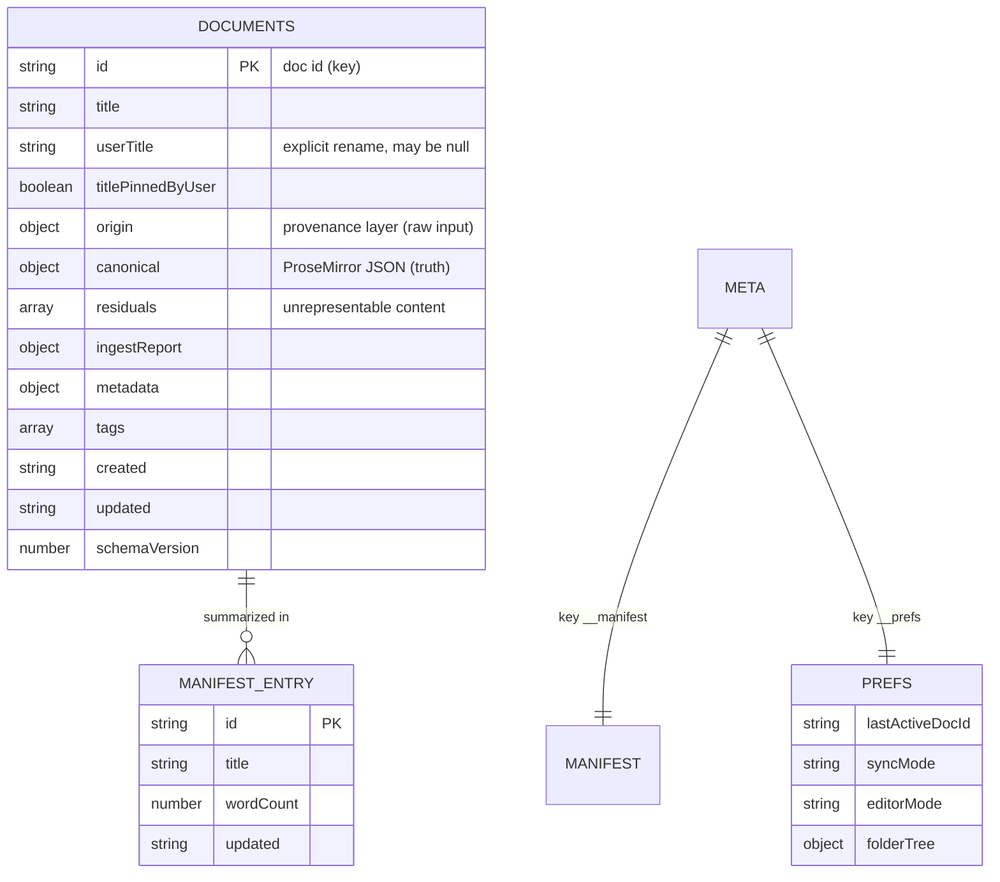

# The "Database" — IndexedDB Schema

> There is no SQL database. Persistence is **IndexedDB**, accessed through a small storage-adapter abstraction. This doc is the equivalent of a schema reference: stores, keys, record shapes, invariants, and the queries (devtools snippets) you'll actually run.

## Where it lives in code

- Abstraction / interface: [src/store/storage-adapter.ts](../src/store/storage-adapter.ts) (`StorageAdapter`, [:75](../src/store/storage-adapter.ts#L75)). Its contract: `get()` resolves `null` **only** when no document has that id, and throws `StorageReadError` when the read itself fails or the stored value will not parse (A029). The IndexedDB, localStorage and in-memory adapters follow it; the `window.storage` API rejects for an absent key, so that adapter can only treat a failed lookup as a miss (a stored value that will not parse still throws).
- IndexedDB implementation: [src/store/idb-storage-adapter.ts](../src/store/idb-storage-adapter.ts).
- Record shape: [src/store/document.ts](../src/store/document.ts).
- Adapter selection (`createStorageAdapter`): [src/store/storage-adapter.ts:485](../src/store/storage-adapter.ts#L485) — picks IndexedDB → window storage → localStorage → in-memory, in that order of availability. A host can inject its own adapter instead; the in-memory one keeps nothing across a reload, and the app then shows a persistent "Not saving" banner (A022).

## The database

| Property | Value | Source |
|----------|-------|--------|
| Database name | `perssonify-docs` (a host may pass its own `dbName`; the iframe embed uses `perssonify-embed-docs` on the app's own hosts, see [decisions.md](decisions.md)) | `DEFAULT_DB_NAME`, [src/store/idb-storage-adapter.ts:138](../src/store/idb-storage-adapter.ts#L138) |
| Version | `1` | `DB_VERSION`, [:139](../src/store/idb-storage-adapter.ts#L139) |
| Object store: documents | `documents` (key = doc id) | `STORE_DOCS`, [:142](../src/store/idb-storage-adapter.ts#L142) |
| Object store: meta | `meta` (key = string) | `STORE_META`, [:143](../src/store/idb-storage-adapter.ts#L143) |
| Storage limit | the browser's quota for the site — no cap of its own; a host may set a hard `maxBytes` | `IDBStorageConfig`, [:49](../src/store/idb-storage-adapter.ts#L49) |



> This is two key-value object stores, not a relational schema — the ER diagram above models the *logical* relationships (the manifest is a denormalized index of the documents store; prefs reference a doc id). There are no enforced foreign keys; the code maintains consistency (see [#invariants](#invariants)).

## The `documents` store

- **Key:** the document `id` (a generated string, `generateId` in [src/store/document.ts](../src/store/document.ts)).
- **Value:** a serialized `DocumentRecord` (JSON string). Written by `serializeForStorage()` ([src/store/document.ts:418](../src/store/document.ts#L418)), which writes an explicit list of fields — the derived caches (`markdownCache`, `htmlCache`, `fidelityReport`) and the transient `_ingestHtml` are not among them and are recomputed on load. A new field that must persist has to be added to that list.
- **Rough size:** one record per document, images included — pasted and imported images are stored inline as `data:` URLs (storing them as blobs is deferred, A086). Expect tens to low-hundreds of documents for a typical user; the ceiling is the browser's quota, shown in Settings ▸ Storage & backup.

### The document record

`DocumentRecord`, defined at [src/store/document.ts:32](../src/store/document.ts#L32). The **three-layer model** (see [architecture.md ADR-3](architecture.md#adr-3--three-layer-document-model-origin--canonical--residuals)):

| Field | Type | Purpose |
|-------|------|---------|
| `id` | string | Primary key |
| `title` | string | Display title (derived from content if no `userTitle`) |
| `userTitle` | string \| null | Explicit rename; survives re-derivation. Set by `renameDoc` |
| `titlePinnedByUser` | boolean | Whether `userTitle` is a genuine rename (not an old "Untitled N" placeholder) — see `resolveDocTitle` |
| `origin` | `OriginRecord` | **Layer 1 (immutable):** `{ format, raw, source, timestamp, alternates }` ([:17](../src/store/document.ts#L17)) — what was originally ingested and from where |
| `canonical` | PM JSON `{ type:"doc", content:[…] }` | **Layer 2 (truth):** the ProseMirror document ([:48](../src/store/document.ts#L48)) |
| `residuals` | `ResidualItem[]` | **Layer 3:** content ingest couldn't represent (unknown elements, styles, attributes, HTML comments) |
| `ingestReport` | object | Per-ingest summary: processed tags, dropped/transformed counts, fidelity score |
| `markdownCache` / `htmlCache` / `fidelityReport` | derived | Recomputed; **not persisted** |
| `metadata` | `Record<string,unknown>` | Free-form; field-block values and a card's colour/pin (`cardColor`/`cardPinned`) live here |
| `tags` | `string[]` | Searchable tags |
| `created` / `updated` | ISO string | Timestamps. `updated` is also the revision the multi-tab guard compares |
| `schemaVersion` | number | The canonical format the content was written in (absent on older records) — see below |

#### Non-obvious columns

- **`origin.source`** — provenance enum-ish string: `"user-typed"`, `"clipboard-paste"`, `"file-import"`, `"api"`, `"storage-load"`. Useful when debugging where a doc came from. Exports leave out `origin.raw` and `origin.alternates` (A079).
- **`origin.alternates`** — alternate clipboard formats captured at paste time (`text/html`, `text/plain`, `text/rtf`).
- **`residuals`** — each entry is categorized by `analyzeHtml()` ([src/store/ingest.ts:238](../src/store/ingest.ts#L238)): `html-comment`, `blocked-element`, `unknown-element`, `unknown-style`, `dropped-attribute`, `noted-attribute`. Drives the StatusBar "residuals" count and the readable list behind it.
- **`canonical`** — nodes from the live Tiptap schema, including this app's own (`callout`, `details`/`summary`, `mathInline`/`mathBlock`, `emoji`, `frontmatter`, `themeImage`, task lists, sized images, aligned table cells) — see [src/extensions/](../src/extensions/). Every canonical that is loaded or imported passes `sanitizeCanonicalNode`, which drops attribute values that are not what their attribute holds (colour, highlight, font, alignment, column widths, theme-image sources) before any renderer writes them into `style` (A070).
- **`schemaVersion`** — records and JSON/backup exports carry the format version (`CURRENT_SCHEMA_VERSION` in [src/store/schema-version.ts](../src/store/schema-version.ts)); `serializeForStorage` never downgrades it. Content stamped with a newer version, or content this build's schema cannot load, is shown as a read-only copy and never saved back (status bar: "Newer version — read-only"), instead of loading as an empty editor that the next autosave would persist (A021).

## The `meta` store

Two well-known keys:

| Key | Constant | Contents |
|-----|----------|----------|
| `__manifest` | `MANIFEST_KEY` ([:144](../src/store/idb-storage-adapter.ts#L144)) | `{ documents: DocumentSummary[] }` (JSON string) — `{ id, title, created, updated, wordCount, tags, hasResiduals, originFormat }` per document, the source for the library list without loading full docs |
| `__prefs` | `PREFS_KEY` ([:145](../src/store/idb-storage-adapter.ts#L145)) | `{ lastActiveDocId, syncMode, editorMode, markdownFeatures, folderTree, historyMemory }` (JSON string) — user preferences; `folderTree` holds the folder names and which document is in which folder |

## The version-history database (`perssonify-snapshots`)

A separate IndexedDB database, independent of whichever storage adapter holds the documents ([src/store/snapshot-store.ts](../src/store/snapshot-store.ts)): one object store, `snapshots`, indexed by `docId`. It keeps earlier versions of each document — before an autosave overwrites older content (at most one per 90 s per document), always before a large shrink or an explicit clear, before a restore, and before a delete. Bounds: 20 versions per document, 30 days, ~12 MB in total, evicted oldest first; a live document's newest version is never evicted, but a **deleted** document's last copy expires with the 30-day window like everything else, and the delete toast offers "Erase history" to remove it at once (A079). A host's `storageConfig.namespace` (or its own `dbName`) moves it to `perssonify-snapshots:<namespace>`; `snapshots: false` turns it off (A103). Restores go through Tools ▸ Version history.

## The image asset database (`perssonify-assets`)

Another sidecar database, for images stored as binary assets instead of as base64 inside each document (A086; [src/store/asset-store.ts](../src/store/asset-store.ts)). Two object stores keyed by `hash` — the SHA-256 of the bytes, lower-case hex: `meta` (`mime`, `size`, `created`, `touched`) and `bytes` (an `ArrayBuffer`), so listing never reads a picture. A document refers to a stored image as `pf-asset:<hash>` in the image's `src` (or a theme image's `lightSrc`/`darkSrc`), with width/height/alt unchanged; the markdown is ``. Rules that keep it safe:

- A reference is written into a document only after its bytes have COMMITTED (`put` resolves to a hash on transaction complete, strict durability). There is no in-memory fallback: where the store is unavailable (no IndexedDB, no WebCrypto, turned off, a write refused), images stay INLINE as `data:` URLs, as they always were.
- It is ON in the standalone app only. A library host or the embed opts in with `storageConfig.assets: true` — content a host reads back out (`onContentChange`, `onSave`, `getMarkdown`/`getHTML`, the bridge) would otherwise refer to images only this browser can resolve. Namespaced like version history: `perssonify-assets:<namespace>`.
- Nothing is deleted automatically. Settings ▸ Storage ▸ **Clean up unused images** ([src/store/asset-gc.ts](../src/store/asset-gc.ts)) scans every document, every snapshot (pre-delete copies included), the live editor, parked drafts and localStorage first, fails closed if any of them cannot be read, keeps anything stored or shown in the last 24 hours, and re-checks each deletion inside the deleting transaction. "Erase all local data" clears it.
- Exports are self-contained (HTML, markdown, Word, PDF, the Markdown/HTML copy actions inline the data); the single-document JSON carries an `assets` member; a backup ZIP writes each asset once as `assets/<hash>.<ext>` and restores them on import.
- Existing documents with inline `data:` images are left as they are; a big `data:` image the USER adds (paste, drop, undo) is stored and re-pointed, a document load never is.

## The link index (in-memory, **not persisted**)

The wiki-link graph is rebuilt at runtime from document content — it is **not** stored in IndexedDB. Built by `buildLinkIndex()` ([src/store/link-index.ts:248](../src/store/link-index.ts#L248)) into the four maps of `LinkIndex` ([:37](../src/store/link-index.ts#L37)):

| Map | Shape | Meaning |
|-----|-------|---------|
| `forward` | `Map<docId, Set<targetId>>` | docs this doc links to |
| `reverse` | `Map<docId, Set<srcId>>` | backlinks (who links to this doc) |
| `unresolved` | `Map<docId, UnresolvedLink[]>` | `[[links]]` that match no document |
| `contexts` | `Map<"srcId→tgtId", string>` | surrounding text for each link, for previews |

Links resolve through one resolver, `createWikiResolver` ([src/store/link-index.ts:193](../src/store/link-index.ts#L193)): the whole `docLink#anchor` as a title first, then an exact id, then an exact title (NFKC, case-insensitive, whitespace-normalised) — never a partial match. The same resolver drives the click handler and the broken-link decoration, so the three always agree (A059).

If the index ever looks wrong, it can be fully rebuilt — `rebuildLinks()` in [src/hooks/useLinkIndex.ts](../src/hooks/useLinkIndex.ts); a document that cannot be read is skipped rather than failing the rebuild. It's derived state; nothing is lost by rebuilding.

## Invariants

These are enforced by code, not by the store:

1. **Every `__manifest` entry has a matching `documents` record, and vice-versa.** The IndexedDB adapter writes a record and the manifest in ONE transaction (`save`/`delete`), rebuilding a missing or unreadable manifest inside that transaction before applying the change, and every listing checks the manifest against the ids actually stored (`sameIdSet`, [src/store/idb-storage-adapter.ts:237](../src/store/idb-storage-adapter.ts#L237)) and rebuilds it from the documents when they differ (A030). A desync heals on the next listing instead of surviving reloads. (The `window.storage` adapter cannot enumerate its keys, so it keeps an unreadable list aside under `doc:__manifest.unreadable` instead.)
2. **Derived fields are never trusted from storage.** `markdownCache`/`htmlCache`/`fidelityReport` are not written and are recomputed on read.
3. **`canonical` is always a ProseMirror `doc`.** Ingest guarantees this; the default is `{ type:"doc", content:[{ type:"paragraph" }] }` (`createDocument`, [src/store/document.ts:123](../src/store/document.ts#L123)). Content that does not fit this build's schema opens read-only (see `schemaVersion` above).
4. **The limit is the browser's quota, and the browser enforces it.** A write it refuses (`QuotaExceededError`) is translated to `StorageQuotaError` ([src/store/idb-storage-adapter.ts:88](../src/store/idb-storage-adapter.ts#L88)), which the save path turns into the terminal status `full` ("Storage full — not saving"). With a host `maxBytes`, the cap is checked inside the write transaction against the real current usage, *before* anything is written. There is no default cap — the old 50 MB one measured characters × 2 and stopped libraries at ~18 MB of markdown (A086).
5. **A failed read is an error, never a miss** (the `window.storage` adapter excepted, see above). `get()` throws `StorageReadError` ([src/store/idb-storage-adapter.ts:118](../src/store/idb-storage-adapter.ts#L118)) — `corrupt` for a record that is present but will not parse — and the save path fails closed on it: it writes nothing and retries, so the blank-over-content backstop, the multi-tab check and the pre-overwrite snapshot can never mistake an unreadable document for an absent one (A029).
6. **IDB transaction callbacks may only await `idbRequest()` calls** — awaiting an arbitrary Promise inside `idbTransaction()` aborts the transaction (browser auto-commit rule). See the comment at [src/store/idb-storage-adapter.ts:200](../src/store/idb-storage-adapter.ts#L200). This is a real footgun if you add storage code.

## "Migrations"

The DB version is `1` and there is no upgrade chain yet. To evolve the schema:

1. Bump `DB_VERSION` ([src/store/idb-storage-adapter.ts:139](../src/store/idb-storage-adapter.ts#L139)).
2. Add object-store creation / data transforms in the `onupgradeneeded` handler (the `upgrade` path in the open logic of [src/store/idb-storage-adapter.ts](../src/store/idb-storage-adapter.ts)).
3. There is **no rollback** — IndexedDB versions only go forward. Guard transforms so they're safe to re-run, and test on a copy of a real profile. An older build that meets a database a newer one upgraded opens it at its own version as long as the `documents` and `meta` stores exist, and an open tab closes its connection when another tab upgrades (`onversionchange`), so it never blocks the upgrade (A021).
4. Because records are JSON strings, additive field changes usually need no migration — just default missing fields on read in `document.ts`.

Content changes are versioned separately from the database: bump `CURRENT_SCHEMA_VERSION` ([src/store/schema-version.ts](../src/store/schema-version.ts)) when a new node, mark or attribute would make stored content unreadable to OLDER builds — they then open it read-only instead of blank.

## Queries you'll run often (browser devtools)

IndexedDB isn't queryable with SQL; use the **Application → IndexedDB** panel in devtools, or the console. Handy snippets:

```js
// List all document ids + titles from the manifest
const db = await new Promise((res, rej) => {
  const r = indexedDB.open('perssonify-docs');
  r.onsuccess = () => res(r.result); r.onerror = () => rej(r.error);
});
const tx = db.transaction('meta', 'readonly');
tx.objectStore('meta').get('__manifest').onsuccess = e => console.table(JSON.parse(e.target.result).documents);
```

```js
// Dump one document record
const tx = db.transaction('documents', 'readonly');
tx.objectStore('documents').get('<doc-id>').onsuccess = e => console.log(JSON.parse(e.target.result));
```

```js
// Inspect prefs (last active doc, sync mode, editor mode, folder tree)
const tx = db.transaction('meta', 'readonly');
tx.objectStore('meta').get('__prefs').onsuccess = e => console.log(JSON.parse(e.target.result));
```

To wipe everything, prefer **Settings ▸ Local data ▸ Erase all local data** (`clearLocalData()`): documents, version history, stored images, the unload stash, parked drafts and undo stacks, optionally every `pf:` preference. By hand:

```js
// Nuke everything (full reset — irreversible)
indexedDB.deleteDatabase('perssonify-docs');
indexedDB.deleteDatabase('perssonify-snapshots');
indexedDB.deleteDatabase('perssonify-assets');
localStorage.clear(); // includes pf:library-canary — left behind, the next boot reports a wiped library
location.reload();
```

> See [local-development.md#reset-local-db](local-development.md#reset-local-db) and [runbooks/](runbooks/) for when to use these.
