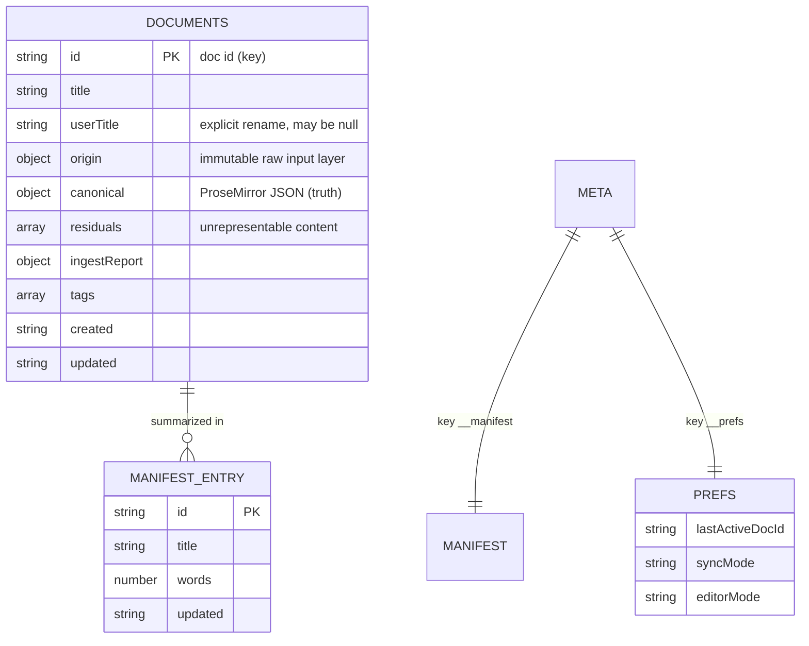

# The "Database" — IndexedDB Schema

> There is no SQL database. Persistence is **IndexedDB**, accessed through a small storage-adapter abstraction. This doc is the equivalent of a schema reference: stores, keys, record shapes, invariants, and the queries (devtools snippets) you'll actually run.

## Where it lives in code

- Abstraction / interface: [src/store/storage-adapter.ts](../src/store/storage-adapter.ts) (`StorageAdapter`, [:63](../src/store/storage-adapter.ts#L63)).
- IndexedDB implementation: [src/store/idb-storage-adapter.ts](../src/store/idb-storage-adapter.ts).
- Record shape: [src/store/document.ts](../src/store/document.ts).
- Adapter selection (`createStorageAdapter`): [src/store/storage-adapter.ts:379](../src/store/storage-adapter.ts#L379) — picks IndexedDB → window storage → localStorage → in-memory, in that order of availability.

## The database

| Property | Value | Source |
|----------|-------|--------|
| Database name | `perssonify-docs` | [src/store/idb-storage-adapter.ts:66](../src/store/idb-storage-adapter.ts#L66) |
| Version | `1` | [src/store/idb-storage-adapter.ts:68](../src/store/idb-storage-adapter.ts#L68) |
| Object store: documents | `documents` (key = doc id) | [:69](../src/store/idb-storage-adapter.ts#L69) |
| Object store: meta | `meta` (key = string) | [:70](../src/store/idb-storage-adapter.ts#L70) |
| Default storage cap | 50 MB (`maxBytes`) | [:28](../src/store/idb-storage-adapter.ts#L28) |



> This is two key-value object stores, not a relational schema — the ER diagram above models the *logical* relationships (the manifest is a denormalized index of the documents store; prefs reference a doc id). There are no enforced foreign keys; the code maintains consistency (see [#invariants](#invariants)).

## The `documents` store

- **Key:** the document `id` (a generated string, `generateId` in [src/store/document.ts](../src/store/document.ts)).
- **Value:** a serialized `DocumentRecord` (JSON string). Written by `serializeForStorage()` ([src/store/document.ts:307](../src/store/document.ts#L307)), which **strips derived caches** (`markdownCache`, `htmlCache`, `fidelityReport`) to save space — these are recomputed on load.
- **Rough size:** one record per document; the whole store is capped at 50 MB by default. Expect tens to low-hundreds of documents for a typical user.

### The document record

Defined at [src/store/document.ts:28](../src/store/document.ts#L28). The **three-layer model** (see [architecture.md ADR-3](architecture.md#adr-3--three-layer-document-model-origin--canonical--residuals)):

| Field | Type | Purpose |
|-------|------|---------|
| `id` | string | Primary key |
| `title` | string | Display title (derived from content if no `userTitle`) |
| `userTitle` | string \| null | Explicit rename; survives re-derivation. Set by `renameDoc` |
| `origin` | `OriginRecord` | **Layer 1 (immutable):** `{ format, raw, source, timestamp, alternates }` ([:13](../src/store/document.ts#L13)) — what was originally ingested and from where |
| `canonical` | PM JSON `{ type:"doc", content:[…] }` | **Layer 2 (truth):** the ProseMirror document ([:47](../src/store/document.ts#L47)) |
| `residuals` | `unknown[]` | **Layer 3:** content ingest couldn't represent (blocked elements, unknown styles/attrs) |
| `ingestReport` | object | Per-ingest summary: processed tags, dropped/transformed counts, fidelity score |
| `markdownCache` / `htmlCache` / `fidelityReport` | derived | Recomputed; **not persisted** |
| `metadata` | `Record<string,unknown>` | Free-form; field-block values sync here |
| `tags` | `string[]` | Searchable tags |
| `created` / `updated` | ISO string | Timestamps |

#### Non-obvious columns

- **`origin.source`** — provenance enum-ish string: `"user-typed"`, `"clipboard-paste"`, `"file-import"`, `"storage-load"`. Useful when debugging where a doc came from.
- **`origin.alternates`** — alternate clipboard formats captured at paste time (`text/html`, `text/plain`, `text/rtf`).
- **`residuals`** — each entry is categorized by `analyzeHtml()` ([src/store/ingest.ts:227](../src/store/ingest.ts#L227)): `blocked-element`, `unknown-element`, `unknown-style`, `dropped-attribute`, `noted-attribute`. Drives the StatusBar "residuals" count.
- **`canonical`** — may contain custom node types (`fieldBlock`, `transclusionBlock`) and a `data-block-id` global attribute — see [src/extensions/](../src/extensions/).

## The `meta` store

Two well-known keys:

| Key | Constant | Contents |
|-----|----------|----------|
| `__manifest` | `MANIFEST_KEY` ([:71](../src/store/idb-storage-adapter.ts#L71)) | Array of `DocumentSummary` `{ id, title, words, updated, … }` — the source for the library list without loading full docs |
| `__prefs` | `PREFS_KEY` ([:72](../src/store/idb-storage-adapter.ts#L72)) | `{ lastActiveDocId, syncMode, editorMode, … }` user preferences |

## The link index (in-memory, **not persisted**)

The wiki-link graph is rebuilt at runtime from document content — it is **not** stored in IndexedDB. Built by `buildLinkIndex()` ([src/store/link-index.ts:177](../src/store/link-index.ts#L177)) into four maps ([:177](../src/store/link-index.ts#L177)):

| Map | Shape | Meaning |
|-----|-------|---------|
| `forward` | `Map<docId, Set<targetId>>` | docs this doc links to |
| `reverse` | `Map<docId, Set<srcId>>` | backlinks (who links to this doc) |
| `unresolved` | `Map<docId, UnresolvedLink[]>` | `[[links]]` that match no document |
| `contexts` | `Map<"srcId→tgtId", string>` | surrounding text for each link, for previews |

If the index ever looks wrong, it can be fully rebuilt — `rebuildLinks()` in [src/hooks/useLinkIndex.ts](../src/hooks/useLinkIndex.ts). It's derived state; nothing is lost by rebuilding.

## Invariants

These are enforced by code, not by the store:

1. **Every `__manifest` entry should have a matching `documents` record**, and vice-versa. `saveActiveDoc`/`deleteDoc` update both together ([src/store/documentStore.ts:172](../src/store/documentStore.ts#L172), [:172](../src/store/documentStore.ts#L172)). A crash between the two writes can desync them — see [runbooks/documents-disappeared.md](runbooks/documents-disappeared.md).
2. **Derived fields are never trusted from storage.** `markdownCache`/`htmlCache`/`fidelityReport` are stripped on write and recomputed on read.
3. **`canonical` is always a valid ProseMirror `doc`.** Ingest guarantees this; a default is `{ type:"doc", content:[{ type:"paragraph" }] }` ([src/store/document.ts:206](../src/store/document.ts#L206)).
4. **Quota is checked before write.** Projected usage > `maxBytes` throws `StorageQuotaError` *before* mutating ([src/store/idb-storage-adapter.ts:46](../src/store/idb-storage-adapter.ts#L46)).
5. **IDB transaction callbacks may only await `idbRequest()` calls** — awaiting an arbitrary Promise inside `idbTransaction()` aborts the transaction (browser auto-commit rule). See the comment at [src/store/idb-storage-adapter.ts:105](../src/store/idb-storage-adapter.ts#L105). This is a real footgun if you add storage code.

## "Migrations"

The DB version is `1` and there is no upgrade chain yet. To evolve the schema:

1. Bump `DB_VERSION` ([src/store/idb-storage-adapter.ts:68](../src/store/idb-storage-adapter.ts#L68)).
2. Add object-store creation / data transforms in the `onupgradeneeded` handler (the `upgrade` path in the open logic of [src/store/idb-storage-adapter.ts](../src/store/idb-storage-adapter.ts)).
3. There is **no rollback** — IndexedDB versions only go forward. Guard transforms so they're safe to re-run, and test on a copy of a real profile.
4. Because records are JSON strings, additive field changes usually need no migration — just default missing fields on read in `document.ts`.

## Queries you'll run often (browser devtools)

IndexedDB isn't queryable with SQL; use the **Application → IndexedDB** panel in devtools, or the console. Handy snippets:

```js
// List all document ids + titles from the manifest
const db = await new Promise((res, rej) => {
  const r = indexedDB.open('perssonify-docs');
  r.onsuccess = () => res(r.result); r.onerror = () => rej(r.error);
});
const tx = db.transaction('meta', 'readonly');
tx.objectStore('meta').get('__manifest').onsuccess = e => console.table(e.target.result);
```

```js
// Dump one document record
const tx = db.transaction('documents', 'readonly');
tx.objectStore('documents').get('<doc-id>').onsuccess = e => console.log(JSON.parse(e.target.result));
```

```js
// Inspect prefs (last active doc, sync mode, editor mode)
const tx = db.transaction('meta', 'readonly');
tx.objectStore('meta').get('__prefs').onsuccess = e => console.log(e.target.result);
```

```js
// Nuke everything (full reset — irreversible)
indexedDB.deleteDatabase('perssonify-docs');
localStorage.removeItem('perssonify-theme');
location.reload();
```

> See [local-development.md#reset-local-db](local-development.md#common-recipes) and [runbooks/](runbooks/) for when to use these.
